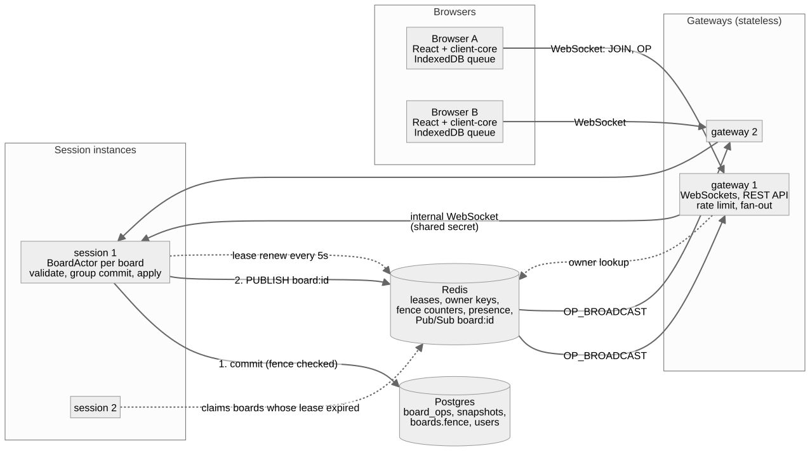
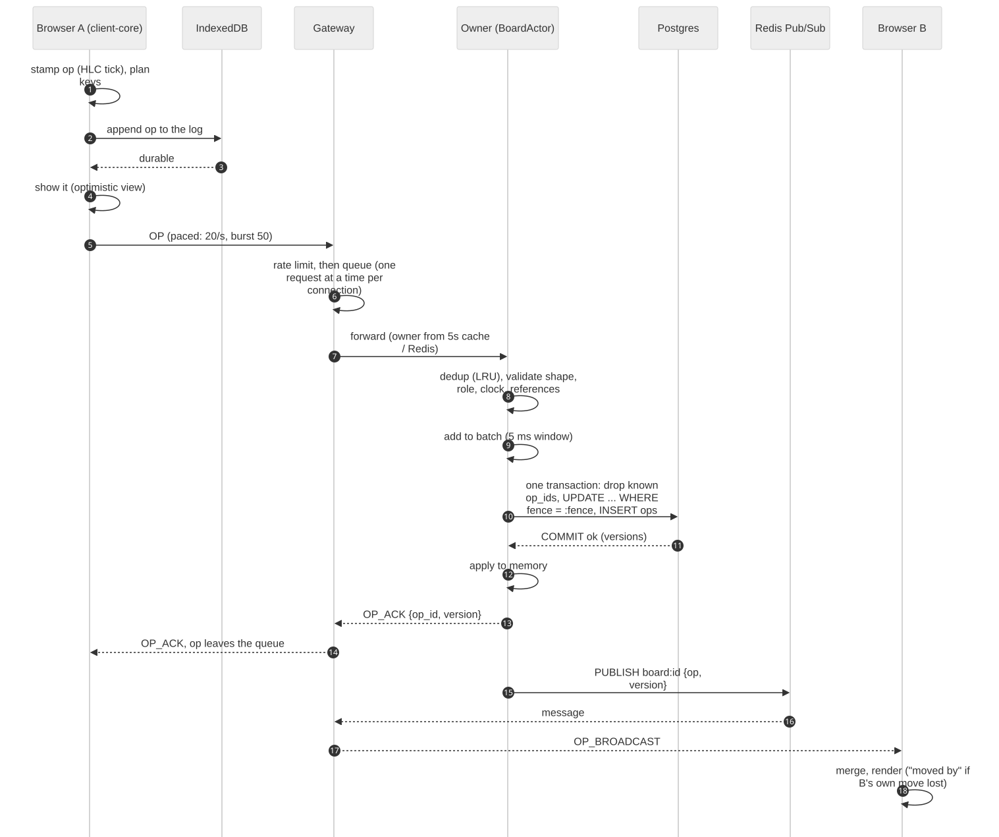
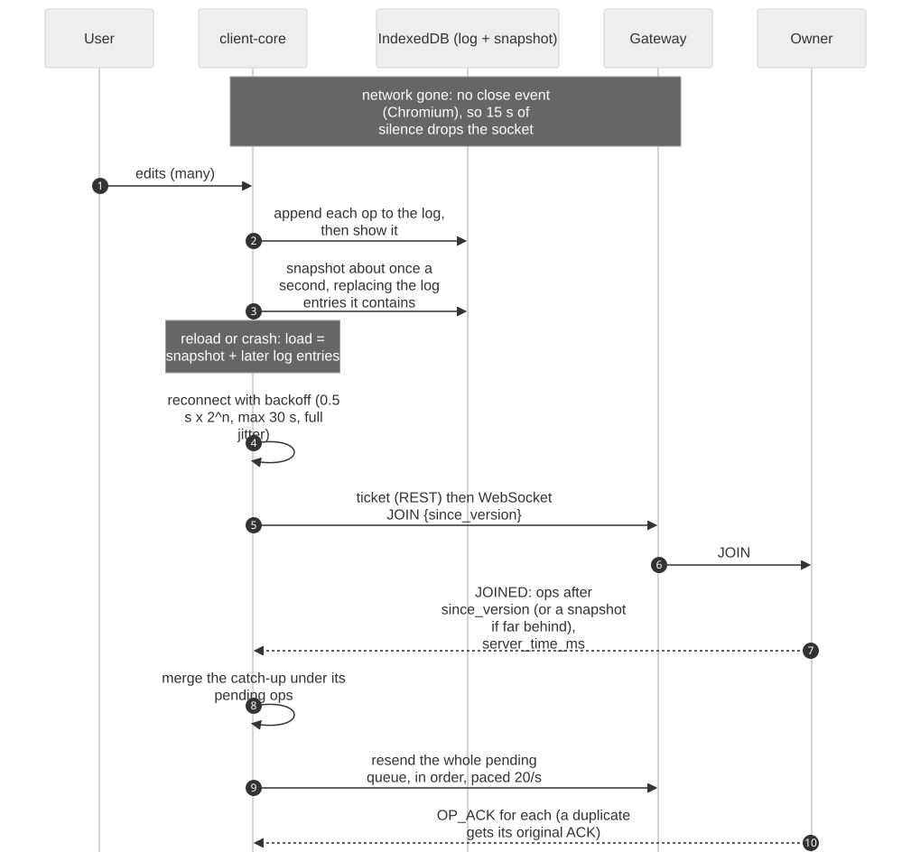
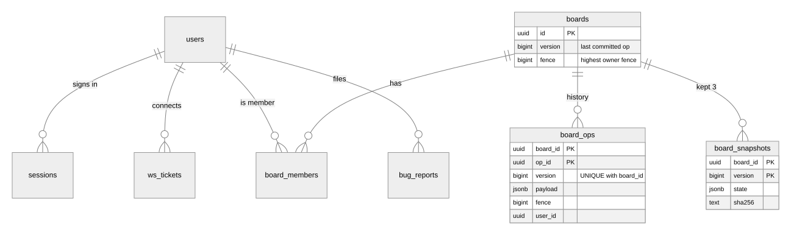
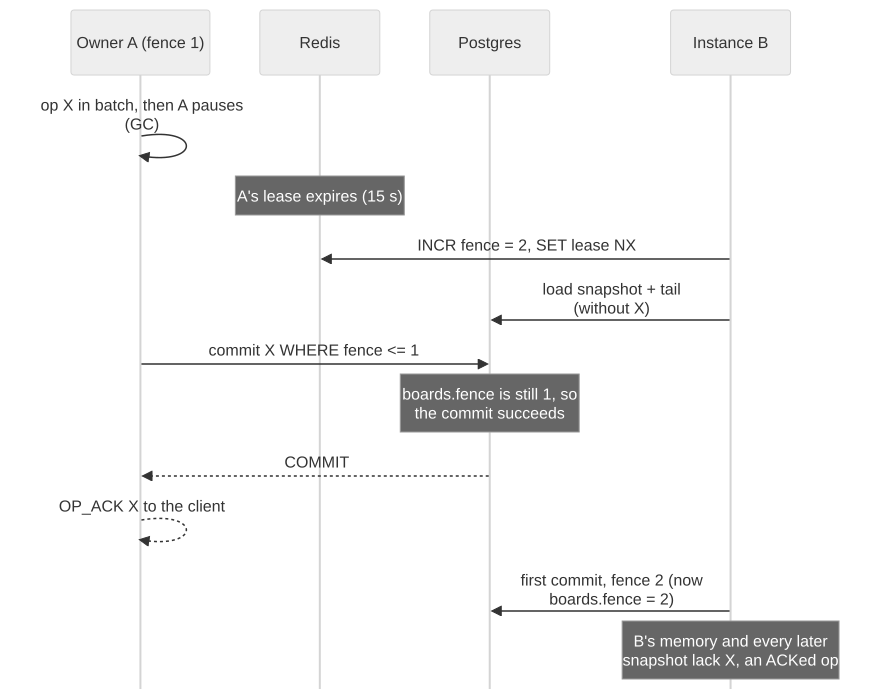
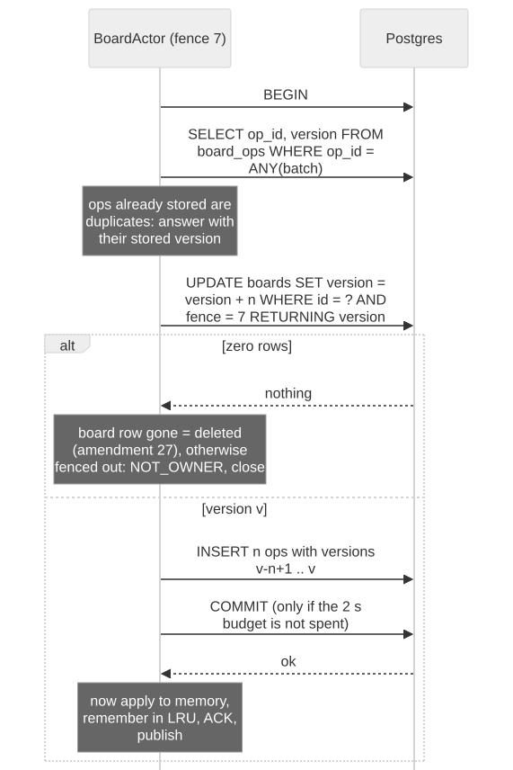
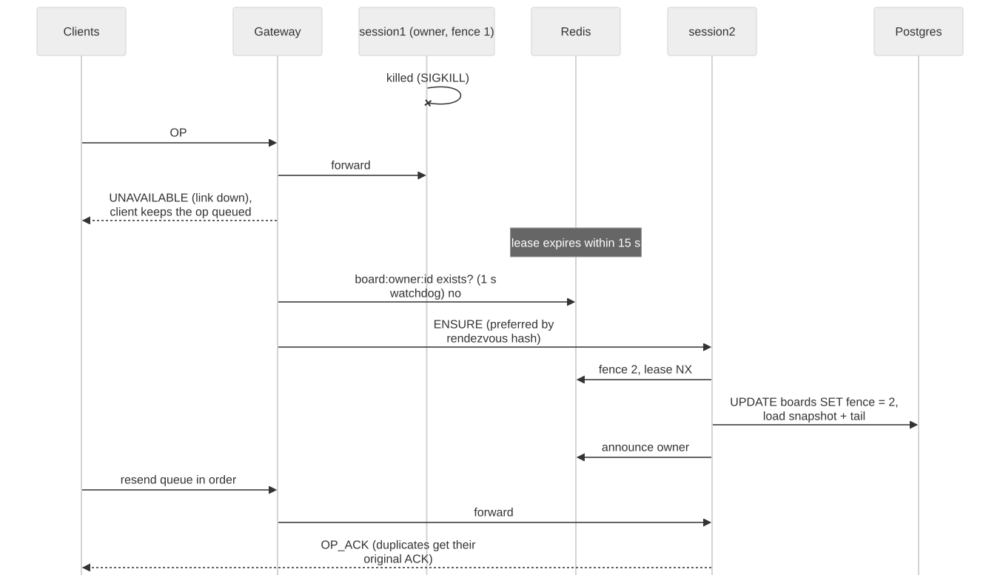
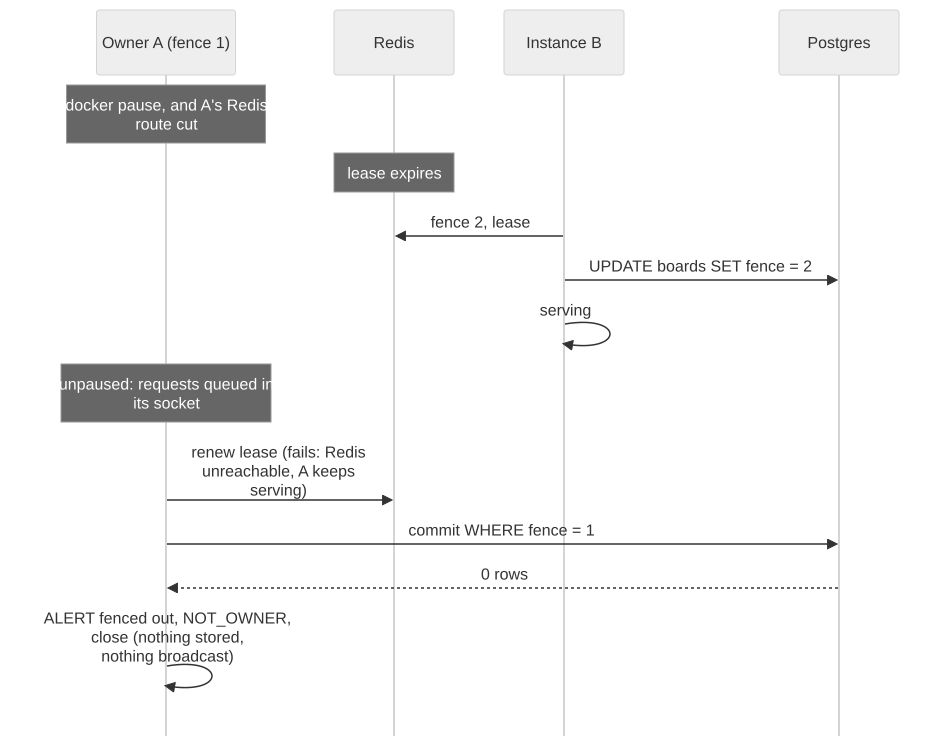
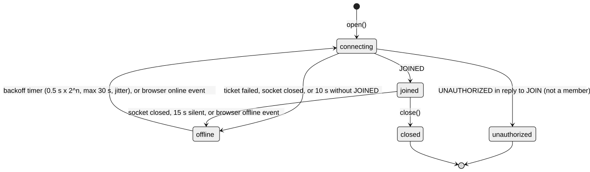

# Concord: How the Spec Was Built

2026-10-18 · Sohan · companion: [interview guide](interview-guide.md)

**How to read this.** Every claim cites its source: a code line (a link such as `BoardActor.java:386`), a test name, a commit, or a report. Every line reference was checked against commit `1230291` by `docs/tools/refs.py check` (the result is at the end of section 14). Measurements carry where they were made:

| Tag | Meaning |
|---|---|
| **[laptop]** | Measured on the development laptop (i7-12700H, 20 logical cores, 15.6 GB, Docker Desktop), with nothing else running (`production/load-tests/README.md`) |
| **[host]** | Measured on the live trial host, AWS t4g.small in Sydney (`deploy/prod/rehearsal-results.txt`) |
| **[CI]** | Measured in GitHub Actions, on shared runners |
| **[accelerated]** | Simulated time: hours compressed into minutes (section 11) |
| **[design]** | Designed and argued, not measured |

## 1. Overview

> **Concord is built, measured and running a small trial: every functional requirement is met, two measured targets are missed and say so, and the system's central promise held in every test, drill and live deploy.**

Concord is a collaborative kanban board. Several people edit the same board at once (lists of cards; card titles, descriptions, assignees, labels; moves and deletes), keep working offline for up to a day, and never lose an edit or get asked which version to keep. It is the specification's "structured workspace, not a rich-text editor" (`docs/SPEC.md`, "Status and what changed").

**Live:** `https://concord-serve.duckdns.org`, invite-only, an AWS t4g.small (2 GB) in ap-southeast-2 (Sydney) (`docs/runbook.md`, top).

**What exists today**

| Part | What it is | Size and proof |
|---|---|---|
| CRDT engine, twice | `crdt-ts/` (TypeScript) and `crdt-java/` (Java 21): HLC, OR-Set, LWW registers, fractional keys, board composition, canonical encoding | 109 tests each; 55 hand-written conformance vectors; a differential fuzz between the two (`docs/phases.md:83-84`) |
| Server | `server/`: Java 21 on Javalin; **gateways** (WebSockets, REST API, fan-out) and **Session instances** (one actor per board, the only writer) | 61 integration tests on real Postgres 16, Redis 7 and Toxiproxy |
| Sync client | `client-core/`: offline queue in IndexedDB, in-order paced resend, clock correction, presence, telemetry | 35 unit tests, 7 end-to-end tests, 7 drills |
| Web app | `web/`: React, drag and drop, history, trash, Unsent edits, bug reports | 19 Playwright tests in Chromium |
| Safety evidence | 42 remove-the-guard checks: each safety guard is deleted and its test must fail | `server/tools/guard_checks.out` |
| Operations | One VM: Caddy (HTTPS), 1 gateway, 2 Session instances, Postgres, Redis, nightly encrypted backups | 5 live deploys, 3 of them under live editing with 0 edits lost (`deploy/prod/rehearsal-results.txt`) |
| Records | 32 SPEC amendments, 10 ADRs, 21 postmortems, every §10.1 measurement | `docs/SPEC.md`, `docs/adr/`, `production/` |

**The core promise** has two halves.
1. **Convergence:** two replicas that have seen the same set of edits, in any order and any number of times, hold byte-identical state. This is what the CRDT engine guarantees, and what the fuzzers and vectors test.
2. **No acknowledged edit is ever lost:** when the server sends a client `OP_ACK`, the edit is committed to Postgres. The client then forgets it for good, so a wrong ACK would be an edit nobody holds. This is what the server's write path and ownership rules guarantee, and what the drills test.

**What it deliberately does not promise** (`docs/SPEC.md` §1.3):
- **Character-level text merging.** A description is one last-writer-wins value: two people editing it at once means one version wins whole.
- **Caret-level cursors, unbounded undo, moving cards between boards.**
- **SSO, two-factor sign-in, email invites.**
- **That a user's own concurrent move always wins.** One of two concurrent moves wins, deterministically, and the loser sees "moved by {name}" (§3.5).
- **Exactly-once delivery to the network.** Edits are resent until acknowledged, and the server deduplicates them by `op_id`.

**Two measured targets are missed** and are stated where they are measured (section 11):
- **Large board:** about 1 render in 300 takes 16–26 ms, against a budget of every render under 16 ms **[laptop]**.
- **Sync latency end to end from India to Sydney:** p95 315–354 ms against 200 ms **[host]**. The server's share is about 17 ms; the rest is network distance.

At 1,000 connections the p95 sync latency is 294 ms **[laptop]**, above the 200 ms target. §1.2 sets that target for 2–10 editors and asks only that 1,000 connections be measured.

## 2. Architecture

> **Postgres is the system's memory and each board's owner is its only writer: an edit is committed before anyone is told about it, and Redis carries only what can be lost.**

**Words used throughout.**

| Term | Meaning | Concord example |
|---|---|---|
| **Op** | One edit, with a unique `op_id`, a timestamp and a type | `{"type":"SET_FIELD","entity_id":X,"field":"title","value":"Pay rent"}` ([`op.ts:27`](../crdt-ts/src/op.ts#L27)) |
| **Replica** | One copy of a board's state that applies ops | each browser tab is a replica; so is the owner |
| **Owner** | The one Session instance allowed to order and commit a board's ops | the instance holding the board's lease, with the current fence |
| **Lease** | A Redis key with a 15 s expiry that says "this instance serves this board" | `board:lease:{id}`, renewed every 5 s ([`RedisKeys.java:12`](../server/common/src/main/java/dev/concord/common/RedisKeys.java#L12)) |
| **Fence (fencing token)** | A number that grows with every change of owner; Postgres refuses commits carrying an old one | `UPDATE boards ... WHERE fence = ?` ([`Store.java:84`](../server/session/src/main/java/dev/concord/session/Store.java#L84)) |
| **Version** | The board's commit counter: each committed op gets the next one | `boards.version`; clients spot a gap from it |
| **ACK** | `OP_ACK {op_id, version}`: the server's promise that the op is stored | sent only after `COMMIT` ([`BoardActor.java:442`](../server/session/src/main/java/dev/concord/session/BoardActor.java#L442)) |

### The life of one edit

From a click in browser A to the screen of browser B. Each step names the code that does it.

1. **Stamp.** `submit()` ticks the client's hybrid logical clock and builds the op with a fresh `op_id` ([`client.ts:359`](../client-core/src/client.ts#L359)). Moves and inserts first compute fractional keys, re-keying equal neighbours if needed ([`client.ts:935`](../client-core/src/client.ts#L935)).
2. **Save before showing.** The op is appended to an IndexedDB log, and only when that write is durable is it put on the pending queue, shown and sent (§7.2, amendment 21; [`idb.ts:176`](../client-core/src/idb.ts#L176)). A crash after this point loses nothing.
3. **Send, paced.** The op goes out through a token bucket shaped like the gateway's limit, 20 ops/s with a burst of 50 (amendment 31; [`client.ts:594`](../client-core/src/client.ts#L594)).
4. **Gateway.** The gateway refuses frames over 64 KB and ops over the rate limit with `RETRY_LATER` ([`ClientConn.java:107`](../server/gateway/src/main/java/dev/concord/gateway/ClientConn.java#L107)). It then queues each request for the connection's own virtual thread, which forwards **one request at a time, in arrival order** ([`ClientConn.java:64`](../server/gateway/src/main/java/dev/concord/gateway/ClientConn.java#L64)). It finds the owner from a 5 s cache, then `board:owner:{id}` in Redis, then rendezvous hashing over live instances ([`Router.java:76`](../server/gateway/src/main/java/dev/concord/gateway/Router.java#L76)).
5. **Admit.** The owner's actor checks its 10,000-entry LRU of recent op_ids (a resend gets the original ACK). It then validates: shape, membership role (from a 30 s cache), clock skew (more than 60 s ahead is refused), and references, such as "this ADD_CARD names a list that exists" ([`BoardActor.java:270`](../server/session/src/main/java/dev/concord/session/BoardActor.java#L270), [`BoardActor.java:304`](../server/session/src/main/java/dev/concord/session/BoardActor.java#L304)).
6. **Group commit.** Admitted ops wait up to 5 ms (ADR-005) and are committed in **one transaction** ([`Store.java:70`](../server/session/src/main/java/dev/concord/session/Store.java#L70)):
   - drop op_ids already stored;
   - `UPDATE boards SET version = version + n WHERE id = ? AND fence = ? RETURNING version` (zero rows means a newer owner exists);
   - insert the ops with consecutive versions.
7. **Apply, ACK, publish, in that order, only after `COMMIT`** ([`BoardActor.java:498`](../server/session/src/main/java/dev/concord/session/BoardActor.java#L498)). Memory never holds an op that is not in Postgres.
8. **Fan-out.** Every gateway with a client on the board is subscribed to `board:{id}` and forwards the broadcast ([`Fanout.java:89`](../server/gateway/src/main/java/dev/concord/gateway/Fanout.java#L89)).
9. **Merge.** Browser B applies the op with the same merge the server uses. If the version is not the next one, it asks for the missing range with `SYNC_REQUEST` ([`client.ts:759`](../client-core/src/client.ts#L759)).

**Measured:** edit on one client to applied on another, p50 27 ms and p95 32 ms with 2 editors **[laptop]**. From India to Sydney: p50 312–318 ms, p95 315–354 ms **[host]**.

### The life of an offline edit

1. **Detecting it.** A browser that loses its network often keeps the WebSocket "open" (incident 013). The owner sends `BOARD_VERSION` every 5 s, so 15 s without any message drops the connection ([`client.ts:680`](../client-core/src/client.ts#L680)). The browser's `offline` event drops it at once ([`client.ts:216`](../client-core/src/client.ts#L216)).
2. **Editing.** Each edit is appended to the IndexedDB log before it is shown. About once a second a snapshot of everything is written, replacing the log entries it contains ([`client.ts:989`](../client-core/src/client.ts#L989), [`idb.ts:167`](../client-core/src/idb.ts#L167)).
3. **Reload or crash.** Loading merges the snapshot with every later log entry ([`storage.ts:43`](../client-core/src/storage.ts#L43)). A closed tab's queue is adopted by the next tab that opens the board (section 8).
4. **Reconnecting.** The client backs off, `0.5 s × 2^attempt`, capped at 30 s, with full jitter ([`client.ts:149`](../client-core/src/client.ts#L149)). The browser's `online` event skips the wait.
5. **Catching up.** `JOIN {since_version}`: the owner sends the ops after that version, or a full snapshot if more than 2,000 behind or the range was pruned ([`BoardActor.java:602`](../server/session/src/main/java/dev/concord/session/BoardActor.java#L602)). It also sends the server's time, from which the client recomputes its clock offset.
6. **Resending.** The whole pending queue goes out in order, paced to 20 ops/s ([`client.ts:663-677`](../client-core/src/client.ts#L663-L677)). Ops that were already committed get their original ACK from dedup.

**Measured:**
- 1 hour offline in two real browsers: 240 edits, converged 11.5 s after reconnecting **[laptop]**.
- 8 and 24 hours **[accelerated]**: 1,885 and 5,701 edits, synced in 92 s and 283 s, 0 lost (`production/load-tests/README.md` §6).

## 3. Requirements, point by point

> **All six functional requirements are met; of the nine non-functional targets, six are met, one is met with a stated caveat (offline, accelerated), and two miss (the large-board render tail, and latency from far away or at 1,000 connections).**

### Functional (SPEC §1.1)

| Requirement | How Concord meets it | Proof | Verdict |
|---|---|---|---|
| Create boards; invite members as owner, editor or viewer | `POST /api/boards` creates the board and makes the caller its owner in one transaction ([`Api.java:330`](../server/gateway/src/main/java/dev/concord/gateway/Api.java#L330)). Owners add members by email, change roles and remove them; a board always keeps one owner, checked under a row lock ([`Api.java:401`](../server/gateway/src/main/java/dev/concord/gateway/Api.java#L401)). Roles are checked on every op through a 30 s cache, cleared at once over the `membership` channel ([`Membership.java:28`](../server/session/src/main/java/dev/concord/session/Membership.java#L28)) | `ApiTest.boardsMembersAndRoles`; guard checks `members-owner-only`, `last-owner` | **Met** |
| Ordered lists of ordered cards | Fractional string keys, ties broken by entity ID (ADR-001); one atomic placement per card (ADR-002) | property tests in both cores; conformance vectors 005–046 | **Met** |
| Concurrent create, edit, reorder, move, delete of cards and lists | OR-Set existence with per-entity tombstones; delete wins over a concurrent edit; restore adds a fresh tag; a deleted list's cards appear in Orphaned (ADR-003, section 4) | 55 vectors; permutation fuzz, 500 seeds per commit and 100,000 nightly; differential fuzz TypeScript against Java | **Met** |
| Offline edits merge on reconnect, no conflict dialog | The queue survives reloads in IndexedDB and is resent in order on reconnect; merge is deterministic; a lost move is shown as "moved by {name}", never asked about | scripted offline hour (`docs/offline-hour-scripted.md`); `web/e2e/offline.spec.ts`; 8 h and 24 h **[accelerated]** | **Met** |
| History: who changed what, when, 30+ days | `GET /api/boards/{id}/history`, newest first, over `board_ops`, each op stored with its `user_id` ([`Api.java:445`](../server/gateway/src/main/java/dev/concord/gateway/Api.java#L445)). Retention keeps 35 days and never deletes above the oldest kept snapshot ([`Retention.java:20`](../server/gateway/src/main/java/dev/concord/gateway/Retention.java#L20)) | `ApiTest.boardsMembersAndRoles` (history is members-only, guard `history-members-only`); `RetentionTest` | **Met** |
| Presence: who is viewing, which card is open | Gateway-only, in a Redis sorted set per board, one entry per connection; a 10 s sweep removes entries older than 30 s and announces "left" ([`Presence.java:86`](../server/gateway/src/main/java/dev/concord/gateway/Presence.java#L86)) | `PresenceTest`; Playwright two-tab test (`web/e2e/board.spec.ts`) | **Met** |

### Non-functional (SPEC §1.2)

| Target | Spec | Measured | Where | Verdict |
|---|---|---|---|---|
| Convergence | identical state on every replica given the same ops in any order | byte-identical canonical state in every vector, fuzz scenario, drill, load test and live check | [laptop] [CI] [host] | **Met** |
| Durability | no ACKed op ever lost | 0 ACKed ops missing in every drill (7), load test, soak (3 runs) and live deploy (3 under live editing: 2,315, 2,306 and 2,351 ops) | [laptop] [CI] [host] | **Met** |
| Sync latency | p95 < 200 ms, p99 < 500 ms at 2–10 editors | 2 editors p95 32 ms, p99 33 ms; 10 editors p95 45 ms, p99 94 ms | [laptop] | **Met** |
| …from a distant client | (same target) | India → Sydney: p95 315–354 ms; the server is about 17 ms of it | [host] | **Missed end to end; met by the server** |
| Editors per board | 30, correct; latency recorded | p95 42 ms at 30; 3,756 ops, all converged, 0 missing | [laptop] | **Met** |
| Cards per board | 2,000, render < 16 ms per update | p50 4.8 ms, p99 11.8–13.8 ms; max 19.9 and 26.3 ms, 2 of about 600 per run over 16 ms | [laptop] | **Missed** (about 0.3% of renders) |
| Offline window | 24 hours of local edits | 5,701 edits from 24 h synced in 283 s, 0 lost | [accelerated] | **Met, accelerated**: hours of real time on the browser and IndexedDB were not exercised |
| Owner crash recovery | serving within 5 s of lease expiry | 1,565 ms after expiry; a claim takes 29–342 ms even at 2,000 cards with a 499-op tail | [laptop] [CI] | **Met** |
| Concurrent connections | ~1,000 on one machine | 1,000 connections on 300 boards: 890 of 900 ops/s committed, p95 294 ms | [laptop] | **Met for connections; latency above 200 ms** |
| Fleet scale | 10,000 boards, ~50,000 connections | not measured: owners spread by rendezvous hashing, idle boards unload, nothing global on the write path | [design] | **Argued, not measured** (the SPEC marks it a design target) |

**The three misses, plainly.**
1. **Distance.** From India to a Sydney host, the network round trip is about 300 ms (TCP connect 298–312 ms), and an edit needs about one round trip, half to the server and half to the other client. The server's share is about 17 ms. A host near the users would meet the target with the same code (`deploy/prod/rehearsal-results.txt`, "On the real host").
2. **The large-board render tail.** One render in about 300 takes 16–26 ms, with no long task behind it. It is not profiled. The test was not loosened ([`perf.spec.ts:163`](../web/e2e/perf.spec.ts#L163)).
3. **1,000 connections.** Postgres was the busiest process, peaking at 6.8 cores for about 300 commits/s, one per board per second. Group commit merges ops within a board, never across boards (section 11).

## 4. The CRDT design, rule by rule

> **The board is two observed-remove sets (which lists and cards exist) and one map of last-writer-wins registers (everything else), ordered by fractional keys; every rule exists to make merge order-independent while keeping what users meant.**

A **CRDT** (conflict-free replicated data type) is a data structure whose replicas can apply the same operations in any order, any number of times, and still end identical, with no coordination. Concord's board is one, built from two simpler ones ([`board.ts:35`](../crdt-ts/src/board.ts#L35)):

| Part | CRDT | Holds |
|---|---|---|
| `lists`, `cards` | OR-Set (observed-remove set) | which entities exist |
| `registers` | LWW map: one last-writer-wins register per (entity, field) | titles, descriptions, assignees, labels, placements |

Merge is the union of the OR-Sets plus a per-register maximum, which is **commutative** (A merge B = B merge A), **associative** and **idempotent** (merging twice changes nothing). The property tests check these three laws for every module (`docs/SPEC.md` §9.1).

**Every example below was computed by running the real `crdt-ts` code** (`docs/tools/examples.ts`; run it with `cd crdt-ts && npx vite-node ../docs/tools/examples.ts`). In each, two replicas receive the same ops in different orders and end with byte-identical canonical state.

### 4.1 Hybrid logical clock (HLC)

**Problem.** Last-writer-wins needs "later". Wall clocks disagree between devices and can jump backwards. A plain counter (a Lamport clock) orders events but loses the link to real time, so "the later edit wins" would not mean later to a person.

**Rule.** An HLC is `(physical_ms, counter, replica_id)`, compared in that order ([`hlc.ts:25`](../crdt-ts/src/hlc.ts#L25)):
- **`tick`** for a local edit takes `max(last.physical, now)`. If that equals the last physical time, the counter goes up; otherwise it resets to 0 ([`hlc.ts:37`](../crdt-ts/src/hlc.ts#L37)).
- **`receive`** of a remote stamp takes the maximum of all three times, so the next local stamp is **strictly greater than anything seen** ([`hlc.ts:43`](../crdt-ts/src/hlc.ts#L43)).
- The replica ID breaks the last tie, so no two replicas can ever produce equal stamps.

**Worked example** (`examples.ts`):

| Step | Replica | Clock before | Event | Clock after |
|---|---|---|---|---|
| 1 | A | 1000 / 0 / A | local edit at wall time 1000 | **1000 / 1 / A** (same ms, counter +1) |
| 2 | B | 990 / 0 / B | receives A's stamp 1005 / 2 at wall time 995 (B's clock is behind) | **1005 / 3 / B**: B's next edit outranks A's although B's wall clock says 995 |
| 3 | n/a | n/a | compare 1000 / 1 / A against 1000 / 1 / B | A < B: the replica ID decides |

**Rejected:** wall time alone (a fast clock wins every contest); vector clocks (exact concurrency detection, but they grow with the number of replicas, and every browser tab is one). Vectors 023 (counter beats replica ID) and 024 (physical time beats counter) pin the order.

### 4.2 The clock-skew guard

**Problem.** An HLC never goes backwards, so a client whose clock is a day fast would win every LWW contest, and every replica that saw its ops would drag its own clock forward (v3 change 2).

**Rule.** The owner rejects an op whose `physical_ms` is **more than 60,000 ms ahead** of server time ([`op.ts:176`](../crdt-ts/src/op.ts#L176), [`op.ts:12`](../crdt-ts/src/op.ts#L12)). The error carries the server's time. The client recomputes its clock offset, re-stamps the op and resends it under the same `op_id`. If its own HLC had already run ahead on the bad clock, it continues as a **fresh replica ID**, because an HLC can never go backwards ([`client.ts:837`](../client-core/src/client.ts#L837)).

**Example.** Server time 1,760,000,000,000. An op stamped `+60,000` is accepted; one stamped `+60,001` gets `CLOCK_SKEW` (vector 010, `010-clock-skew-guard-boundary`). The end-to-end test "10: client clock two minutes fast" (`client-core/test/e2e/failures.test.ts`) shows the correction.

**Rejected:** trusting client clocks (above); server-assigned timestamps (the client could no longer order its own offline edits).

### 4.3 OR-Set with per-entity tombstones

**Problem.** "Does card X exist?" must merge. A plain set cannot tell "deleted" from "not added yet". A two-phase set cannot bring anything back.

**Rule.** Each add (`ADD_*` or `RESTORE_*`) adds a **tag**, the op's own `op_id`, under the entity. A delete carries the tags its sender had seen (`observed_tags`), and **tombstones exactly those (entity, tag) pairs** ([`orset.ts:27`](../crdt-ts/src/orset.ts#L27)). An entity is live while it has a tag that is not tombstoned ([`orset.ts:36`](../crdt-ts/src/orset.ts#L36)]). Merge is the union of both maps ([`orset.ts:58`](../crdt-ts/src/orset.ts#L58)). Tombstones are kept for the board's life (v3 change 9), so a delete that arrives before its add still wins.

**Why per entity (amendment 4).** The first Phase 1 shape kept one flat set of tombstoned tags. A buggy or malicious `DELETE_CARD` naming card X but listing a tag of card Y deleted Y. Convergence still held, so no fuzzer could catch it; it was found by reading the shape. Now a delete naming X can only touch X (vectors 051–054).

**Worked example: a delete that arrives before its add** (vector 012):

| Order | after op 1 | after op 2 | Card X |
|---|---|---|---|
| R1: ADD_CARD X (tag t2), then DELETE_CARD X {t2} | adds {t2} | tombstones {t2} | **absent** |
| R2: DELETE_CARD X {t2}, then ADD_CARD X (tag t2) | tombstones {t2}, no adds | adds {t2} | **absent** |

Both replicas end with adds {t2} and tombstones {t2}. Same state, same view.

### 4.4 Delete wins over a concurrent edit; restore by a new tag

**Problem.** v1 said "add wins", but an edit adds no tag, so the rule could not be implemented (v3 change 3). What should happen when one person deletes a card while another retitles it?

**Rule.** An edit writes its register but adds no tag, so it cannot revive a deleted entity. **The delete wins; the edit is kept**, and shows again if the card is restored ([`board.ts:47`](../crdt-ts/src/board.ts#L47)). A restore adds a **fresh** tag, so a restore concurrent with a delete survives: the delete never observed that tag.

**Worked example: delete against a concurrent edit** (vectors 002, 003):

| Order | Ops applied | Card X shown? | `title` register |
|---|---|---|---|
| R1 | ADD_CARD X "Pay rent"; DELETE_CARD X {t2} (B); SET_FIELD title "Pay rent today" (A) | **no** | "Pay rent today" |
| R2 | ADD_CARD X; SET_FIELD (A); DELETE_CARD (B) | **no** | "Pay rent today" |

**Worked example: a restore concurrent with a delete** (vectors 004, 020):

| Order | Ops applied | Tags | Card X shown? |
|---|---|---|---|
| R1 | ADD (t2); DELETE {t2} (B); RESTORE (A, tag t4) | adds {t2, t4}, tombstones {t2} | **yes** |
| R2 | ADD (t2); RESTORE (t4); DELETE {t2} | same | **yes** |

A delete that *did* observe the restore's tag wins (vector 011).

**Rejected:** add-wins (an edit would need a tag, so deleting a card someone is typing in could never stick); a two-phase set (nothing could be restored); cascading list deletes to their cards (ADR-003).

### 4.5 The LWW map and the collision tie-break

**Problem.** Two people set the same field at once; everyone must agree on the result.

**Rule.** One register per (entity, field); the higher HLC wins ([`lww.ts:23`](../crdt-ts/src/lww.ts#L23)). Two registers with **equal HLCs and different values** can only come from a buggy client, since a correct one never reuses a stamp. They are resolved **by the larger canonical encoding as unsigned UTF-8 bytes**, and counted as a "collision" metric (amendment 2).

**Worked example** (`examples.ts`): the same stamp 1000/0/A with values "x" and "y" gives **"y"** (larger bytes), with `collision: true`, in either order (vectors 025, 026). Different fields never interfere (vector 022).

**Rejected:** arrival order (the fuzzers were tested by injecting exactly this bug, and caught it within 200 runs: ADR-000).

### 4.6 The atomic placement register

**Problem.** v1 stored a card's list and its position as two LWW fields. Two concurrent moves could then mix one writer's list with the other's position: a placement no user chose (ADR-002).

**Rule.** Placement is **one** register holding `{list_id, position_key}` for a card, or `{position_key}` for a list. Create, move and reorder all write it whole; `SET_FIELD` may not touch it ([`op.ts:108`](../crdt-ts/src/op.ts#L108)).

**Worked example: concurrent moves** (vectors 005, 006):

| Order | A moves X to "To Do" at a1 (HLC 1010/A) | B moves X to "Done" at a0 (HLC 1011/B) | Result |
|---|---|---|---|
| R1 | applied first | applied second | X in **Done** at a0 |
| R2 | applied second | applied first | X in **Done** at a0 |

B's higher HLC wins the whole placement on both replicas. A's client notices its move lost and shows "moved by {B's name}" for 4 s ([`client.ts:946`](../client-core/src/client.ts#L946)).

### 4.7 The Orphaned list

**Problem.** A card can be live while its list is deleted (concurrently, or never seen yet). v2 hid such cards, which looked like lost edits (v3 change 4).

**Rule.** A live card whose list is deleted, unknown, or absent from its placement is shown in a built-in **Orphaned** list with the reserved nil UUID, last, and only when non-empty ([`board.ts:128`](../crdt-ts/src/board.ts#L128)). It is a derived view, not a write. Restoring the list, or the list's add arriving, brings the cards back with no op; moving a card out is an ordinary move. No op may name the nil UUID (vector 038).

**Worked example** (vectors 008, 014–019, 047):

| Order | DELETE_LIST "To Do" (B) | ADD_CARD "Call bank" into "To Do" (A) | View |
|---|---|---|---|
| R1 | first | second | Orphaned: "Pay rent", "Call bank" |
| R2 | second | first | Orphaned: "Pay rent", "Call bank" |

### 4.8 Fractional keys (Greenspan, CC0)

**Problem.** Order must survive concurrent inserts and allow an insert between any two neighbours without touching them. v1's floats run out of precision after about 50 halvings of one gap (ADR-001).

**Rule.** A position key is a base-62 string compared as bytes, made by a **credited port of David Greenspan's fractional-indexing algorithm** as implemented in `rocicorp/fractional-indexing`, released under CC0-1.0 ([`keys.ts:7`](../crdt-ts/src/keys.ts#L7); amendment 3 corrected an earlier "MIT"). A key is a variable-length integer part plus a fraction that never ends in `0` ([`keys.ts:29`](../crdt-ts/src/keys.ts#L29)). Order is `(position_key, entity_id)` (v3 change 8). Unlike upstream, `keyBetween(a, b)` throws unless `a < b`, so a caller bug cannot pass silently ([`keys.ts:110`](../crdt-ts/src/keys.ts#L110)).

**Examples** (`examples.ts`):

| Call | Result |
|---|---|
| `keyBetween(null, null)` (an empty list) | `a0` |
| `keyBetween("a0", null)` (append) | `a1` |
| `keyBetween("a0", "a1")` (insert between) | `a0V` |
| `keyBetween("a0", "a0V")` | `a0G` |
| `keysBetween(null, null, 4)` | `a0 a1 a2 a3` |

Appending stays short: 2,000 consecutive appends never exceed 4 characters (asserted in both `keys` test suites, ADR-001).

### 4.9 Equal keys and re-keying

**Problem.** `keyBetween` is deterministic, so two replicas appending to the same list at once pick the **same** key. That is common, not rare: 1,555 adjacent equal-key pairs over 200 fuzz scenarios (ADR-001).

**Rule.**
1. **Ties render by entity ID**, the same on every replica (vector 007).
2. **Inserting between two equal keys first re-keys** the upper neighbour, and every further one sharing that key, with ordinary `SET_PLACEMENT` ops, then computes the new key ([`keys.ts:175`](../crdt-ts/src/keys.ts#L175), [`client.ts:935`](../client-core/src/client.ts#L935)).
3. **A key longer than 40 characters** makes the owner issue fresh, short keys for that list as ordinary `SET_PLACEMENT` ops under its own replica ID ([`BoardActor.java:453`](../server/session/src/main/java/dev/concord/session/BoardActor.java#L453)). Validation caps keys at 64 characters.

**Worked example: concurrent appends** (`examples.ts`):

| Order | A appends "From A" (key a1) | B appends "From B" (key a1) | Rendered order |
|---|---|---|---|
| R1 | first | second | Pay rent (a0), From A (a1, …0002), From B (a1, …0003) |
| R2 | second | first | same: equal keys fall to entity ID |

**Re-key example:** inserting at index 2 of `[a0, a1, a1, a2]` first re-keys entry 2 to `a1V`, then uses `a1G` (`planInsert`, `examples.ts`; vector 045 covers three equal keys).

**Known anomaly, accepted:** two people inserting several cards into the same gap at once can see them interleave; an insert concurrent with a rebalance can land elsewhere (vector 046). It is deterministic on every replica, so it never breaks convergence (ADR-001).

## 5. Components

> **Four codebases, each with one job: the CRDT core decides what state means, the Session instance decides what is committed, the gateway decides who may say what to whom, and the client decides when to show and when to send.**

### CRDT core (`crdt-ts/src`, mirrored in `crdt-java/src/main/java/dev/concord/crdt`)

| Module | Decides | Key choices |
|---|---|---|
| `hlc` | timestamps | pure: the caller passes the time in, so tests need no clock ([`hlc.ts:37`](../crdt-ts/src/hlc.ts#L37)) |
| `op` | what a valid op is | exact members, lowercase canonical UUIDs, never the nil UUID, code-point lengths, NFC sorted labels, no U+0000 because Postgres JSONB cannot store it ([`op.ts:128`](../crdt-ts/src/op.ts#L128), [`op.ts:63`](../crdt-ts/src/op.ts#L63)) |
| `orset` | existence | tags per entity, tombstones kept forever ([`orset.ts:27`](../crdt-ts/src/orset.ts#L27)) |
| `lww` | attributes | HLC order, canonical-bytes tie-break counted as a collision ([`lww.ts:23`](../crdt-ts/src/lww.ts#L23)) |
| `keys` | order | Greenspan port; reversed bounds throw; re-key plan ([`keys.ts:175`](../crdt-ts/src/keys.ts#L175)) |
| `board` | composition and view | apply, merge, Orphaned, render order `(key, id)` ([`board.ts:101`](../crdt-ts/src/board.ts#L101)) |
| `canonical` | bytes for hashing | RFC 8785 JSON, integers only, fixed escapes; equal states have equal SHA-256 (amendment 1) |

### Server (`server/`)

| Component | Decides | Key choices |
|---|---|---|
| `BoardActor` (session) | the order, validity and commit of one board's ops | one mailbox drained by one **virtual thread**, so the board's state has one writer and no locks ([`BoardActor.java:136`](../server/session/src/main/java/dev/concord/session/BoardActor.java#L136)); states CLAIMING → SERVING ⇄ RECONCILING → CLOSED; bounded mailbox, 5,000 ([`BoardActor.java:49`](../server/session/src/main/java/dev/concord/session/BoardActor.java#L49)) |
| `Store` (session) | every SQL statement of the write path | the fenced group commit, reconcile under a row lock, claim's fence write, snapshot load with checksum fallback ([`Store.java:70`](../server/session/src/main/java/dev/concord/session/Store.java#L70)) |
| `Ownership` (session) | who may serve a board | Lua scripts: fence counter with a floor, compare-and-extend renewal, re-take only while Postgres agrees ([`Ownership.java:17`](../server/session/src/main/java/dev/concord/session/Ownership.java#L17)) |
| `Boards` (session) | which actors this instance runs | creates an actor on first request; renews every lease every 5 s; graceful close ([`Boards.java:85`](../server/session/src/main/java/dev/concord/session/Boards.java#L85)) |
| `InternalServer` (session) | the gateway-facing socket | shared-secret header on upgrade (amendment 8); 64 MB bound per gateway (amendment 9) ([`InternalServer.java:45`](../server/session/src/main/java/dev/concord/session/InternalServer.java#L45)) |
| `ClientConn` (gateway) | one client WebSocket | per-connection token bucket; one request in flight, in order ([`ClientConn.java:64`](../server/gateway/src/main/java/dev/concord/gateway/ClientConn.java#L64)) |
| `Router` (gateway) | where a board's owner is | 5 s cache → `board:owner:{id}` → rendezvous hash; retries `NOT_OWNER` ([`Router.java:52`](../server/gateway/src/main/java/dev/concord/gateway/Router.java#L52)) |
| `Fanout` (gateway) | delivering broadcasts | subscribe while a client is on the board; 1 s tick: poll owners if Pub/Sub is down, ask for a claim if a board has no owner ([`Fanout.java:108`](../server/gateway/src/main/java/dev/concord/gateway/Fanout.java#L108)) |
| `Api` (gateway) | the REST API | session cookie (hashed), Origin checks, invite code, single-use WebSocket tickets, history, bug reports, telemetry ([`Api.java:115`](../server/gateway/src/main/java/dev/concord/gateway/Api.java#L115)) |
| `Presence` (gateway) | who is here | Redis sorted set per board, one member per connection, 30 s expiry by sweep ([`Presence.java:46`](../server/gateway/src/main/java/dev/concord/gateway/Presence.java#L46)) |
| `Retention` (gateway) | op retention | daily, batches of 5,000, at or below the oldest kept snapshot ([`Retention.java:33`](../server/gateway/src/main/java/dev/concord/gateway/Retention.java#L33)) |
| `Accounts` (gateway) | deleting a user | one transaction; boards with no other member deleted; shared boards keep the user's past edits ([`Accounts.java:35`](../server/gateway/src/main/java/dev/concord/gateway/Accounts.java#L35)) |
| `Backup` (session) | a backup you can check | one exported snapshot for `pg_dump` and a manifest of every board's state hash; `verify` replays each board ([`Backup.java:43`](../server/session/src/main/java/dev/concord/session/Backup.java#L43)) |
| `Outbox` (common) | sending without unbounded memory | counts unsent bytes; over the limit, says `RECONNECT_ELSEWHERE` and closes ([`Outbox.java:41`](../server/common/src/main/java/dev/concord/common/Outbox.java#L41)) |
| `Tracing`, `Prom` (common) | observability | trace ID = `op_id`; off unless `CONCORD_OTLP_ENDPOINT` is set ([`Tracing.java:72`](../server/common/src/main/java/dev/concord/common/Tracing.java#L72)) |

### Client (`client-core/src`) and web (`web/src`)

| Component | Decides | Key choices |
|---|---|---|
| `SyncClient` | connection, queue, view | three parts: confirmed state, ops ahead of a gap, pending own ops; view = confirmed + ahead + pending ([`client.ts:153`](../client-core/src/client.ts#L153)) |
| `IndexedDbStorage` | what survives a reload | one replica per tab held by a Web Lock; append-only log plus coalesced snapshots ([`idb.ts:86`](../client-core/src/idb.ts#L86)) |
| `Storage`, `MemoryStorage` | the storage interface | `load`, `save`, `append`; the same merge for both ([`storage.ts:33`](../client-core/src/storage.ts#L33)) |
| `useBoard`, `BoardPage` | rendering | external store subscription; memoised list and card components over a stable view ([`BoardPage.tsx:357`](../web/src/BoardPage.tsx#L357)) |

## 6. Data model

> **Postgres holds everything that must not be lost, and its constraints enforce the rules that matter; Redis is never the source of truth, so losing it costs speed and presence, never data.**

| Table | Holds | Constraint and what it enforces |
|---|---|---|
| `users` ([`schema.sql:4`](../server/common/src/main/resources/schema.sql#L4)) | accounts; argon2id hash in PHC format | `email UNIQUE`, stored lowercased: one account per email |
| `sessions` ([`schema.sql:14`](../server/common/src/main/resources/schema.sql#L14)) | sign-in sessions, 30 days | only the **SHA-256** of the token, so a leaked table cannot be replayed; cascades with the user |
| `ws_tickets` ([`schema.sql:23`](../server/common/src/main/resources/schema.sql#L23)) | single-use WebSocket tickets, 30 s | read and deleted in one statement (`DELETE … RETURNING`), so a ticket works once, on any gateway ([`Api.java:304`](../server/gateway/src/main/java/dev/concord/gateway/Api.java#L304)) |
| `boards` ([`schema.sql:29`](../server/common/src/main/resources/schema.sql#L29)) | title, `version`, `fence` | `fence` is the Postgres side of ownership: every commit requires `fence = :fence` |
| `board_members` ([`schema.sql:38`](../server/common/src/main/resources/schema.sql#L38)) | role per user per board | `CHECK (role IN ('owner','editor','viewer'))`; primary key `(board_id, user_id)` |
| `board_ops` ([`schema.sql:47`](../server/common/src/main/resources/schema.sql#L47)) | every committed op | **`PRIMARY KEY (board_id, op_id)`** is the last line of dedup: an op can be stored once. **`UNIQUE (board_id, version)`**: no two ops share a version |
| `board_snapshots` ([`schema.sql:75`](../server/common/src/main/resources/schema.sql#L75)) | canonical state at a version, with its SHA-256 | three kept per board ([`Store.java:296`](../server/session/src/main/java/dev/concord/session/Store.java#L296)); a hash mismatch falls back to the previous one |
| `bug_reports` ([`schema.sql:66`](../server/common/src/main/resources/schema.sql#L66)) | trial bug reports | diagnostics pass the secret redactor first ([`Api.java:474`](../server/gateway/src/main/java/dev/concord/gateway/Api.java#L474)) |

`board_ops` is deliberately unpartitioned (v3 change 1): a partitioned table's keys must include the partition key, and v2's did not. Schema changes are forward-only migrations, serialised by an advisory lock and recorded in `schema_migrations` ([`Migrate.java:35`](../server/common/src/main/java/dev/concord/common/Migrate.java#L35)). The live database is at version 2 (`migrations/2.sql`: names, sessions, tickets, bug reports).

**Redis keys** ([`RedisKeys.java:4`](../server/common/src/main/java/dev/concord/common/RedisKeys.java#L4)). Everything here can be lost.

| Key | Holds | If lost |
|---|---|---|
| `instances` (sorted set) | live Session instances, heartbeat every 2 s, live = within 6 s ([`Registry.java:27`](../server/session/src/main/java/dev/concord/session/Registry.java#L27)) | gateways fall back to the owners they know |
| `board:lease:{id}` | the owner's lease, 15 s, renewed every 5 s | the owner re-takes it only while `boards.fence` is still its own (amendment 13) |
| `board:owner:{id}` | owner address and fence, for gateway lookup | gateways use rendezvous hashing, and an instance claims |
| `board:fence:{id}` | the fence counter | rebuilt: the Lua script never returns less than `boards.fence + 1` ([[ownership#local floor = tonumber(ARGV[1])]]) |
| `presence:{id}` (sorted set) | who is on the board | presence is simply absent until clients report again |
| channels `board:{id}`, `membership`, `board-deleted` | fan-out and cache invalidation | a lost broadcast is a version gap the client repairs; a lost `membership` message waits out the 30 s cache; a lost `board-deleted` is found at the next commit (section 7) |

**Why this split.** Ownership correctness never depends on Redis: the fence check is in the same Postgres transaction that stores the ops (ADR-007). So the stop-redis drill kept committing, 268 ACKs during a 15.8 s outage **[laptop]**, and the wipe-redis drill lost nothing (incidents 005, 006).

## 7. The write path and ownership

> **One owner per board, chosen by a Redis lease but fenced by Postgres: the fence reaches Postgres before the owner reads anything, every commit checks it, and nothing touches memory until Postgres says COMMIT.**

**Lease.** A lease is a time-limited claim: "instance S serves board B for the next 15 s, unless it renews". It says who *should* serve. It cannot guarantee that only one instance *does*: a process paused past its lease (a long GC pause, `docker pause`, a VM migration) wakes up still believing it is the owner.

**Fencing token.** A fencing token is a number that only grows, handed out with each new claim, that the storage layer checks on every write. A writer holding an old number is refused. In Concord the number comes from Redis (`INCR`) and is checked by Postgres, inside the same transaction that stores the ops (ADR-007).

### 7.1 The claim order, and the interleaving that lost ACKed ops

**The rule** (amendment 6 A, confirmed by amendment 8; [`Ownership.java:97`](../server/session/src/main/java/dev/concord/session/Ownership.java#L97)):
1. Draw a fence: `INCR board:fence:{id}`, but never below `boards.fence + 1`, so it survives a Redis wipe ([`Ownership.java:17`](../server/session/src/main/java/dev/concord/session/Ownership.java#L17)).
2. Take the lease: `SET board:lease:{id} NX PX 15000`. If that fails, someone else owns the board.
3. Write the fence to Postgres **before loading anything**: `UPDATE boards SET fence = :f WHERE id = ? AND fence < :f` ([`Store.java:220`](../server/session/src/main/java/dev/concord/session/Store.java#L220)).
4. Load the newest snapshot whose SHA-256 matches, and replay the ops after it ([`Store.java:232`](../server/session/src/main/java/dev/concord/session/Store.java#L232)).
5. Announce the owner in Redis and serve ([`BoardActor.java:209`](../server/session/src/main/java/dev/concord/session/BoardActor.java#L209)).

**What the original order got wrong** (SPEC v3, found in review before any code; incident 009). v3 wrote the new fence to Postgres lazily, at the new owner's *first commit*, with the condition `fence <= :fence`. Between B's load and B's first commit, Postgres still held A's fence:

With step 3 first, A's commit in that window updates **zero rows**: Postgres already holds fence 2. `FencingTest.staleOwnerCannotCommitAfterANewOwnerClaims` reproduces exactly this window: B claims and loads but does not commit, then A wakes. The guard check `old-claim-order` restores v3's order, and the test fails with `stale owner ACKed`. The first version of this test passed even with the old order, because B committed before A woke (incident 015).

I kept the lease `SET NX` *before* the Postgres write, unlike the order first proposed in review: otherwise a claimer that loses the lease race would already have fenced out the live owner. That reading was put to review and confirmed in amendment 8.

### 7.2 The normal commit

- **Apply-after-commit** (v3 change 5). Memory changes only after `COMMIT` ([`BoardActor.java:498`](../server/session/src/main/java/dev/concord/session/BoardActor.java#L498)). v2 applied first, so a failed append left an unstored op in memory and in the next snapshot. Guard check `apply-after-commit`: with apply moved before the transaction, `WritePathTest.noAckBeforeCommit` fails with "memory must not change".
- **The 2 s budget.** Pool wait counts toward it, and every statement gets a network timeout of what is left. A `COMMIT` that would start after the deadline is never sent ([`Store.java:127`](../server/session/src/main/java/dev/concord/session/Store.java#L127)).
- **Group commit.** The batch closes 5 ms after its first op ([`BoardActor.java:295`](../server/session/src/main/java/dev/concord/session/BoardActor.java#L295), ADR-005).

### 7.3 Idempotency and dedup

**Idempotency** means doing something twice has the same effect as doing it once. Clients resend until they see an ACK, so the server must recognise a resend. Two layers do it:
1. **The LRU:** the last 10,000 op_ids and their versions, in the actor's memory ([`BoardActor.java:41`](../server/session/src/main/java/dev/concord/session/BoardActor.java#L41)). A resend gets its original ACK at once, even while Postgres is down.
2. **The primary key:** `board_ops (board_id, op_id)`. Inside the commit, ops already stored are dropped and answered with their stored version. A rejected resend is checked against the table before it is called invalid, so a stored op is never reported as bad ([`BoardActor.java:328`](../server/session/src/main/java/dev/concord/session/BoardActor.java#L328)).

Guard checks `dedup-lru` and `dedup-backstop` prove each layer separately. The LRU's own test had to be written after the first guard run, because the primary key alone made the LRU's removal invisible (incident 015).

### 7.4 A commit with an unknown outcome

A commit that throws or times out may have committed: the reply can be lost after the work is done. Concord treats that as **unknown** (amendment 6 B, incident 010). The actor:
1. answers `RETRY_LATER` and takes no snapshots;
2. locks the board row, which waits out any transaction of ours still holding it (`SELECT fence FROM boards WHERE id = ? FOR UPDATE`, [`Store.java:183`](../server/session/src/main/java/dev/concord/session/Store.java#L183));
3. reads every op above its version, applies and publishes them;
4. serves again, or closes if the fence moved ([`BoardActor.java:520`](../server/session/src/main/java/dev/concord/session/BoardActor.java#L520)).

A deleted board ends reconciling instead of retrying forever (amendment 27). The soak's disk stall produced 16 real commit failures, and every one was reconciled (`deploy/soak/results.txt`).

### 7.5 Versions and gap detection

Every commit gives each op the next board version, and every broadcast carries it. A client applies versions in order. An op that arrives early waits in `ahead`, and the client asks for the gap with `SYNC_REQUEST` ([`client.ts:759`](../client-core/src/client.ts#L759)). The owner also publishes `BOARD_VERSION` every 5 s, so a quiet client that missed the last op notices within 5 s ([`BoardActor.java:242`](../server/session/src/main/java/dev/concord/session/BoardActor.java#L242)). Pub/Sub is fire-and-forget (ADR-006), so a lost message costs one round trip, never an op. The e2e test drops broadcasts on purpose: "8 dropped, 8 SYNC_REQUESTs, converged" **[CI]**.

### 7.6 Owner crash and stale owner

**Measured** (kill-owner drill, current code): new owner serving **1,565 ms after lease expiry** (target ≤ 5 s); first ACK 13,979 ms after the kill; 0 of 347 ACKed ops missing **[laptop]**. Five earlier runs: 210–1,474 ms. The claim watchdog is in [`Fanout.java:119`](../server/gateway/src/main/java/dev/concord/gateway/Fanout.java#L119).

**Measured** (pause-owner-no-redis drill): 1 fence rejection, rows 99 → 99, the probe op refused with `NOT_OWNER`, 0 stale commits **[laptop]**. With Redis reachable, the stale owner's renewal finds the new lease first and drops the board before trying to commit (pause-owner drill: 0 stale commits). A **renewal** re-takes a missing lease only while `boards.fence` still equals its fence, so a stale owner cannot steal back the board after a Redis wipe (amendment 13, incident 014; [`Ownership.java:131`](../server/session/src/main/java/dev/concord/session/Ownership.java#L131)).

**Stale reads** (amendment 12). A stale owner that never writes is never fenced, and may answer `JOIN` from memory that is behind. It is a prefix of the committed history: behind, never wrong. The window is bounded by the gateway's 5 s owner cache and by the stale owner's next renewal.

### 7.7 Idle unload and board deletion

- **Idle unload** (amendment 26; [`BoardActor.java:652`](../server/session/src/main/java/dev/concord/session/BoardActor.java#L652)). After 10 minutes with no request **and** no gateway subscribed to the board's channel, the owner unloads the board the way a graceful handover does: snapshot, release the lease, close. It never unloads while reconciling, with ops still queued, or when Redis cannot count subscribers. Found by the memory soak: a Session instance's heap grew with every board it had ever loaded (incident 016).
- **A board deleted while loaded** (amendment 27; [`BoardActor.java:685`](../server/session/src/main/java/dev/concord/session/BoardActor.java#L685)). Account deletion removes a user's sole-member boards in one transaction ([`Accounts.java:35`](../server/gateway/src/main/java/dev/concord/gateway/Accounts.java#L35)) and announces them on `board-deleted`. The owner drops the board at once: no snapshot, lease released, queued requests get `UNAUTHORIZED "board deleted"`, so an edit in flight lands in its sender's Unsent edits. If the message is lost, the next commit tells "zero rows **and** no board row" (deleted) apart from "zero rows" (fenced), with no false fence alert ([`Store.java:91`](../server/session/src/main/java/dev/concord/session/Store.java#L91)). Found on the live host (incident 018).

## 8. The client

> **The client saves before it shows, sends in order at the server's pace, and never drops an edit silently: every edit ends acknowledged, still queued, or in a visible Unsent list.**

### 8.1 What the client keeps

The client keeps three things, and the screen shows them merged ([`client.ts:153`](../client-core/src/client.ts#L153); the file's opening comment explains why):

| Part | Holds | Changes when |
|---|---|---|
| `confirmed` | a board built only from server-confirmed ops, and its version | an ACK or broadcast at the next version; a snapshot replaces it |
| `ahead` | confirmed ops that arrived before an earlier version (a gap) | drained once the gap is filled |
| `pending` | this client's own ops not yet ACKed, in creation order | an ACK removes one; a rejection moves it to Unsent |

**View = confirmed + ahead + pending, merged** ([`client.ts:898`](../client-core/src/client.ts#L898)). Merge is idempotent, so an op present in two parts is harmless, and an optimistic edit never needs undoing by hand. When an op leaves `pending` without being confirmed, the view is simply rebuilt.

### 8.2 Storage layout: append first, snapshot later

IndexedDB holds two object stores ([`idb.ts:67`](../client-core/src/idb.ts#L67)):

| Store | Key | Holds |
|---|---|---|
| `log` | `[owner, seq]` | each new edit, appended before it is shown or sent |
| `replicas` | `boardId:tabReplicaId` | one coalesced snapshot per tab replica: confirmed state, version, pending, Unsent, replica ID, HLC, clock offset, `logUpTo` |

1. **Append-first** (§7.2, amendment 21). `submit()` appends the op to `log` and waits for the write to commit before putting it on `pending`, showing it and sending it ([`client.ts:359`](../client-core/src/client.ts#L359)). If storage refuses (quota, a closed database), the edit is kept in memory rather than dropped ([`client.ts:378`](../client-core/src/client.ts#L378)).
2. **Snapshots, coalesced.** ACKs, broadcasts and rejections mark the state dirty. A snapshot is written about once a second, and on `pagehide` ([`client.ts:989`](../client-core/src/client.ts#L989)). One write is in flight at a time; changes made meanwhile are written together right after.
3. **Log compaction.** A snapshot records `logUpTo`, the highest append it includes. The same IndexedDB transaction that writes it deletes those log entries ([`idb.ts:167`](../client-core/src/idb.ts#L167)).
4. **Load** = the snapshot plus every later log entry, merged ([`storage.ts:43`](../client-core/src/storage.ts#L43)). A crash between an append and the next snapshot loses nothing.

**Measured:** edit-to-screen p50 4.1–4.3 ms with append-first, 4.9–5.0 ms before. It got faster, because an edit used to trigger a full snapshot write and now writes one small log entry (`web/e2e/latency.spec.ts`, amendment 21; `docs/phases.md:244`) **[laptop]**.

### 8.3 One replica per tab, with Web Locks

Each browser tab is its own replica, with its own replica ID and queue ([`idb.ts:102`](../client-core/src/idb.ts#L102)):
- **The replica ID lives in `sessionStorage`,** so a reload resumes the same replica and its queue.
- **Each tab holds the Web Lock** `concord:replica:{board}:{replica}` for its lifetime. The browser releases it when the tab closes or crashes.
- **The duplicated-tab bug** (amendment 17). Browsers copy `sessionStorage` into a duplicated tab, so two live tabs would share one replica ID. Their HLCs could produce the same stamp for different ops. On load, a tab takes the lock for its remembered ID; if another tab holds it, it makes a new ID ([`idb.ts:8`](../client-core/src/idb.ts#L8)). Guard check `duplicate-tab-lock` (`web/e2e/offline.spec.ts`).
- **Adopting a closed tab's queue.** On load, a tab looks for saved replicas of this board whose lock nobody holds (their tab is gone). It takes each one's lock before adopting it, so two tabs never adopt the same queue. Adopted ops go to the front of its queue, keeping their op_id, HLC and replica ID, so a resend of one that already committed is answered by dedup. Writing the merged record and deleting the adopted ones is one IndexedDB transaction ([`idb.ts:118`](../client-core/src/idb.ts#L118)). Guard check `adoption-lock`.

### 8.4 Connecting, liveness and reconnect

- **Ticket.** Every connection attempt first fetches a single-use, 30 s ticket over REST, and puts it in the WebSocket URL (amendment 14). A ticket in a URL may end up in a log, but it is worthless once used.
- **JOIN timeout, 10 s** ([`client.ts:136`](../client-core/src/client.ts#L136)). A port can accept TCP before the gateway behind it is listening, and the handshake then hangs forever (incident 001).
- **Liveness: the Chromium finding** (amendment 18, incident 013). A browser that loses its network often keeps the WebSocket "open": no close, no error. The client therefore treats **15 s without any message** as death ([`client.ts:143`](../client-core/src/client.ts#L143)), since the owner sends `BOARD_VERSION` every 5 s. It also listens for the browser's `offline` event, which drops the socket at once, and `online`, which reconnects without waiting for the backoff ([`client.ts:216`](../client-core/src/client.ts#L216)).
- **Backoff** with full jitter, so thousands of clients do not reconnect in step ([`client.ts:149`](../client-core/src/client.ts#L149)). The reconnect-storm drill shows this alone was enough at 500 clients (amendment 30).
- **Rotation.** Each failed attempt moves to the next gateway URL.

### 8.5 Sending: in order, paced

- **Resend the whole queue, in order, on one timer** (incident 012). Ops depend on each other: an `ADD_CARD` is valid only after its `ADD_LIST` commits. So the client never retries one op on its own timer ([`client.ts:873`](../client-core/src/client.ts#L873)).
- **Paced to the gateway's limit** (amendment 31, incident 021). A token bucket of the gateway's shape, 20 ops/s with a burst of 50, full on each new connection, timed on real time ([`client.ts:594`](../client-core/src/client.ts#L594)). Before this, a 24-hour queue was refused frame by frame and had not synced after 10 minutes; now it takes 283 s **[accelerated]**.

### 8.6 Every rejection, and why nothing is dropped silently

([`client.ts:809`](../client-core/src/client.ts#L809))

| Server answer | Meaning | What the client does | Where the edit ends |
|---|---|---|---|
| `OP_ACK` | committed | removes it from `pending`; confirmed at that version | the board |
| `RETRY_LATER` | rate limited, owner busy, commit failed, storage unreachable | resends the whole queue after backoff | still queued |
| `UNAVAILABLE` | owner unreachable or changing | same | still queued |
| `CLOCK_SKEW` | stamped more than 60 s ahead | recomputes the clock offset, re-stamps, resends under the same `op_id`; a fresh replica ID if its HLC had run ahead | still queued |
| `INVALID_OP` **behind** an unacknowledged op of ours | may be invalid only because its dependency has not committed yet | **deferred**: judged again once everything ahead is ACKed ([`client.ts:780`](../client-core/src/client.ts#L780)) | still queued |
| `INVALID_OP` at the **head** of the queue | really invalid (a client bug) | moves it to Unsent edits | **Unsent edits** (visible, exportable) |
| `UNAUTHORIZED` (for an op) | access revoked, or the board deleted | moves it to Unsent edits | **Unsent edits** |
| `UNAUTHORIZED` (for JOIN) | no longer a member | every queued edit goes to Unsent; stops connecting | **Unsent edits** |

**Unsent edits** are kept in storage and shown to the user, never discarded (v3 change 10, amendment 4). Every drill, load test and live check asserts **0 Unsent edits**: a valid edit landing there is a bug, as it was in incident 012.

## 9. Failure handling

> **All fifteen SPEC §8 failure scenarios are handled; the eight marked "drill" were induced on purpose, rerun on the current code, run in CI on every push, and written up, and none lost an acknowledged edit.**

### 9.1 The SPEC's scenarios

| # | Failure | Handling | Proof |
|---|---|---|---|
| 1 | Gateway crashes | clients reconnect elsewhere with backoff and resend | e2e "1: gateway crash" **[CI]**: client back on gateway 2 in 0.1 s; incident 001 |
| 2 | Owner crashes | lease expires; next instance claims, loads snapshot + tail | kill-owner drill; incident 002 |
| 3 | Two owners at once | Postgres fence rejects the stale owner's commit | pause-owner drills; incident 003 |
| 4 | Postgres down | no commits, no ACKs, `RETRY_LATER`; clients edit locally | stop-postgres drill; incident 004 |
| 5 | Redis down | owners keep serving; gateways poll owners each second; presence lost | stop-redis drill; incident 005 |
| 6 | Redis wiped | fence counters rebuild from `boards.fence`; leases re-taken | wipe-redis drill; incident 006 |
| 7 | Pub/Sub message lost | version gap or `BOARD_VERSION` → `SYNC_REQUEST` | e2e "7: lost broadcast" **[CI]**: 8 dropped, 8 syncs, converged |
| 8 | Client offline 24 h | snapshot or op range on reconnect; queue resent, paced | offline 24 h **[accelerated]**: 5,701 edits, 0 lost |
| 9 | Same op many times | LRU, then primary key; original ACK, never re-broadcast | e2e "9: same op many times"; `WritePathTest.dedupReturnsTheOriginalAckAndNeverRebroadcasts` |
| 10 | Client clock far ahead | `CLOCK_SKEW`; client corrects and re-stamps | e2e "10: client clock two minutes fast"; vector 010 |
| 11 | Access revoked while offline | ops rejected into Unsent edits, never dropped | `WritePathTest.viewersAndNonMembersCannotEditAndRevocationTakesEffectOnTheNextOp`; client unit tests |
| 12 | Malformed or malicious op | rejected before persist; logged with user and reason ([`BoardActor.java:328`](../server/session/src/main/java/dev/concord/session/BoardActor.java#L328)) | e2e "12: malformed and malicious frames"; `validateShape` vectors 037–044, 055 |
| 13 | Snapshot corrupt | hash mismatch → previous snapshot + longer tail ([`Store.java:250`](../server/session/src/main/java/dev/concord/session/Store.java#L250)) | `SnapshotTest`; `RetentionTest` loads identically with the two newest snapshots corrupted |
| 14 | Reconnect storm | client jitter; no rate limit needed (amendment 30) | reconnect-storm drill; incident 007 |
| 15 | Rolling deploy | gateway sends `RECONNECT_ELSEWHERE` and drains; owners flush, snapshot, release | 3 live deploys under live editing; incident 008 |

### 9.2 The drills

Self-checking. Each fails unless every ACKed op is in `board_ops`, every client and a fresh one end on one SHA-256 state hash, and nothing is in Unsent edits ([`drills.test.ts:13`](../client-core/test/drills/drills.test.ts#L13)). Results from the rerun on current code, 2026-10-18 (`deploy/drills/results.txt`) **[laptop]**:

| Drill | Fault | Result | ACKed missing / Unsent / converged |
|---|---|---|---|
| kill-owner | `SIGKILL` the owner | new owner serving 1,565 ms after lease expiry | 0 / 0 / yes |
| pause-owner | `docker pause` the owner 20.5 s | 0 commits by the stale owner (its renewal saw the new lease) | 0 / 0 / yes |
| pause-owner-no-redis | pause, with the owner's Redis also cut | 1 Postgres fence rejection; probe op refused `NOT_OWNER`, never stored | 0 / 0 / yes |
| stop-postgres | Postgres down 10.6 s | 0 ACKs while down; first ACK 7.8 s after it returned | 0 / 0 / yes |
| stop-redis | Redis down 15.8 s | 268 ACKs while down; clients 3–13 versions behind (polling) | 0 / 0 / yes |
| wipe-redis | `FLUSHALL` | forced claim got `boards.fence + 1` with 0 retries | 0 / 0 / yes |
| reconnect-storm | gateway with 500 clients on 50 boards killed | all back in 3.5–16.2 s (12.4 s in CI); nothing else restarted | 0 / n/a / 50 of 50 boards |

### 9.3 Every postmortem, one lesson each

All in `production/incident-reports/`, in Reliant's format.

| # | What happened | Lesson |
|---|---|---|
| 001 | Clients could hang in "connecting" after a gateway restart | every state a client can wait in needs a timer out of it |
| 002 | Owner killed mid-load: held; found 012 | a drill must check the user's end state, not only the server's |
| 003 | The stale-owner drill never reached the Postgres fence | log the counter that proves the path under test ran |
| 004 | Postgres down: 0 ACKs, 0 lost | the honest answer during an outage is to promise nothing |
| 005 | Redis down: kept committing | the fence in Postgres makes losing Redis a speed problem, not a safety one |
| 006 | The wipe drill asserted a mechanism, not a property | assert the property; count retries, which can hide the bug they recover from |
| 007 | The storm drill's wait condition was wrong, twice | describe the clients the fault actually hit, and count them |
| 008 | Rolling deploys lost nothing; the deploy *process* had gaps | end every deploy by checking the change from outside |
| 009 | The spec's claim order could lose an ACKed op | the fence must be in the database before the new owner reads |
| 010 | No rule for a commit with an unknown outcome | every remote call has three outcomes; name the third |
| 011 | The gateway could reorder a client's ops | asynchronous code keeps no order unless something enforces it |
| 012 | Per-op retry timers made valid edits Unsent | independent timers for dependent work recreate reordering |
| 013 | Chromium's WebSocket never closed offline | a connection is alive only if something was heard recently |
| 014 | A stale owner could re-take its lease after a wipe | "safe because Postgres fences it" covered writes, not reads and routing |
| 015 | The fencing test could not fail | a test that has never failed has shown nothing; remove the guard and watch |
| 016 | The soak failed: heap grew by design | a soak's workload must have a flat correct heap; bound time, not just size |
| 017 | CI deadlocked on arm64 in a test helper | make a hang fail loudly with a thread dump before hunting it |
| 018 | A board deleted while loaded | "zero rows" needs a "why" before it raises an alarm |
| 019 | `/metrics` public; two deploys did not close it | pin the config files with the images; mount directories, not files |
| 020 | A telemetry report one item over the cap | check a cap against the largest single addition |
| 021 | A day's offline queue would take hours to sync | a limit on one side needs a matching pace on the other |

## 10. Testing strategy

> **Each test layer exists to prove one kind of claim, and the remove-the-guard checks prove the tests themselves: every safety guard was deleted and its test was seen to fail.**

### 10.1 The layers, and what each proves

| Layer | Proves | How | Where |
|---|---|---|---|
| Property tests | the algebraic laws: merge is **commutative**, **associative** and **idempotent**; apply equals merging single-op states; HLC `tick` strictly increases; `keyBetween` lands strictly between | fast-check (TS) and jqwik (Java) over random states | e.g. [`orset.test.ts:24`](../crdt-ts/test/orset.test.ts#L24), [`board.test.ts:29`](../crdt-ts/test/board.test.ts#L29) |
| Permutation fuzz | convergence under realistic concurrency | 3–5 simulated replicas with skewed clocks, 50–500 steps each, delivered in 8 random orders with about 20% duplicates; every replica must end byte-identical, with no LWW tie-break on valid ops | [`fuzz.test.ts:10`](../crdt-ts/test/fuzz.test.ts#L10), [`sim.ts:36`](../crdt-ts/test/fuzz/sim.ts#L36) |
| Conformance vectors | the two cores agree with a *hand-written* expectation | 55 JSON cases with expected view, state and hash; the hashes come from a third implementation (Python), never from either core | `conformance/vectors/` |
| Differential fuzz | the two cores agree with *each other* | the TS fuzzer drives the Java core through a line-protocol CLI and compares state hashes, view hashes, verdicts and bytes | `conformance/runner/differential.test.ts` |
| Integration (Testcontainers) | the server's promises against real Postgres 16, Redis 7 and Toxiproxy | write path, fencing, reconcile after a lost COMMIT reply, snapshots, idle unload, deletion, retention, backup, REST, presence, telemetry, log redaction: 61 tests | `server/*/src/test` |
| Client unit | queue order, rejections, liveness, pacing, telemetry | a scripted fake gateway: 35 tests | `client-core/test/unit` |
| End to end | the whole stack | 1,000 random ops across two gateways converge; §8 rows 1, 7, 9, 10, 12; traces | `client-core/test/e2e` |
| Drills | the §8 failure promises | kill, pause, stop, wipe and storm against the compose stack | `deploy/drills/run-all.sh` |
| Browser (Playwright) | the product, in Chromium | editing, drag and drop, "moved by", offline and reload, duplicated tabs, bug reports, CSP, latency, the 2,000-card render budget: 19 tests | `web/e2e` |
| Soak | memory stays flat for 2 hours | heap after a full GC sampled every 5 minutes; the verdict needs a flat second hour | `deploy/soak/` (incident 016) |
| Load (§10.1) | the measured targets | `production/load-tests/run-all.sh` | section 11 |

**The permutation fuzz in detail.**
- **Op mix:** each step picks an op kind out of 100 ([`sim.ts:207-245`](../crdt-ts/test/fuzz/sim.ts#L207-L245)):

  | Kind | Share |
  |---|---|
  | add list | 6 |
  | add card | 20 |
  | move card | 20 |
  | reorder card | 10 |
  | set a field | 12 |
  | delete card | 10 |
  | restore card | 8 |
  | delete list | 5 |
  | restore list | 4 |
  | reorder list | 3 |
  | rename list | 2 |

- **Leaning on the hard cases:** one "hot" card takes most moves, edits, deletes and restores, and inserts favour the end of a list so replicas pick equal keys. Clock skews range from −120 s to +59 s per replica.
- **A second property forces same-gap inserts** until keys pass the 40-character rebalance mark.
- **On failure:** fast-check shrinks the scenario, delta debugging cuts it to a minimal op set ([`sim.ts:315`](../crdt-ts/test/fuzz/sim.ts#L315)), and the result is written to `.fuzz-failures/`, a candidate for a new vector.
- **Counts:** CI runs 500 seeds per commit; the nightly workflow runs 100,000 per core plus 5,000 differential scenarios (`.github/workflows/nightly.yml`). The last recorded nightly took 56 min (TS) and 39 min (Java) and was green (`docs/phases.md:94`).
- **Testing the fuzzer:** three deliberately injected bugs (arrival-order LWW, a delete that forgets unseen tags, an HLC that ignores its counter) were each caught within 200 runs (ADR-000).
- **Covering the hard cases:** the generator's coverage is asserted, so a test fails if it stops producing them (`crdt-ts/test/coverage.test.ts`).

### 10.2 The remove-the-guard checks

For each safety guard, `server/tools/guard_checks.py`:
1. replaces the guarded code with code that compiles and runs without the guard;
2. runs the named test and **requires it to fail**;
3. restores the file from git and **requires the test to pass**.

Drill-level checks rebuild the server image with the guard removed. Results are recorded in `server/tools/guard_checks.out`. All 42:

| Guard check | What was removed | Test that must fail | How it failed |
|---|---|---|---|
| `fence-check` | the fence condition in the commit `UPDATE` | `FencingTest.staleOwnerCannotCommitAfterANewOwnerClaims` | `stale owner ACKed: {type=OP_ACK …}` |
| `old-claim-order` | claim step 3, restoring v3's `fence <= :fence` | same | `stale owner ACKed` |
| `apply-after-commit` | apply-after-commit (applied before the transaction) | `WritePathTest.noAckBeforeCommit` | `memory must not change` |
| `dedup-backstop` | commit step 3.1 (drop stored op_ids) | `WritePathTest.dedupReturnsTheOriginalAckAndNeverRebroadcasts` | `RETRY_LATER … commit failed` instead of the ACK |
| `dedup-lru` | the LRU lookup | `WritePathTest.lruAnswersResendsWithoutTheDatabase` | `RETRY_LATER … storage unavailable` instead of the ACK |
| `retake-fence-check` | the `boards.fence` check before re-taking a lease | `FencingTest.staleOwnerDoesNotRetakeAWipedLease` | `a stale owner must not re-take the lease: expected 0 but was 2` |
| `fence-counter-rebuild` | the `boards.fence` floor in the fence Lua script | drill wipe-redis | `without a retry: expected 1 to be +0` |
| `fence-check-e2e` | the fence condition, end to end | drill pause-owner-no-redis | `the stale owner sent no ACK for the probe: expected 'OP_ACK' to be 'ERROR'` |
| `ticket-single-use` | deleting the ticket as it is read | `ApiTest.aTicketWorksOnceAndOnlyWithin30Seconds` | `a used ticket is refused`: nothing thrown |
| `ticket-expiry` | the 30 s expiry check | same | `a ticket older than 30s is refused`: nothing thrown |
| `rest-origin` | Origin checks on state-changing REST calls | `ApiTest.stateChangingCallsRequireAnAllowedOrigin` | expected 403, was 201 |
| `password-revokes-sessions` | ending other sessions on a password change | `ApiTest.changingThePasswordEndsTheUsersOtherSessions` | expected 401, was 200 |
| `members-owner-only` | the owner check on adding a member | `ApiTest.boardsMembersAndRoles` | expected 403, was 404 |
| `last-owner` | "a board keeps at least one owner" | same | `the last owner stays`: expected 409, was 200 |
| `history-members-only` | the membership check on history | same | expected 404, was 200 |
| `bug-report-redaction` | redacting secrets from bug reports | `ApiTest.bugReportsAreStoredWithSecretsRedacted` | the session token appeared in storage |
| `log-redaction-ticket` | redacting `ticket=` and session values in logs | `GatewayLogTest.tokensNeverReachTheLogs` | `secret in encoded output` |
| `trusted-proxy-only` | believing X-Forwarded-For only from Caddy | `ApiTest.forwardedForIsBelievedOnlyFromTheTrustedProxy` | `a forged X-Forwarded-For … must not dodge the per-IP limit` |
| `backup-verify-replay` | checking each board's replay against the manifest | `BackupTest.verifyPassesOnTheSameDataAndCatchesDamage` | `expected: <true> but was: <false>` (no problem reported) |
| `delete-user-heir` | promoting a member when the last owner is deleted | `ApiTest.deletingAnAccountRemovesItsDataAndKeepsSharedBoards` | expected 200, was 503 |
| `idle-unload-not-reconciling` | never unloading while reconciling | `IdleUnloadTest.neverUnloadedWhileReconcilingAnUnknownCommitOutcome` | the actor was gone (null) |
| `idle-unload-subscribers` | keeping a subscribed board loaded | `IdleUnloadTest.anIdleBoardIsUnloadedAndARejoinConverges` | `a board with a subscriber stays loaded` |
| `board-deleted-commit` | telling deleted from fenced on zero rows | `BoardDeletedTest.anEditCommittingAfterTheDeletionIsRefusedNotAFenceAlert` | `NOT_OWNER … fenced out` instead of `UNAUTHORIZED` |
| `board-deleted-reconcile` | ending reconcile on a deleted board | `BoardDeletedTest.reconcilingOnADeletedBoardEndsInsteadOfRetryingForever` | not dropped within 15 s |
| `board-deleted-announced` | dropping a board on the announcement | `BoardDeletedTest.anAnnouncedDeletionDropsTheBoardAtOnceWithNoSnapshot` | not dropped within 15 s |
| `retention-below-snapshot` | retention's bound by a snapshot | `RetentionTest.deletesOnlyOldOpsAtOrBelowTheOldestKeptSnapshot` | deleted 1,500 ops, expected 500 |
| `retention-oldest-snapshot` | bounding by the *oldest* kept snapshot | same | `only ops 1..500: the oldest kept snapshot, not the newest` |
| `presence-sweep` | removing presence entries older than 30 s | `PresenceTest.sweepRemovesStaleEntriesAndAnnouncesEachConnectionThatWent` | the stale entry was still in the set |
| `presence-joined-board` | PRESENCE must name the joined board | `PresenceTest.presenceFlowsWithTheGatewaysPostgresCutOffAndStaysOnItsBoard` | `no matching message within 10s` |
| `telemetry-size` | the 100-item cap | `ApiTest.telemetryIsBoundedAndRateLimited` | `{accepted=101}`: expected 413, was 200 |
| `telemetry-rate` | one report per 10 s | same | `the third report within 10s`: expected 429, was 200 |
| `telemetry-client-cap` | the client's pre-flush before two items | `client-core/test/unit/features.test.ts` | `expected false to be true` (a report over 100 items) |
| `client-send-pacing` | the client's send pacing | `client-core/test/unit/client.test.ts` | `the burst goes out at once, no more: expected 200 to be 50` |
| `trace-op-id` | keying the commit span by `op_id` | `client-core/test/e2e/trace.test.ts` | the trace had 6 span names instead of 7 |
| `equal-key-rekey` | re-keying equal neighbours before an insert | `client-core/test/unit/features.test.ts` | `expected [ADD_CARD] to equal [SET_PLACEMENT, ADD_CARD]` |
| `silence-drop` | the 15 s silence drop | same file | `expected 1 to be 3` (no reconnect) |
| `offline-event` | reacting to the browser's `offline` event | same file | `listeners.offline is not a function` |
| `moved-by` | detecting a lost concurrent move | `web/e2e/moved.spec.ts` | `expect(received).toEqual(expected)` |
| `append-before-view` | appending before showing | `web/e2e/offline.spec.ts` | `expect(locator).toBeVisible() failed` |
| `presence-per-connection` | presence keyed by connection | `web/e2e/board.spec.ts` | `expect(locator).toHaveText(expected) failed` |
| `duplicate-tab-lock` | the Web Lock on the remembered replica ID | `web/e2e/offline.spec.ts` | `expect(received).not.toBe(expected)` (the two tabs' replica IDs) |
| `adoption-lock` | taking a lock before adopting a queue | `web/e2e/offline.spec.ts` | `expect(received).toEqual(expected)` |

**Where a guard check exposed a test that could not fail.**
- **`old-claim-order`, first run:** `FencingTest` passed with the old order, because the new owner committed before the stale one woke (incident 015, `d48cfa2`).
- **`dedup-lru`, first run:** nothing failed, because the primary key still caught every duplicate. A new test cuts Postgres off, so only the LRU can answer.
- **The pause-owner drill:** it never exercised the fence (`stale_owner_fence_rejections: 0`), because the lease renewal stopped the stale owner first. The no-Redis variant and its probe op were added (`2cfb00c`, `c092c96`; incident 003).
- **The wipe-redis drill:** a retry made a broken counter rebuild look correct, so the drill now requires zero retries (amendment 11; incident 006).

The blog draft `docs/blog/remove-the-guard.md` tells this story.

### 10.3 Coverage

Measured on 2026-10-18 at `1230291` **[laptop]**:

| Core | Branches | Lines |
|---|---|---|
| crdt-ts `src/` (`npm run coverage`) | **94.62%** (475/502) | 98.94% (658/665) |
| crdt-java core (`./gradlew test jacocoTestReport`, excluding the differential-test CLI) | **87.37%** (595/681) | 98.30% (637/648) |

The server's coverage has **not been measured**: JaCoCo is configured only for `crdt-java`. Its evidence is the integration tests plus the 42 guard checks.

### 10.4 CI: every job, and what it gates

On every push (`.github/workflows/ci.yml`):

| Job | Runs | Gates |
|---|---|---|
| vectors are up to date | regenerates the vectors from their hand-written source and diffs | stale vectors |
| crdt-ts (node 20, node 22) | typecheck, unit and property tests, 55 vectors, 500 fuzz seeds, coverage | the TS core |
| crdt-java | the same in Java, JaCoCo | the Java core |
| differential fuzz (ts vs java) | TS drives the Java CLI | any disagreement between cores |
| server (Testcontainers) | 61 tests | the server |
| arm64 | the server suite and the production images on `ubuntu-24.04-arm` | the architecture the trial host runs |
| client-core (unit) | 35 tests | the client |
| end to end and drills | the compose stack, e2e tests, then all 7 drills | §8 promises |
| web (Playwright) | 19 browser tests; the render test's CI bound is p95 < 25 ms (amendment 20) | the product |
| publish images (amd64, arm64, manifest) | builds and pushes `ghcr.io/sohans1092004/concord-server` and `concord-backup`, tagged by SHA | **needs every job above** ([`ci.yml:286`](../.github/workflows/ci.yml#L286)]) |

A commit's images exist only if all of its tests passed, and the trial host only pulls images by SHA (section 12). Nightly: 100,000 fuzz seeds per core and 5,000 differential scenarios.

## 11. Performance

> **Every §10.1 measurement is recorded with its command and raw output; the server is fast where it was designed to be, and the measurements found one real bug and chose one parameter.**

All in `production/load-tests/README.md`, raw output in `production/load-tests/raw/`, harness `client-core/test/load/load.test.ts` **[laptop]** unless tagged. Sync latency there is **exact**: every client runs in one process, so the submit time and the apply time on another client come from one clock ([`load.test.ts:26`](../client-core/test/load/load.test.ts#L26)).

| Test | Setup | Result | Verdict |
|---|---|---|---|
| Baseline sync latency | 2 clients, 1 op/s each, 120 s | p50 27 ms, **p95 32 ms**, p99 33 ms | met |
| From India to Sydney **[host]** | smoke test, n = 30 | p50 312–318 ms, p95 315–354 ms; server ≈17 ms | missed end to end |
| Editors per board | 2 → 30 editors, 30 s per step | p95 33–45 ms at every step; at 30: 3,756 ops, 0 missing | met; never crosses 200 ms |
| Commit window | 30 editors; 0 / 5 / 15 / 30 ms | p50 18 / 24 / 35 / 49 ms; ops per commit 1.0 / 2.55 / 2.53 / 1.8 | 5 ms chosen (ADR-005) |
| Many boards | 1,000 connections, 300 boards, 900 editors | 890 of 900 ops/s committed; p95 294 ms; Postgres peak 6.8 cores | latency above target |
| Large board | 2,000 cards, 10 editors, Chromium | p99 11.8–13.8 ms; max 19.9 / 26.3 ms | missed (≈0.3%) |
| Offline 1 h | real browsers, real time | 240 edits, converged 11.5 s after reconnecting | met |
| Offline 8 h / 24 h **[accelerated]** | the 1 h rates, compressed | 1,885 / 5,701 edits synced in 92 / 283 s | met after amendment 31 |
| Owner crash, stale owner, storm | the drills | 1.6 s after expiry; 0 stale commits; 500 back in 3.5–16.2 s | met |
| One op in flight | 1 connection, submit, wait, repeat | 21.6 ops/s, ACK p50 47 ms | the 20 ops/s rate limit is the cap |
| Recovery cost | snapshot + 0 or 499-op tail, owner killed | claim 29–342 ms at 2,000 cards (942 KB snapshot) | recorded (ADR-008) |

### 11.1 The large-board profiling story: 56.6 ms → 4.7 ms

The first 2,000-card measurement, timing each update in the page from client-core's change to React's DOM commit (`concord:update`), gave **p50 56.6 ms, p95 83.9 ms, max 121.1 ms, with 200 of 200 updates over 16 ms** (`docs/phases.md:242`). Three causes, three fixes (`2dfb84c`):

| Cause | Fix | Where |
|---|---|---|
| The drag-and-drop context re-rendered on every data update, re-rendering every sortable card | the context sits in a memoised component that does not depend on board data | [`BoardPage.tsx:104`](../web/src/BoardPage.tsx#L104) |
| Unchanged list and card objects were rebuilt on every update, so memoised components re-rendered anyway | `useStableView` reuses the previous object for anything unchanged | [`BoardPage.tsx:357`](../web/src/BoardPage.tsx#L357) |
| The store subscription was recreated on render | a stable subscription through `useSyncExternalStore` | [`useBoard.ts:75`](../web/src/useBoard.ts#L75) |

After the fixes: **p50 4.7 / 4.8 / 4.7 ms, max 12.0–13.4 ms over three runs, 0 updates over 16 ms** (`docs/phases.md:241`) **[laptop]**. The rerun on the current code on an idle laptop has a tail again: 2 of about 600 updates at 16–26 ms, with no long task. That tail is not profiled. In CI the test is a regression guard at p95 < 25 ms (amendment 20).

### 11.2 The commit-window experiment (ADR-005)

The same 30-editor load, 60 s per window, with the Session instances restarted with `CONCORD_BATCH_MS` each time:

| Window | p50 | p95 | Ops per commit | Commits/s |
|---|---|---|---|---|
| 0 ms | 18 ms | 36 ms | 1.00 | 29.7 |
| **5 ms** | **24 ms** | **34 ms** | **2.55** | **11.6** |
| 15 ms (the SPEC's first value) | 35 ms | 46 ms | 2.53 | 11.8 |
| 30 ms | 49 ms | 58 ms | 1.80 | 16.5 |

**Reading:** any window above 0 cuts commits by more than half, and 5 ms batches as much as 15 ms for 11 ms less median latency. The window became 5 ms (amendment 32; [`Config.java:57`](../server/common/src/main/java/dev/concord/common/Config.java#L57)).

### 11.3 The send-pacing fix (amendment 31)

The 8 h and 24 h offline measurements found a client bug. On reconnect, the client sent its whole queue at once, and the gateway refused everything past its burst of 50. Every refusal then made the client resend the **whole** queue: thousands of frames per cycle for a handful accepted, with the work per cycle growing with the queue.

| | Before | After |
|---|---|---|
| 8 h: 1,885 edits | 487 s | **92 s** |
| 24 h: 5,701 edits | 5,243 still pending after 10 min (the run failed) | **283 s** |

The fix is the client token bucket of section 8.5; unit test and guard check `client-send-pacing` (incident 021, `816037b`). The runs from before the fix are kept in `production/load-tests/raw/before-amendment-31/`.

## 12. Operations

> **One small VM runs the trial: images are pulled by commit SHA and never built there, every deploy is rolling and checked from outside, backups are encrypted and verifiable, and the monitoring is free.**

### 12.1 The live deployment

| Piece | Choice | Source |
|---|---|---|
| Host | AWS EC2 **t4g.small** (2 vCPU arm64, 2 GB; MemTotal 1,834 MiB) in **ap-southeast-2 (Sydney)**, Ubuntu Server 26.04 | `docs/runbook.md` |
| Name | `concord-serve.duckdns.org` on an Elastic IP (DuckDNS, free) | `docs/runbook.md` |
| TLS and the only open ports | **Caddy** with Let's Encrypt on 80 and 443; HSTS and security headers; `/metrics*` answers 404 ([`Caddyfile:23`](../deploy/prod/caddy/Caddyfile#L23)) | incident 019 |
| Services | 1 gateway, 2 Session instances (so a board's owner can fail over), Postgres 16, Redis 7, the backup job | `deploy/prod/compose.yaml` |
| Hardening | production refuses every dev value: secrets of at least 32 bytes, https origin only, Secure cookie, invite code, trusted proxy ([`Config.java:95`](../server/common/src/main/java/dev/concord/common/Config.java#L95)); the gateway sets the CSP ([`GatewayMain.java:97`](../server/gateway/src/main/java/dev/concord/gateway/GatewayMain.java#L97)) | amendment 24 |

**Memory budget** ([`compose.yaml:16`](../deploy/prod/compose.yaml#L16)):

| Container | gateway | session ×2 | postgres | redis | caddy | backup | total |
|---|---|---|---|---|---|---|---|
| Limit (MiB) | 320 | 288 each | 224 | 40 | 48 | 128 | **1,336** (72.8% of 1,834) |

Every limit is at least 23% above its measured peak (soak run 3). The JVMs use the Serial collector with capped heap, metaspace, code cache and direct memory, and `MALLOC_ARENA_MAX=2` stops glibc growing a native arena per thread. **On the host after the fifth deploy [host]:** gateway 161.7/320 MiB, session1 134.2/288, session2 111.9/288, postgres 32.2/224; 720 MiB available.

### 12.2 Deploys and rollback

`deploy/prod/deploy.sh <full commit SHA>` ([`deploy.sh:23`](../deploy/prod/deploy.sh#L23)):
1. Refuses unless the VM's checkout is at that SHA, so the config files match the images ([`deploy.sh:30`](../deploy/prod/deploy.sh#L30)]).
2. Takes a backup with the running version.
3. Pulls the images, which CI published only after every test passed. If they don't exist, it stops before changing anything.
4. Migrates, forward-only: a migration must keep the previous code working.
5. Replaces session1, then session2, then the gateway, each after the previous is healthy. An owner on SIGTERM flushes, snapshots and releases its leases; the gateway sends `RECONNECT_ELSEWHERE` ([`GatewayMain.java:158`](../server/gateway/src/main/java/dev/concord/gateway/GatewayMain.java#L158)).
6. Reloads Caddy's config, then checks from outside that `/healthz` answers and `/metrics/prometheus` gives 404.
7. Prints the rollback: the same command with the previous SHA.

**Record [host]:** five deploys on 2026-10-18. Three ran under live editing: 2,315, 2,306 and 2,351 ops through the deploy, 0 missing, 0 unsent (`deploy/prod/rehearsal-results.txt`). Locally, a deploy and its rollback were rehearsed under live editing first (1,834 and 1,854 ops, 0 missing).

### 12.3 Backups and the verified restore

- **Nightly at 03:00 UTC, kept 14 days** (`deploy/prod/compose.yaml`, `BACKUP_HOUR_UTC`, `BACKUP_KEEP_DAYS`).
- **Encrypted with `age`** to a public key. The private key is never on the server (`docs/runbook.md` §5).
- **Uploaded to Backblaze B2** with rclone.
- **Checkable:** `Backup dump` takes `pg_dump` and a manifest of every board's state hash from **one exported snapshot**, so both describe the same moment while editing continues. `verify` restores into a throwaway Postgres and replays every board ([`Backup.java:43`](../server/session/src/main/java/dev/concord/session/Backup.java#L43)).
- **Restore result:** a rehearsal restore printed `RESTORE VERIFIED` in 19.9 s **[laptop]**.
- **On the host:** the first restore check from the laptop failed before touching data, because the key file was unreadable. `restore.sh` was fixed to pass the key on stdin, and that fix was verified on the rehearsal stack. **A restore of a live backup after the fix is not recorded** (`deploy/prod/rehearsal-results.txt`, "On the real host").

### 12.4 Monitoring

- **`deploy/prod/summary.sh`, daily:** containers, memory and heaps, errors and warnings, fence rejections, commit failures, metrics read inside the network, users and ops, and the last backup. Confirmed on the host (`deploy/prod/rehearsal-results.txt`, 12:47 UTC) **[host]**.
- **`/healthz`:** Postgres reachable and the disk under 90% full ([`GatewayMain.java:80`](../server/gateway/src/main/java/dev/concord/gateway/GatewayMain.java#L80)).
- **External checks:** the runbook prescribes UptimeRobot on `/healthz` (5 minutes) and a healthchecks.io ping per backup (`docs/runbook.md` §9). Whether those accounts were set up is **not recorded in the repo**.
- **Prometheus, Grafana and Jaeger** run locally only (`docker compose --profile observability`); the 2 GB host has no room for them.

### 12.5 The /metrics exposure (incident 019)

The gateway's `/metrics` was reachable through Caddy. It exposed operational counters, including board IDs; no tokens, user data or board contents.
1. The Caddy rule (`eca3941`) did not take effect: the VM's checkout was stale, because the command I gave skipped `git pull`.
2. The next deploy's new outside check caught that Caddy was still reading the old file: a single-file bind mount pins the original inode. Fixed by mounting the directory (`e274eba`).
3. `deploy.sh` now refuses a stale checkout and checks `/metrics` from outside.

### 12.6 Costs and credits

The account is on AWS's free plan, spending sign-up credits ($100 here); "about $20 a month at this size" is **an estimate in the runbook, not a measured bill** ([`runbook.md:39`](../docs/runbook.md#L39)). DuckDNS, Let's Encrypt, Backblaze B2 (10 GB free), UptimeRobot and healthchecks.io are free tiers. A zero-spend budget emails if anything ever costs real money.

## 13. Decisions

> **Ten ADRs record the design choices and thirty-two dated amendments record every change to the spec; most make a rule precise enough for two implementations to agree, and the rest close gaps a test, drill, measurement or the live host found.**

### 13.1 Architecture decision records (`docs/adr/`)

| ADR | Decision | Alternatives rejected | Why | Consequence | Changed the spec? |
|---|---|---|---|---|---|
| 000 | Hand-roll the CRDTs | Automerge, Yjs, a library for primitives | their defaults are not this product's rules (delete-wins, Orphaned); no Java implementation | correctness is on us: the test suite is the product | no (decided in v3) |
| 000b | Java 21 server, TypeScript client, conformance suite between them | TypeScript everywhere; GraalJS; one core compiled to both | the server's concurrency story fits the JVM; the browser needs TS | every rule stated precisely enough for two implementations | no |
| 001 | String fractional keys; ties by `(key, entity_id)`; interleaving accepted | floats, pure fractions, RGA, random jitter | no precision limit, short appends, deterministic | equal keys are common; interleaving anomaly accepted | no |
| 002 | One atomic placement register | separate list and position registers; a sequence CRDT per list | no mixed-winner placement | a losing move is undone visibly ("moved by") | no |
| 003 | Delete wins over an edit; restore by a new tag; Orphaned list | add-wins, two-phase set, cascade, hiding cards | implementable and loses no edit | tombstones grow for the board's life | made precise (per-entity tombstones, amendment 4) |
| 004 | One actor per board, which is also its writer | stateless merge-on-read; v3's per-instance writer for all boards; platform threads | no locks in merge; one board's failure stalls only itself | commits never merge across boards (§11 many boards) | **yes**: v3's per-instance writer replaced (amendment 6 D) |
| 005 | ACK only after commit; 5 ms group-commit window | ACK on receipt; 0 ms; 15 ms; adaptive | an ACK must mean stored; 5 ms measured best | each edit pays ≤ 5 ms + one commit | **yes**: 15 ms → 5 ms (amendment 32) |
| 006 | Redis Pub/Sub, not Kafka, for fan-out | Kafka, LISTEN/NOTIFY, owner-push | Postgres already holds every op with its version; a lost message is a repairable gap | best-effort delivery plus version-gap repair | no |
| 007 | Fence in Postgres; owners keep serving while Redis is down | fence check in Redis; v3's lazy fence; stop when Redis is down | correctness must not depend on Redis | one extra small transaction per claim | **yes**: claim order (amendments 6 A, 8, 13) |
| 008 | Snapshot every 500 ops or 60 s, keep three | more or less often; one snapshot | recovery is dominated by the lease, not replay | retention bounded by the oldest kept snapshot | no (made precise by amendment 28) |

### 13.2 Every amendment (`docs/SPEC.md`, "Amendments log")

"Changed" means the amendment changed what the original v3 text required; "precise" means it pinned down a rule v3 left loose; "added" means v3 said nothing.

| # | Decision | Why | Consequence | Kind |
|---|---|---|---|---|
| 1 | HLC JSON has three fields; canonical encoding is integer-only RFC 8785 | equal states must give equal bytes in both languages | one SHA-256 per state | precise |
| 2 | Strict 60,000 ms skew boundary; LWW tie-break on canonical bytes, counted; exact Orphaned rules; Greenspan key format; op JSON and validation rules | two implementations must agree on every edge | 55 vectors pin them | precise |
| 3 | The key algorithm's licence is CC0-1.0, not MIT; reversed bounds throw | the attribution was wrong; silent swaps hide caller bugs | notice corrected | precise |
| 4 | Tombstones per entity; `INVALID_OP` goes to Unsent, not dropped; only the server parses client JSON | a flat tombstone set let a delete for X remove Y | vectors 051–054 | **changed** |
| 5 | U+0000 rejected everywhere; snapshot hash over the canonical re-encoding | Postgres JSONB cannot store U+0000 and does not keep bytes | vector 055 | precise |
| 6 | (A) claim order: fence to Postgres before load; (B) reconcile after an unknown commit; (D) one writer per actor; (E) server admission rules | v3's order could lose an ACKed op; v3 had no rule for "no reply" | incidents 009, 010 | **changed** |
| 7 | The rate limit lives in gateway memory | a connection lives on one gateway and must work with Redis down | `rl:` key removed | changed |
| 8 | Claim order confirmed with the lease before the Postgres fence; `membership` channel; shared secret on the internal socket | a claimer losing the lease race must not fence out the live owner | `CONCORD_INTERNAL_SECRET` | precise |
| 9 | Every queue bounded (mailbox 5,000; client 8 MB; per-connection 256; owner→gateway 64 MB; Redis 10,000) | an unbounded queue is a memory leak waiting for a slow peer | slow consumers are cut | added |
| 10 | Phase 2 client and gateway behaviour approved (head-of-queue `INVALID_OP`, in-order resend, 10 s JOIN timeout, fresh replica after skew) | incidents 001, 011, 012 | the client's rules | added |
| 11 | A drill where only the Postgres fence can stop the stale owner; claim retries counted | the plain drill never reached the fence; retries hid bugs | incidents 003, 006 | added |
| 12 | A stale owner may serve stale reads, bounded by the 5 s cache and its next renewal | writes are fenced, reads are not | documented limit | precise |
| 13 | A renewal re-takes a missing lease only while `boards.fence` is its own | a stale owner could steal routing back after a wipe | incident 014 | **changed** |
| 14 | Session cookies and argon2id, no JWTs; single-use 30 s WebSocket tickets | as in Reliant; tokens in URLs leak to logs | JWT code deleted | **changed** |
| 15 | Broadcasts carry the sender's `user_id`; JOINED carries the member map | "moved by {name}" needs a name | protocol fields added | added |
| 16 | Presence specified (`active`/`idle`, 10 s, Redis only, sweep) | v3 named presence without a protocol | `PresenceTest` | precise |
| 17 | One replica per tab with Web Locks; duplicated tabs make a new ID; adoption under a lock | duplicated tabs share `sessionStorage` | §8.3 | added |
| 18 | 15 s silence drops a connection; browser `offline`/`online` events used | Chromium leaves a dead WebSocket open | incident 013 | added |
| 19 | REST endpoints; members and history rules; in-app bug reports | v3 did not list them | `Api.java` | precise |
| 20 | The laptop is the measuring machine; CI runs looser regression bounds | shared CI runners are not a benchmark | render test: < 16 ms laptop, p95 < 25 ms CI | precise |
| 21 | Append each edit durably before showing it; coalesced snapshots | §7.2's order was not enforced | edit-to-screen got faster | precise |
| 22 | Presence per connection | two tabs of one user conflicted | two-tab test | changed |
| 23 | X-Forwarded-For believed only from the trusted proxy | anyone could forge it to dodge per-IP limits | guard `trusted-proxy-only` | added |
| 24 | Trial deployment: Caddy, explicit memory limits, production refuses dev values | Phase 4a | §12 | added |
| 25 | Verified backups; account deletion | a backup you cannot check is a hope | `Backup`, `Accounts` | added |
| 26 | Idle boards unload after 10 minutes | the soak's heap grew with every board ever loaded | incident 016 | added |
| 27 | A board deleted while loaded is dropped | the live host's smoke test found it | incident 018 | added |
| 28 | Op retention bounded by the oldest kept snapshot | the newest would break the corrupt-snapshot fallback | `RetentionTest` | precise |
| 29 | Observability as built; `/metrics` not served publicly | §9.5 | incident 019 | precise |
| 30 | No per-gateway connection-rate limit | the storm drill showed no cascade without one; the spec gave no number | "revisit above 500 connections per gateway" | **changed** |
| 31 | The client paces its sends to the gateway's limit | a day's offline queue would take hours to sync | incident 021 | **changed** |
| 32 | The group-commit window is 5 ms | measured: as much batching as 15 ms, 11 ms faster | ADR-005 | **changed** |

## 14. Known limits and open gaps

> **The limits are real and stated: one laptop's numbers, one small VM in one distant region, a render tail on the largest board, and a Postgres bottleneck at many boards.**

**Known limits**
- **What the numbers mean.** Every laptop number comes from one machine running the services, Postgres, Redis and the load generator together, with no network between them. Treat them as where the bottlenecks sit, not as capacity.
- **One region, far away.** From India the round trip to Sydney is about 300 ms, so the 200 ms target is missed end to end while the server takes about 17 ms.
- **Many boards.** One commit per board per batch; at 300 active boards, about 300 commits/s and p95 294 ms **[laptop]**. Commits merged across boards would help; ADR-004 rejected that for isolation.
- **The large-board render tail.** About 1 render in 300 at 2,000 cards takes 16–26 ms; not profiled.
- **Accelerated offline runs.** 8 h and 24 h were compressed with a clock offset; only the 1 h run is real time in a real browser.
- **One small VM.** No replica, no Postgres failover, nightly backups. A lost VM loses up to a day of edits. Point-in-time recovery would tighten that.
- **Fleet scale** (10,000 boards, 50,000 connections) is argued from the design, not measured.
- **Security scope.** No SSO, no two-factor sign-in, invite-only sign-up (SPEC §1.3). Server code coverage is not measured.

**Open gaps**
- **Profile the large board's slow renders,** and fix them or argue a looser bound with evidence. The test stays strict until then.
- **Record a restore of a live backup** after the `restore.sh` fix (section 12.3).
- **The manual offline hour** (`docs/manual-offline-run.md`) is for the project owner to do by hand.
- **Trial bug reports:** none received so far. Each one that reveals a bug gets a postmortem.

**Reference check.** `python docs/tools/refs.py check` verifies that every code link in this document and in the interview guide resolves at the current commit and still points at its anchor text, that every cited commit exists, and that every cited test method exists. Result at the commit that adds these documents: **288 file references (293 line numbers), 12 commit SHAs and 29 test names, all resolve.** Rebuild with `python docs/tools/refs.py build`, then `node docs/tools/render.mjs` for the diagrams and PDFs.
