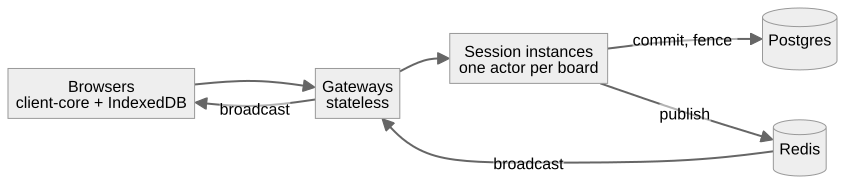
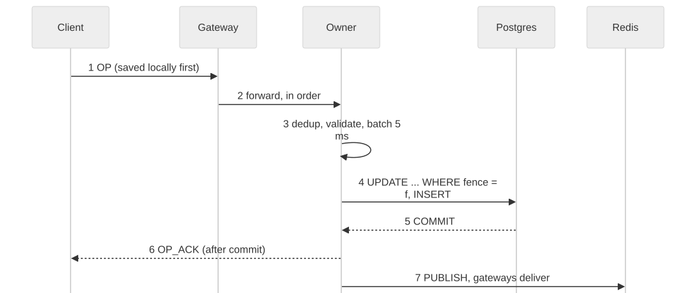
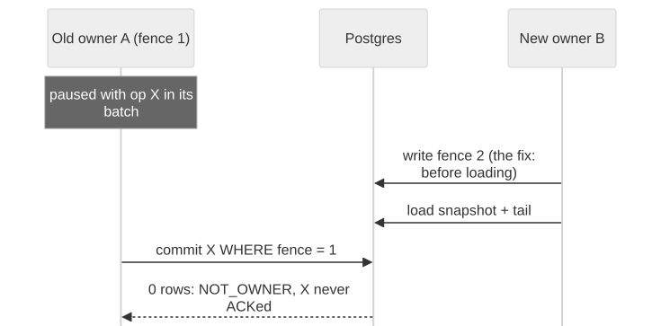

# Concord: Interview Guide

Private prep · 2026-10-18 · companion: [how Concord was built](how-concord-was-built.md)

**How to use this.** Learn the pitches by heart (section 1), then the numbers (section 9), then work through the question bank (section 3) out loud. Every answer points at the code it relies on; open the link and read the lines before you trust the answer. The self-test (section 12) has its answers at the very end. Measurements are tagged **[laptop]**, **[host]** (the live AWS VM), **[CI]**, **[accelerated]** (compressed time) or **[design]** (argued, not measured), exactly as in the main document. Every code link here was checked against the code by `python docs/tools/refs.py check` (288 references across both documents, all resolving).

## 1. Pitches

> **Three lengths of the same story: what it does, why it is hard, how I know it works, and what it does not do.**

### 30 seconds

"Concord is a collaborative kanban board: several people edit the same board at once, work offline for a day, and never lose an edit or get asked which version to keep. Under it is a hand-rolled CRDT engine, built twice, in TypeScript for the browser and Java for the server, proven byte-identical by shared test vectors and a cross-language fuzzer. Around it is an actor-per-board server that never acknowledges an edit until Postgres has committed it, with ownership fenced in Postgres. It's live on AWS. Every safety guard has a test I've watched fail with the guard removed, and the failure drills (killed owners, frozen owners, Postgres and Redis outages) lost zero acknowledged edits."

### 2 minutes

1. **The problem.** Real-time collaboration plus offline work means two copies of a board change independently and must end up identical, without asking users to pick. That's convergence. And when the server says "saved", it must be true forever. That's durability.
2. **The data model.** The board is two observed-remove sets (which lists and cards exist) and a map of last-writer-wins registers (titles, labels, placements), ordered by hybrid logical clocks. A card's list and position are one atomic register, so concurrent moves never produce a placement nobody chose. Delete wins over a concurrent edit, but the edit is kept and comes back on restore. Order uses fractional string keys.
3. **The server.** Each board has exactly one owner, an actor on one virtual thread, chosen by a Redis lease. The lease isn't trusted for safety: the claim writes a fencing token to Postgres before loading, and every commit checks it in the same transaction. The owner commits a batch, then applies, acknowledges and broadcasts. Redis Pub/Sub fans out, every broadcast carries a version, and clients repair gaps.
4. **The client.** It saves each edit to IndexedDB before showing it, resends its queue in order at the server's pace, and nothing it can't send disappears: it goes to a visible Unsent list.
5. **Evidence.** 55 hand-written vectors, a permutation fuzzer at 100,000 seeds nightly, a differential fuzzer between the languages, 61 integration tests on real Postgres and Redis, 7 failure drills, and 42 remove-the-guard checks. Two of those checks caught tests that couldn't fail.
6. **Honest limits.** p95 sync latency is 32 ms on the laptop, but 315–354 ms from India to the Sydney host, because the network is about 300 ms. One render in 300 on a 2,000-card board misses the 16 ms budget. At 300 busy boards, Postgres commits are the bottleneck.

### 10 minutes: the walkthrough script, and what to draw when

| Minute | Say | Draw |
|---|---|---|
| 0–1 | The promise: convergence plus "an ACK means stored"; what it does not promise (no character-level text, one move wins) | nothing yet |
| 1–3 | The architecture: browsers → gateways → one owner per board → Postgres; Redis for leases and fan-out only | **box diagram** (drill 6.1): browsers, gateway, Session instances, Postgres, Redis, with arrows labelled |
| 3–5 | The life of one edit: stamp, save, send, validate, group commit, apply, ACK, publish, merge | **sequence** (drill 6.2) |
| 5–7 | Why fencing: the paused-owner story; the claim order bug in the original spec; fence checked inside the commit | **the interleaving** (drill 6.3) |
| 7–8 | The CRDT rules that matter: OR-Set tags, delete wins, atomic placement | **the concurrent-move table** (drill 6.4) |
| 8–9 | Evidence: vectors, fuzz, drills, guard checks; one story (the fencing test that couldn't fail) | the guard-check loop: remove → must fail → restore → must pass |
| 9–10 | Limits and what I'd do next: region, Postgres commits across boards, the render tail | point at Postgres in the box diagram |

## 2. How it was built, honestly

> **Spec-driven and AI-assisted: I owned the specification, directed the build phase by phase, and reviewed and approved every decision; Claude Code wrote the code. My ownership is in the decisions, the review findings and the evidence I insisted on.**

**What to say, plainly:**
- "I owned the specification. It carries my name and went through three versions; v3 fixed eleven correctness gaps found in review (`docs/SPEC.md`, 'Changes from v2')." The repo does not record how the spec itself was drafted. If AI helped draft it too, say so in the same breath.
- "I built it with an AI coding agent under fixed ground rules:
  - follow the spec;
  - stop and ask at every gap;
  - record every change as a dated amendment with its evidence;
  - never invent a number;
  - never weaken a test;
  - prove every safety guard by removing it and watching its test fail."
- "I reviewed every proposal and approved or redirected it. I can walk you through any of them."

Don't claim you typed the code. Do claim the decisions, and be ready to defend each one line by line: section 7 is the code tour for that.

**Decisions I made or approved** (each recorded in `docs/SPEC.md`, "Amendments log"):

| Decision | What I chose, and why | Amendment |
|---|---|---|
| Hand-roll the CRDTs, in two languages | Our rules (delete-wins, Orphaned) aren't Automerge's defaults; no Java implementation exists; two implementations prove the spec is precise | ADR-000, ADR-000b |
| The claim order | The fence goes into Postgres before the new owner loads anything, and the lease is taken before that write | 6 A, 8 |
| A commit with an unknown outcome reconciles from Postgres before serving again | A lost COMMIT reply is not a failure | 6 B |
| Per-entity tombstones | A delete naming X can't touch Y (the cross-card delete) | 4 |
| `INVALID_OP` edits go to Unsent, never dropped | Users must see what didn't save | 4, 10 |
| No JWTs: hashed session cookies and single-use WebSocket tickets | As in Reliant; tokens in URLs end up in logs | 14 |
| The laptop is the measuring machine; CI runs looser regression bounds | Shared CI runners aren't benchmarks | 20 |
| Idle boards unload after 10 minutes | The soak's heap grew with every board ever loaded | 26 |
| Retention bounded by the *oldest* kept snapshot | The newest would break the corrupt-snapshot fallback | 28 |
| Drop the connection-rate limit for reconnect storms | The drill showed no cascade without one, and I wouldn't invent a number | 30 |
| The client paces its sends | A day's offline queue would otherwise take hours | 31 |
| A 5 ms commit window | Measured: as much batching as 15 ms, 11 ms faster | 32 |

**Problems found in review or by the evidence, before or after they could hurt** (incident reports in `production/incident-reports/`):

| Problem | How it was found | Result |
|---|---|---|
| v3's claim order could lose an ACKed op | Reading §6.2 against §6.3 while implementing claims | amendment 6 A; incident 009 |
| No rule for a commit whose reply is lost | Reading §6.1: no branch for "no reply" | amendment 6 B; incident 010 |
| The cross-card delete: a flat tombstone set let a delete for X remove Y | Reading the data shape; no fuzzer could find it, because convergence held | amendment 4; vectors 051–054 |
| Lease before or after the Postgres fence | Comparing the proposed order with the race it allows | kept the lease first; amendment 8 confirmed |
| A stale owner could re-take its lease after a Redis wipe | Writing up stale reads (§6.3) | amendment 13; incident 014 |
| The gateway's `CompletableFuture` chains could reorder ops | Reading the code | one request at a time per connection; incident 011 |
| The fencing test, and the LRU test, could not fail | Remove-the-guard checks | incident 015 |
| Chromium never closes a dead WebSocket | The Phase 3 offline browser test | amendment 18; incident 013 |
| A board deleted while loaded | The live host's logs | amendment 27; incident 018 |
| `/metrics` public on the live host | Checking the URL while building observability | incident 019 |
| A day's offline queue would take hours | The 24 h measurement | amendment 31; incident 021 |

## 3. Question bank

> **Sixty-six questions in fifteen groups; each has a model answer grounded in the code, the follow-up most likely to come next, and the trap that loses the point.**

Read each answer, open its code link, then say the answer out loud without looking.

### 3.1 CRDT theory

**Q1. What is a CRDT, and why use one here instead of a central lock?**
- *Answer.* A conflict-free replicated data type is a structure whose replicas can apply the same operations in any order, any number of times, and end identical with no coordination. Concord needs offline editing for up to a day, so a client must change its copy without asking anyone. A lock would make offline editing impossible. The board is two OR-Sets plus an LWW map ([`board.ts:35`](../crdt-ts/src/board.ts#L35)).
- *Follow-up.* "Then why have a server at all?" Durability, access control, a total version order for gap detection, and history. The server is a replica that also persists (section 7 of the main document).
- *Trap.* Saying a CRDT "resolves conflicts". It *defines* the result so that there is nothing to resolve; the product rules (delete-wins, one move wins) are choices that someone may dislike.

**Q2. Name the three algebraic laws merge must satisfy, and what each buys you.**
- *Answer.*
  - **Commutative** (A⊔B = B⊔A): arrival order doesn't matter.
  - **Associative** ((A⊔B)⊔C = A⊔(B⊔C)): grouping doesn't matter, so replicas can merge pairwise in any topology.
  - **Idempotent** (A⊔A = A): duplicates are harmless, so resending is safe.

  Property tests check all three per module ([`orset.test.ts:24`](../crdt-ts/test/orset.test.ts#L24)).
- *Follow-up.* "Is your op-based apply also commutative?" Yes: `apply` equals merging single-op states, which is tested ([`board.test.ts:29`](../crdt-ts/test/board.test.ts#L29)).
- *Trap.* Confusing idempotence with "exactly once". Concord gets idempotence from the data type *and* from server dedup.

**Q3. State-based or op-based?**
- *Answer.* Both. Clients and the owner exchange **ops**. The owner stores ops and **state snapshots**, and a far-behind client gets a snapshot that replaces its confirmed state ([`client.ts:731`](../client-core/src/client.ts#L731)). Because applying an op equals merging its single-op state, the two views agree.
- *Follow-up.* "What does an op-based CRDT normally require of delivery?" Causal or exactly-once delivery. Concord's ops are idempotent and commutative, so it needs only eventual delivery; versions provide a total order anyway.
- *Trap.* Claiming Concord needs causal delivery: it doesn't, and vector 012 shows a delete arriving before its add.

**Q4. Explain the OR-Set in Concord with an example.**
- *Answer.* Each add or restore puts a tag (its own `op_id`) under the entity; a delete tombstones exactly the tags its sender saw ([`orset.ts:27`](../crdt-ts/src/orset.ts#L27)). An entity is live while one of its tags is not tombstoned. Example: a restore concurrent with a delete survives, because the delete never saw the restore's tag (vector 004).
- *Follow-up.* "Why keep tombstones forever?" A delete can arrive before its add, for a client offline 24 h, and must still win. At 2,000 cards that costs only IDs (v3 change 9).
- *Trap.* Calling it a two-phase set. A 2P-set can never re-add; the OR-Set can.

**Q5. What was the cross-card delete bug?**
- *Answer.* The first shape stored one flat set of tombstoned tags. A `DELETE_CARD` naming X but listing a tag of card Y deleted Y. Convergence still held, so no fuzzer could find it; it was found by reading the shape. Tombstones became per entity, so a delete naming X can only touch X (amendment 4; vectors 051–054).
- *Follow-up.* "Why not just validate tags on the server?" That fixes only the server path; clients merge each other's ops too, so the shape itself had to make it impossible.
- *Trap.* Calling it a convergence bug. It was a semantics and safety bug in a convergent design.

**Q6. Why does delete win over a concurrent edit?**
- *Answer.* An edit writes a register but adds no tag, so it cannot make a deleted card live again; "add wins" would need edits to carry tags (v3 change 3). The edit is kept, though: restoring the card shows it (vectors 002, 003).
- *Follow-up.* "Isn't that bad for the person who was typing?" Their text is kept, and the card is one click from restored in the trash view. The alternative, an un-deletable card while anyone types, is worse.
- *Trap.* Saying the edit is lost. It isn't.

**Q7. What's the Orphaned list?**
- *Answer.* A *derived view*, not data: a live card whose list is deleted, unknown or not yet seen is shown in a built-in list with the nil UUID ([`board.ts:128`](../crdt-ts/src/board.ts#L128)). Restoring the list brings the cards back with no write (vectors 008, 014–019).
- *Follow-up.* "Why not cascade-delete the cards?" A cascade is a write that races with concurrent moves into the list, and it would turn one undo into many.
- *Trap.* Saying Orphaned is stored or synced; it is computed identically on every replica.

**Q8. How do you know the TypeScript and Java cores agree?**
- *Answer.* Three ways (ADR-000b):
  1. 55 hand-written conformance vectors, whose expected hashes come from a third implementation (Python), never from either core.
  2. A differential fuzzer where TypeScript drives Java through a CLI and compares state hashes, view hashes and validation verdicts.
  3. A canonical byte encoding, so "equal" means equal bytes.
- *Follow-up.* "What disagreed in practice?" String ordering (UTF-16 against UTF-8 bytes), what counts as an integer (`1.0` in JavaScript), code points against UTF-16 lengths, and NFC tables (ADR-000b).
- *Trap.* Saying one core generated the vectors for the other; that would only prove they share bugs.

### 3.2 HLC and clocks

**Q9. What's a hybrid logical clock and why not wall time?**
- *Answer.* `(physical_ms, counter, replica_id)`. `tick` takes the maximum of the last physical time and now, bumping the counter on a tie; `receive` takes the maximum of all three times, so the next stamp outranks everything seen ([`hlc.ts:43`](../crdt-ts/src/hlc.ts#L43)). It stays close to real time but never goes backwards, and the replica ID makes stamps unique.
- *Follow-up.* "Give a concrete case." B's clock says 995; it receives A's 1005/2; its clock becomes 1005/3, so B's next edit beats A's (`docs/tools/examples.ts`).
- *Trap.* Saying an HLC detects concurrency like a vector clock. It orders; it doesn't detect.

**Q10. A client's clock is a day fast. What happens?**
- *Answer.* The owner rejects its op with `CLOCK_SKEW`: more than 60,000 ms ahead of server time ([`op.ts:176`](../crdt-ts/src/op.ts#L176)). The error carries server time; the client recomputes its offset and re-stamps under the same `op_id`. If its HLC had already run ahead, it continues as a **fresh replica ID**, because an HLC can't go backwards ([`client.ts:837`](../client-core/src/client.ts#L837)).
- *Follow-up.* "Why does the fresh replica matter?" Its old ID's sequence already reached the future; a new ID can never repeat one of the old ticks.
- *Trap.* Saying the server rewrites the timestamp. It doesn't; it refuses and the client fixes itself.

**Q11. What if two ops have exactly equal HLCs?**
- *Answer.* Only a buggy client can produce that, because the replica ID is part of the stamp. Concord resolves it deterministically by the larger canonical encoding as unsigned UTF-8 bytes, and counts it as a "collision" metric ([`lww.ts:23`](../crdt-ts/src/lww.ts#L23)). The fuzz test fails if a valid scenario ever needs this tie-break.
- *Follow-up.* "Why bytes and not 'first arrival'?" Arrival order differs per replica: that was one of the bugs injected to test the fuzzer.
- *Trap.* Saying it can't happen. It can't happen *correctly*, so it is handled anyway.

**Q12. How is sync latency measured if every device's clock differs?**
- *Answer.* Two ways.
  - **In load tests, exactly:** all clients are in one process, so submit and apply times share a clock ([`load.test.ts:26`](../client-core/test/load/load.test.ts#L26)).
  - **From real clients:** latency is "applied here minus the op's HLC time", with both clocks corrected by the offset taken at JOIN. The error is the difference of the two clients' one-way delays, and that is stated in the SPEC (§9.5).
- *Follow-up.* "And the trace spans?" Server spans share one clock; the client spans carry the same correction error. In the test, `peer.render` appeared about 14 ms before `gateway.deliver` locally.
- *Trap.* Presenting client-reported numbers as exact.

### 3.3 Consistency models

**Q13. What consistency does Concord give a user?**
- *Answer.* Strong eventual consistency for the board state: replicas that have seen the same ops are identical. A client also sees its own writes at once (optimistic view), and the owner gives a single total order of versions per board, which is what gap detection and history use.
- *Follow-up.* "Is it linearizable?" Commits per board are serialised by one owner and fenced by Postgres, so the committed history is a total order. A client's view, though, includes its own uncommitted edits, so reads are not linearizable.
- *Trap.* Calling the whole system "strongly consistent".

**Q14. Can a client read stale data?**
- *Answer.* Yes, in one documented case (amendment 12): a stale owner that never writes is never fenced, and may answer `JOIN` from memory that is behind. It is a prefix of the committed history, behind but never wrong. It's bounded by the gateway's 5 s owner cache and the stale owner's next renewal.
- *Follow-up.* "Why not fence reads too?" Every read would need a Postgres round trip; the prefix guarantee plus `BOARD_VERSION` catch-up is enough for a board.
- *Trap.* Claiming reads are always fresh.

**Q15. Where do you need a total order, and where don't you?**
- *Answer.* Merge doesn't need one, since it commutes. The total order of versions exists for durability bookkeeping: "the client is at version v", gap detection, history and retention. One owner per board makes it cheap.
- *Follow-up.* "Could you drop the owner and have peers sync directly?" Convergence would hold, but the ACK promise, access control and history would need another home.
- *Trap.* Saying the CRDT needs the server's order.

### 3.4 Ownership and fencing

**Q16. Why does each board have one owner?**
- *Answer.* Validation needs current state (an `ADD_CARD` must name a list that exists), and versions need one sequence. One actor per board does both with no locks: one virtual thread drains its mailbox ([`BoardActor.java:136`](../server/session/src/main/java/dev/concord/session/BoardActor.java#L136), ADR-004).
- *Follow-up.* "What about a hot board?" Its throughput is one commit at a time. At 30 editors the p95 was 42 ms, with commits levelling off around 13–16/s **[laptop]**.
- *Trap.* Saying the owner makes the CRDT correct; it makes validation and versioning simple.

**Q17. Explain fencing tokens.**
- *Answer.* A number that grows with every new owner; storage refuses writes carrying an old one. Concord draws it from Redis with a Lua script that never goes below `boards.fence + 1` ([`Ownership.java:17`](../server/session/src/main/java/dev/concord/session/Ownership.java#L17)), writes it to Postgres before loading, and every commit checks `fence = :fence` in the same `UPDATE` that reserves the versions ([`Store.java:84`](../server/session/src/main/java/dev/concord/session/Store.java#L84)).
- *Follow-up.* "Why check in the same transaction?" A check and a write in two systems leave a gap a pause can fall into.
- *Trap.* Saying the lease guarantees one owner. It guarantees nothing during a pause.

**Q18. Walk me through the claim-order bug.**
- *Answer.* The original spec wrote the fence to Postgres at the new owner's *first commit*:
  1. A pauses with an op in its batch.
  2. B claims and loads.
  3. A wakes and commits: `boards.fence` still held A's value, so the commit succeeded and A ACKed.
  4. B's state never had that op.

  The fix writes the fence before loading ([`Store.java:220`](../server/session/src/main/java/dev/concord/session/Store.java#L220)), and commits require equality (amendment 6 A; incident 009).
- *Follow-up.* "How do you know the fix works?" `FencingTest` stops in exactly that window. The guard check that restores the old order makes it fail with `stale owner ACKed`.
- *Trap.* Not knowing that the first version of that test passed with the bug: it let B commit first.

**Q19. Why take the lease before writing the fence to Postgres?**
- *Answer.* If the Postgres write came first, a claimer that then loses the lease race would already have fenced out the live owner, an outage for nothing. Lease first means only the lease winner touches Postgres ([`Ownership.java:97`](../server/session/src/main/java/dev/concord/session/Ownership.java#L97)). I kept that order against the order first proposed; amendment 8 confirmed it.
- *Follow-up.* "What if two claimers both pass?" `SET NX` admits one. The Postgres update is conditional (`fence < :f`), so even a racing claim can't lower it; a loser releases and retries, counted as `claim_fence_retries`.
- *Trap.* Forgetting that the counter's floor is what survives a Redis wipe.

**Q20. What happens when an owner is paused for 20 seconds?**
- *Answer.* Its lease expires; another instance claims, writes fence n+1 to Postgres and serves. When the paused one wakes:
  - **If it can reach Redis,** its renewal sees a foreign lease and drops the board.
  - **If it can't,** it tries to commit and gets zero rows (`ALERT fenced out`), answers `NOT_OWNER` and closes, with nothing stored or broadcast ([`BoardActor.java:412`](../server/session/src/main/java/dev/concord/session/BoardActor.java#L412)).

  Drills: 0 stale commits both ways **[laptop]**.
- *Follow-up.* "How did you make sure the drill reached the fence?" A probe op sent straight to the frozen owner, which nobody else could commit (`c092c96`).
- *Trap.* Saying the stale owner "might commit a little". It commits nothing.

**Q21. And after a Redis wipe?**
- *Answer.*
  - **Fence counters rebuild** from `boards.fence + 1` ([[ownership#local floor = tonumber(ARGV[1])]]).
  - **A renewal that finds its lease gone** re-takes it only while `boards.fence` still equals its fence ([`Ownership.java:131`](../server/session/src/main/java/dev/concord/session/Ownership.java#L131), amendment 13). Otherwise a stale owner would steal routing back from the real one.
  - **The drill** requires the forced claim to get exactly `boards.fence + 1` with zero retries.
- *Follow-up.* "Why count retries?" A retry would also reach the right number and hide a counter that restarted at 1.
- *Trap.* Saying a wipe loses data. Redis holds nothing that can't be rebuilt.

**Q22. How does a gateway find the owner?**
- *Answer.* A 5 s cache, then `board:owner:{id}` in Redis, then rendezvous hashing over live instances (heartbeats every 2 s, live within 6 s) ([`Router.java:76`](../server/gateway/src/main/java/dev/concord/gateway/Router.java#L76), [`Rendezvous.java:30`](../server/common/src/main/java/dev/concord/common/Rendezvous.java#L30)). A `NOT_OWNER` drops the cache and tries again, 3 attempts in all. With Redis down, the last known owner is used.
- *Follow-up.* "Why rendezvous hashing?" Every gateway computes the same preferred owner with no coordination, and losing an instance moves only that instance's boards.
- *Trap.* Saying the hash decides ownership. It only says who *should* claim; the lease and fence decide.

### 3.5 Durability

**Q23. What exactly does an ACK promise, and how is it kept?**
- *Answer.* That the op is committed in Postgres. The owner applies, ACKs and publishes only after `COMMIT` returns ([`BoardActor.java:498`](../server/session/src/main/java/dev/concord/session/BoardActor.java#L498)). v2 applied first, so a failed append could leave an unstored op in memory and in the next snapshot (v3 change 5). Guard check `apply-after-commit` proves the test catches that.
- *Follow-up.* "And if COMMIT's reply is lost?" Next question.
- *Trap.* "ACK means received."

**Q24. A commit times out. Did it commit?**
- *Answer.* Unknown, and Concord treats it so (amendment 6 B):
  1. It answers `RETRY_LATER` and takes no snapshots.
  2. It locks the board row with `SELECT … FOR UPDATE`, which waits out any of its own transactions still holding it ([`Store.java:183`](../server/session/src/main/java/dev/concord/session/Store.java#L183)).
  3. It reads every op above its version and applies them.
  4. It serves again.

  Clients resend, and dedup returns the original ACK for anything that did commit.
- *Follow-up.* "Seen in practice?" Yes: a disk stall during the first soak caused 16 commit failures, and all were reconciled.
- *Trap.* Retrying the same commit blindly, which can double-apply without the primary key.

**Q25. How do you deduplicate?**
- *Answer.* Two layers:
  1. **The LRU:** the last 10,000 op_ids with their versions, in the owner's memory. It answers even with Postgres down ([`BoardActor.java:41`](../server/session/src/main/java/dev/concord/session/BoardActor.java#L41)).
  2. **The primary key** `(board_id, op_id)`: inside the commit, stored op_ids are dropped and answered with their version.

  A rejected resend is checked against the table before being called invalid ([`BoardActor.java:328`](../server/session/src/main/java/dev/concord/session/BoardActor.java#L328)). Never re-broadcast.
- *Follow-up.* "Why both?" The LRU is fast and works through outages; the key is the truth after a failover empties the LRU.
- *Trap.* Not knowing the LRU's test had to be added: removing the LRU first changed nothing.

**Q26. What's in the 2-second commit budget?**
- *Answer.* Pool wait plus the statements. Each statement gets a network timeout of what's left, and a `COMMIT` that would start after the deadline is never sent ([`Store.java:127`](../server/session/src/main/java/dev/concord/session/Store.java#L127)).
- *Follow-up.* "Why not send it late?" A late commit is exactly the unknown-outcome case. Not sending it keeps the outcome known: not committed.
- *Trap.* Thinking a timeout means "not committed".

**Q27. How does the system recover a board after a crash?**
- *Answer.* The newest snapshot whose SHA-256 matches, then replay of the ops after it ([`Store.java:232`](../server/session/src/main/java/dev/concord/session/Store.java#L232)). A corrupt snapshot falls back to the previous one, of three kept. A claim takes 29–342 ms even at 2,000 cards with a 499-op tail **[laptop]**.
- *Follow-up.* "Then why did users wait 13–20 s?" The 15 s lease plus client backoff (ADR-008).
- *Trap.* Blaming replay for recovery time.

### 3.6 Postgres

**Q28. Which constraints carry the design?**
- *Answer.*
  - `board_ops PRIMARY KEY (board_id, op_id)`: an op is stored once, the last line of dedup.
  - `UNIQUE (board_id, version)`: no two ops share a version.
  - `boards.fence`: checked by every commit.
  - `CHECK (role IN …)` on memberships.
  - Foreign keys, which is how a deleted board is detected at snapshot time ([`schema.sql:47`](../server/common/src/main/resources/schema.sql#L47)).
- *Follow-up.* "Why isn't `board_ops` partitioned?" A partitioned table's keys must include the partition key; v2's didn't, so the table wouldn't compile. Hash partitioning on `board_id` later would keep both keys legal (v3 change 1, the schema comment).
- *Trap.* Calling the primary key "just an index".

**Q29. Which Postgres features does the code lean on?**
- *Answer.*
  - `UPDATE … RETURNING` to check the fence and reserve versions in one statement.
  - `SELECT … FOR UPDATE` for reconcile and for the last-owner rule.
  - `ON CONFLICT DO NOTHING`.
  - An advisory lock to serialise migrations ([`Migrate.java:35`](../server/common/src/main/java/dev/concord/common/Migrate.java#L35)).
  - `pg_export_snapshot()` with a repeatable-read transaction, so `pg_dump` and the backup manifest describe one moment ([`Backup.java:43`](../server/session/src/main/java/dev/concord/session/Backup.java#L43)).
  - `DELETE … RETURNING` for single-use tickets.
  - `ctid` batches for retention.
- *Follow-up.* "Why batch retention by ctid?" So no statement holds `board_ops` for long; 5,000 at a time ([`Retention.java:21`](../server/gateway/src/main/java/dev/concord/gateway/Retention.java#L21)).
- *Trap.* Not knowing why the ticket delete must be one statement: a SELECT then DELETE lets two gateways use the same ticket.

**Q30. Why is Postgres the bottleneck at 300 boards?**
- *Answer.* Group commit merges ops *within* a board's batch, but each board commits alone, so 300 active boards meant about 300 commits/s. Postgres peaked at 6.8 cores, and p95 rose to 294 ms **[laptop]**. Each commit is a durable disk flush.
- *Follow-up.* "Fix?" Batch commits *across* boards on an instance: one transaction per instance-window. ADR-004 rejected that for isolation, and this measurement is what would reopen it. Or synchronous commit off for a bounded window, which trades durability, so no.
- *Trap.* Blaming the JVM; the Session instances averaged under one core each.

**Q31. How are migrations safe during a rolling deploy?**
- *Answer.* Forward-only, and every migration must keep the previous code working: add, never rename or drop. The old Session instances run against the new schema until they are replaced, and a rollback runs the old code on the newer schema (`deploy/prod/deploy.sh` header). Version 2 added names, sessions, tickets and bug reports.
- *Follow-up.* "And a column you want to drop?" Two releases: stop using it, then drop it.
- *Trap.* "We run migrations then restart": the overlap is the point.

### 3.7 Redis

**Q32. What does Redis hold, and what happens if it disappears?**
- *Answer.* Nothing durable:
  - leases, owner keys and fence counters;
  - the live-instance set;
  - presence;
  - Pub/Sub channels.

  Down: owners keep committing, because Postgres fences them; gateways poll owners every second; presence goes blank. The stop-redis drill saw 268 ACKs during a 15.8 s outage **[laptop]**. Wiped: counters rebuild from Postgres.
- *Follow-up.* "Why not put the fence in Redis?" A check in Redis and a write in Postgres can't be atomic, so a pause between them reopens the hole (ADR-007).
- *Trap.* Calling Redis a cache of the board. It never holds board state.

**Q33. Why Lua scripts?**
- *Answer.* Atomicity: "INCR but never below a floor", "extend only if the lease value is mine", and "delete only if mine" must each be one step, or a concurrent claimer slips in between ([`Ownership.java:28`](../server/session/src/main/java/dev/concord/session/Ownership.java#L28)).
- *Follow-up.* "Why compare the lease value?" So a slow owner can't extend or delete a lease that a new owner now holds.
- *Trap.* Using `EXPIRE` without checking ownership.

**Q34. Pub/Sub loses messages. Is that OK?**
- *Answer.* Yes. Every broadcast carries the board version, so a client that sees v after v−2 asks `SYNC_REQUEST`; a quiet client learns it's behind from `BOARD_VERSION` every 5 s. A lost message costs a round trip, never an op (ADR-006). The e2e test drops 8 broadcasts and converges **[CI]**.
- *Follow-up.* "Why not Kafka?" Postgres already holds every op with its version; Kafka's durability would buy nothing and add a cluster and latency.
- *Trap.* Saying Redis Streams were needed.

**Q35. How does idle unload know nobody has the board open?**
- *Answer.* `PUBSUB NUMSUB board:{id}`: each gateway with a client on the board subscribes to its channel. Zero subscribers and 10 minutes without a request means unload. If Redis doesn't answer within 1 s, it unloads nothing ([`BoardActor.java:652`](../server/session/src/main/java/dev/concord/session/BoardActor.java#L652), [`SessionMain.java:63`](../server/session/src/main/java/dev/concord/session/SessionMain.java#L63)).
- *Follow-up.* "Why never while reconciling?" The board's true state isn't known yet.
- *Trap.* Unloading by timer alone.

### 3.8 WebSockets and the gateway

**Q36. How is a WebSocket authenticated?**
- *Answer.* The client gets a **single-use, 30-second ticket** from `POST /api/ws-ticket` with its session cookie, and puts it in the URL. The gateway checks the Origin allowlist, then consumes the ticket with one `DELETE … RETURNING` before upgrading ([`GatewayMain.java:111`](../server/gateway/src/main/java/dev/concord/gateway/GatewayMain.java#L111)). A URL in a log is worthless once used. No JWTs (amendment 14).
- *Follow-up.* "Why not the cookie on the upgrade?" Cross-site WebSocket hijacking: browsers send cookies on cross-origin upgrades. The ticket plus the Origin check closes that.
- *Trap.* Putting a long-lived token in the URL.

**Q37. What does the gateway do with a slow client?**
- *Answer.* Every send goes through a bounded outbox. Past 8 MB of unsent bytes it sends `RECONNECT_ELSEWHERE`, closes, and cuts the connection after 1 s if the client never finishes the close ([`Outbox.java:41`](../server/common/src/main/java/dev/concord/common/Outbox.java#L41), amendment 9). The client reconnects and catches up by version.
- *Follow-up.* "Why does that matter?" Jetty queues async writes without limit, so one client that stops reading would grow the gateway's memory forever.
- *Trap.* Blocking the broadcast loop on a slow client.

**Q38. How are a client's ops kept in order through the gateway?**
- *Answer.* Each connection has its own virtual thread that takes requests from a bounded inbox and forwards **one at a time**, waiting for the owner's reply ([`ClientConn.java:64`](../server/gateway/src/main/java/dev/concord/gateway/ClientConn.java#L64), [`ClientConn.java:136`](../server/gateway/src/main/java/dev/concord/gateway/ClientConn.java#L136)). That's the fix for the `CompletableFuture` reordering (incident 011).
- *Follow-up.* "Cost?" At most one op in flight per connection. Measured, the 20 ops/s rate limit caps a connection first: 21.6 ops/s **[laptop]**.
- *Trap.* "TCP keeps order." It does, until a retry or an async callback reorders.

**Q39. What happens to clients during a rolling deploy?**
- *Answer.* The gateway on SIGTERM sends every client `RECONNECT_ELSEWHERE` and closes ([`ClientConn.java:215`](../server/gateway/src/main/java/dev/concord/gateway/ClientConn.java#L215)). Owners flush, snapshot and release their leases. Clients reconnect with backoff and resend their queues. Three live deploys under editing lost nothing: 2,315, 2,306 and 2,351 ops **[host]**.
- *Follow-up.* "And Caddy?" Unchanged config isn't restarted; a changed one is reloaded gracefully.
- *Trap.* Assuming the WebSocket survives a backend restart.

### 3.9 Offline and the client

**Q40. Why save before showing an edit?**
- *Answer.* Otherwise a crash between showing and saving loses an edit the user saw. Each edit is appended to an IndexedDB log and committed before it's put on the queue, shown and sent ([`client.ts:359`](../client-core/src/client.ts#L359), amendment 21). It also made edit-to-screen faster, 4.1–4.3 ms against 4.9–5.0, because a full snapshot write became one small append **[laptop]**.
- *Follow-up.* "What if IndexedDB refuses?" The edit is kept in memory rather than dropped, and logged.
- *Trap.* "localStorage is enough." It's synchronous, small and per-origin, and a snapshot write per keystroke is slow.

**Q41. What's the duplicated-tab bug?**
- *Answer.* A tab keeps its replica ID in `sessionStorage`, which browsers *copy* into a duplicated tab. Two live tabs would then share a replica ID and could stamp different ops with equal HLCs. On load a tab takes a Web Lock for its ID; if another tab holds it, it makes a new ID ([`idb.ts:102`](../client-core/src/idb.ts#L102), amendment 17). Guard check `duplicate-tab-lock`.
- *Follow-up.* "What happens to a closed tab's queue?" The next tab adopts it, taking its lock first, in one IndexedDB transaction.
- *Trap.* One replica per browser: two tabs then race on one queue.

**Q42. How does the client detect a dead connection?**
- *Answer.* Chromium, like a dropped network, often leaves the WebSocket open with no close event. The owner sends `BOARD_VERSION` every 5 s, so **15 s of silence** drops the connection; the browser's `offline` event drops it at once and `online` reconnects immediately ([`client.ts:143`](../client-core/src/client.ts#L143), amendment 18).
- *Follow-up.* "Why not WebSocket pings?" Browsers don't expose ping/pong to JavaScript; an application heartbeat is the portable way.
- *Trap.* Trusting `onclose`.

**Q43. A client comes back after a day with 5,000 queued edits. What happens?**
- *Answer.*
  1. JOIN with its version; it gets the ops after that, or a snapshot if more than 2,000 behind.
  2. It resends its queue in order through a token bucket matching the gateway: 20 ops/s, burst 50 ([`client.ts:594`](../client-core/src/client.ts#L594)).
  3. 5,701 edits synced in 283 s, 0 lost **[accelerated]**.

  Before amendment 31 the client sent everything at once and resent the whole queue on every refusal: still pending after 10 minutes.
- *Follow-up.* "Can it go faster?" A batch frame carrying many ops would: a protocol change, not made under the feature freeze.
- *Trap.* Saying the server limit was the bug. The two sides didn't match.

**Q44. Name every way an edit can fail, and where it ends.**
- *Answer.*
  - `RETRY_LATER`, `UNAVAILABLE`: stays queued, resent.
  - `CLOCK_SKEW`: re-stamped, resent.
  - `INVALID_OP` behind an unacked op of ours: deferred and judged again.
  - `INVALID_OP` at the head, `UNAUTHORIZED`: **Unsent edits**, visible and kept.

  Nothing is silently dropped ([`client.ts:809`](../client-core/src/client.ts#L809)). Every drill asserts 0 Unsent.
- *Follow-up.* "Why defer `INVALID_OP`?" The owner may have died between an `ADD_LIST` and its `ADD_CARD`; the card was judged without the list (incident 012).
- *Trap.* Dropping "invalid" ops.

### 3.10 Java concurrency

**Q45. Why virtual threads?**
- *Answer.* One thread per board actor and per client connection lets the code block simply: `queue.poll`, JDBC, waiting for the owner's reply. A blocked virtual thread costs little, so 10,000 boards don't need 10,000 OS threads ([`BoardActor.java:136`](../server/session/src/main/java/dev/concord/session/BoardActor.java#L136), ADR-004). Javalin also runs handlers on virtual threads.
- *Follow-up.* "Pitfalls?" Pinning: a virtual thread blocked inside `synchronized` holds its carrier. The arm64 CI deadlock was a test helper doing slow work under a monitor, with a virtual thread holding it (incident 017).
- *Trap.* "Virtual threads are faster." They're cheaper to block, not faster.

**Q46. How does the actor avoid locks?**
- *Answer.* All board state (the CRDT, version, LRU, batch) is touched only by the actor's own thread. Others only `offer` items to its `LinkedBlockingQueue` mailbox ([`BoardActor.java:96`](../server/session/src/main/java/dev/concord/session/BoardActor.java#L96)). The single `synchronized (closeLock)` makes "check closed, then enqueue" atomic against closing ([`BoardActor.java:160`](../server/session/src/main/java/dev/concord/session/BoardActor.java#L160)).
- *Follow-up.* "Why bound the mailbox?" A board flooded past 5,000 items answers `RETRY_LATER` instead of growing without limit; control messages (drop, release, delete) always get in.
- *Trap.* Saying "the actor is single-threaded, so nothing is concurrent". Offers come from many threads.

**Q47. Explain the CompletableFuture reordering bug.**
- *Answer.* The first gateway draft forwarded each op with chained `thenCompose`/`thenAccept` callbacks. Callbacks run on whichever thread completes the previous stage, so two ops from one connection could complete in either order, and a `NOT_OWNER` retry could overtake a later op. An `ADD_CARD` reaching the owner before its `ADD_LIST` fails validation. Fix: the connection's own virtual thread forwards one request and *waits* for its reply ([`ClientConn.java:136`](../server/gateway/src/main/java/dev/concord/gateway/ClientConn.java#L136), incident 011). Found by reading the code.
- *Follow-up.* "Where do you still use CompletableFuture?" In `Router` and `Link`, where one request's lifecycle is a chain, never two requests racing.
- *Trap.* "Use a single-threaded executor": that still doesn't wait for the owner's reply.

**Q48. What's `volatile` doing in BoardActor?**
- *Answer.* `state` and `fence` are read from other threads: the lease renewer reads `fence()`, and `offer` reads `state`. `volatile` gives visibility of the actor thread's writes without a lock ([`BoardActor.java:98`](../server/session/src/main/java/dev/concord/session/BoardActor.java#L98)).
- *Follow-up.* "Is that enough for `offer`'s check-then-act?" No, hence the `closeLock`.
- *Trap.* Making everything `synchronized`.

**Q49. How does the lease renewer interact with actors?**
- *Answer.* One platform thread renews every lease every 5 s with compare-and-extend. If another owner holds the lease, or Postgres holds a newer fence, it *offers* a `Drop` to that actor rather than touching its state ([`Boards.java:85`](../server/session/src/main/java/dev/concord/session/Boards.java#L85)). If Redis is down it does nothing, since Postgres still fences the owner.
- *Follow-up.* "Why not renew inside the actor?" A busy actor would miss renewals and lose its lease.
- *Trap.* Closing the actor from the renewer's thread.

### 3.11 Testing

**Q50. How do you test convergence?**
- *Answer.* A permutation fuzzer simulates 3–5 replicas with skewed clocks making 50–500 ops each from partial views, then delivers all ops in 8 random orders with about 20% duplicates. Every replica must end byte-identical, with no LWW tie-break firing on valid ops ([`fuzz.test.ts:10`](../crdt-ts/test/fuzz.test.ts#L10)). It runs 500 seeds per commit and 100,000 nightly. The op mix leans on the hard cases: one "hot" card takes most moves, deletes and restores ([`sim.ts:207-245`](../crdt-ts/test/fuzz/sim.ts#L207-L245)).
- *Follow-up.* "How do you know the fuzzer can find bugs?" Three bugs were injected (arrival-order LWW, a delete forgetting unseen tags, an HLC ignoring its counter); each was caught within 200 runs (ADR-000).
- *Trap.* "We have high coverage, so it's correct." Coverage says nothing about orders.

**Q51. What happens when the fuzzer finds a failure?**
- *Answer.*
  1. fast-check shrinks the scenario.
  2. Delta debugging cuts it to a minimal op set ([`sim.ts:315`](../crdt-ts/test/fuzz/sim.ts#L315)).
  3. Both are written to `.fuzz-failures/` with the seed, a candidate for a new conformance vector. `FUZZ_SEED` replays a run.
- *Follow-up.* "Did that happen?" The rebalance property found that the generator never rebalanced *list* keys, which once grew to 65 characters (ADR-001).
- *Trap.* Not knowing what a seed buys you: replay.

**Q52. What's a remove-the-guard check?**
- *Answer.* For each safety guard, a script swaps the guarded code for code that compiles without it, runs the named test and requires it to **fail**, then restores the file and requires it to pass ([`guard_checks.py:32`](../server/tools/guard_checks.py#L32)). There are 42, at unit, browser and drill level. Two tests could not fail on the first run: `FencingTest` (the new owner committed first, so the window was skipped) and the LRU test (the primary key hid the LRU's removal) (incident 015).
- *Follow-up.* "How is that different from mutation testing?" Mutation testing mutates everything at random; this targets the lines I already know matter, and records the failure message as evidence.
- *Trap.* Commenting a guard out and calling a compile error "the test failed".

**Q53. How do the drills check themselves?**
- *Answer.* Each drill fails unless every op any client saw ACKed is in `board_ops`, every client and a fresh one end on one SHA-256 state hash, and nothing is in Unsent edits ([`drills.test.ts:13`](../client-core/test/drills/drills.test.ts#L13)). Each also logs the counter that proves its path ran, such as `stale_owner_fence_rejections`.
- *Follow-up.* "What did a drill find?" The kill-owner drill found valid edits landing in Unsent after a crash: per-op retry timers (incident 012).
- *Trap.* A drill that only checks "the service came back".

**Q54. Server coverage?**
- *Answer.* Not measured: JaCoCo is configured for `crdt-java` only. The cores are measured: TS 94.62% of branches, Java 87.37% excluding the CLI **[laptop]**. The server's evidence is 61 integration tests on real infrastructure plus the guard checks.
- *Follow-up.* "Would you add it?" Yes, cheaply, but I'd trust the guard checks more: they prove the tests detect the bug, not just that lines ran.
- *Trap.* Inventing a number.

### 3.12 Performance

**Q55. What's your sync latency?**
- *Answer.* p50 27 ms and p95 32 ms with 2 editors; p95 42 ms with 30 **[laptop]**. From India to the Sydney host: p95 315–354 ms, of which the server is about 17 ms; the rest is a ~300 ms round trip **[host]**. The target, p95 < 200 ms, is met by the server and missed end to end from far away.
- *Follow-up.* "Fix?" Host near the users. No server change needed.
- *Trap.* Quoting the laptop number as user-facing latency.

**Q56. How did you pick the commit window?**
- *Answer.* Measured 0, 5, 15 and 30 ms with 30 editors on one board. 5 ms batched as well as 15 (2.55 against 2.53 ops per commit) at 11 ms less median latency; 0 ms committed every op alone; 30 ms only added latency **[laptop]**. Changed from 15 to 5 (ADR-005, amendment 32).
- *Follow-up.* "Is one run per setting enough?" It's thin: 60 s and about 52,000 samples each. I'd rerun before betting much on the 5-against-15 batching tie.
- *Trap.* Claiming the window matters at 300 boards; there, each board commits alone anyway.

**Q57. Tell me about the render performance work.**
- *Answer.* 2,000 cards, 10 editors: p50 was 56.6 ms, with every update over 16 ms. Three causes (`2dfb84c`):
  1. The drag-and-drop context re-rendered every sortable card on each update.
  2. Unchanged objects were rebuilt, so memoised components re-rendered.
  3. The store subscription was unstable.

  Fixes: memoise the DnD area, `useStableView`, a stable subscription ([`BoardPage.tsx:357`](../web/src/BoardPage.tsx#L357)). After: p50 4.7 ms. On today's idle rerun about 1 update in 300 still takes 16–26 ms, so the strict target is missed, and it's not profiled.
- *Follow-up.* "Why not virtualise the list?" A choice I'd test next; the tail may be GC or layout, not render count.
- *Trap.* Saying the target is met.

**Q58. What's the throughput of one connection?**
- *Answer.* 21.6 ops/s with one op in flight, capped by the 20 ops/s per-connection rate limit plus a burst of 50 (50 + 20 × 30 = 650; 649 sent) **[laptop]**. A person never comes close; a reconnecting client with a backlog does, which is why the client paces itself.
- *Follow-up.* "Would pipelining help?" Only above the rate limit; per-connection sequence numbers would be needed to keep order.
- *Trap.* Blaming the round trip.

### 3.13 Security

**Q59. How are passwords and sessions stored?**
- *Answer.* Passwords use argon2id with OWASP's minimum (19 MiB, 2 passes, 1 lane), in the PHC string format so parameters can rise later ([`Passwords.java:18`](../server/common/src/main/java/dev/concord/common/Passwords.java#L18)). Sessions are 32 random bytes; Postgres stores only their SHA-256, so a leaked table can't be replayed. The cookie is `HttpOnly; SameSite=Strict; Secure`, 30 days.
- *Follow-up.* "Timing attacks on sign-in?" An unknown email is checked against a dummy hash, so timing doesn't reveal which emails exist ([`Api.java:227`](../server/gateway/src/main/java/dev/concord/gateway/Api.java#L227)).
- *Trap.* bcrypt "because it's standard" without parameters.

**Q60. CSRF and cross-site WebSocket hijacking?**
- *Answer.* Every state-changing REST call must be JSON from an allowed Origin, and a request carrying the cookie with no Origin is refused ([`Api.java:115`](../server/gateway/src/main/java/dev/concord/gateway/Api.java#L115)). WebSockets need the Origin allowlist plus a single-use ticket. The CSP allows only same-origin scripts and `wss://` to the host.
- *Follow-up.* "Rate limits behind a proxy?" X-Forwarded-For is believed only from Caddy's own address, re-resolved every 30 s (amendment 23).
- *Trap.* Trusting X-Forwarded-For from anyone.

**Q61. What protects the internal gateway-to-owner socket?**
- *Answer.* A shared-secret header, compared in constant time; production refuses a secret under 32 bytes or the dev one ([`InternalServer.java:45`](../server/session/src/main/java/dev/concord/session/InternalServer.java#L45), [`Config.java:95`](../server/common/src/main/java/dev/concord/common/Config.java#L95)). Only Caddy publishes ports.
- *Follow-up.* "Why not mTLS?" One VM on a private Docker network; a secret plus no published ports is proportionate. mTLS would be next on a real network.
- *Trap.* "It's internal, so it's safe."

**Q62. Do secrets reach the logs?**
- *Answer.* No. A redacting JSON encoder scrubs `ticket=`, `access_token=`, the session cookie and `Bearer` values from every log line, and bug-report diagnostics pass the same redactor ([`RedactingJsonEncoder.java:17`](../server/common/src/main/java/dev/concord/common/RedactingJsonEncoder.java#L17)). `GatewayLogTest` checks it; guard checks `log-redaction-ticket` and `bug-report-redaction`.
- *Follow-up.* "And `/metrics`?" Exposed publicly once on the trial host (counters including board IDs, no secrets); now 404 from outside (incident 019).
- *Trap.* Not owning the `/metrics` incident.

### 3.14 Operations

**Q63. How do you deploy without losing edits?**
- *Answer.* `deploy.sh <sha>`:
  1. refuse unless the checkout matches the SHA;
  2. back up;
  3. pull the images CI built after every test passed;
  4. migrate forward-only;
  5. replace session1, session2, then the gateway, each after the previous is healthy;
  6. reload Caddy;
  7. check `/healthz` and that `/metrics` is closed from outside;
  8. print the rollback.

  Three live deploys under editing lost nothing **[host]**.
- *Follow-up.* "Why pull, never build, on the VM?" The VM has 2 GB, a build measured 1,072 MiB, and pulling runs exactly what CI tested.
- *Trap.* `latest` tags.

**Q64. How do you know a backup works?**
- *Answer.* `pg_dump` and a manifest of every board's state hash come from one exported snapshot. `verify` restores into a throwaway Postgres and replays each board from its oldest kept snapshot against the manifest. A rehearsal restore printed `RESTORE VERIFIED` in 19.9 s **[laptop]**. Honest gap: a restore of a *live* backup after the `restore.sh` fix isn't recorded.
- *Follow-up.* "Where's the key?" The age private key is never on the server.
- *Trap.* "We have nightly dumps": untested backups.

### 3.15 Why not X?

**Q65. Why not Yjs or Automerge? Why not OT?**
- *Answer.* Yjs and Automerge are general JSON/text CRDTs whose defaults aren't our product rules: delete-wins, the Orphaned list, one atomic placement. Neither has a Java implementation, so the server would run JavaScript or Rust through a bridge. Concord needs no text CRDT, since descriptions are last-writer-wins whole (ADR-000). OT (operational transformation) needs a central transform server and transform functions for every pair of operations, and handles offline divergence poorly; CRDTs merge without coordination.
- *Follow-up.* "Would you use Yjs for descriptions?" If character-level editing became a requirement, yes, for that field only.
- *Trap.* Dismissing libraries as "not invented here": it was a semantics decision.

**Q66. Why not Kafka, Raft, a StatefulSet, merge-on-read, or JWTs?**
- *Answer.*
  - **Kafka:** Postgres already stores every op with its version, so Pub/Sub plus gap repair is enough and faster (ADR-006).
  - **Raft:** Concord needs one writer per board, not a replicated log. Postgres is the durable log, and a lease plus a Postgres fence gives single-writer safety without running consensus.
  - **A StatefulSet:** the ownership of boards moves at runtime by lease, not by pod identity, and v3 dropped Kubernetes for Phase 4 (v3 change 12).
  - **Merge-on-read:** every op would load the board, and two requests would race unless Postgres row locks serialised them, which moves the actor into the database (ADR-004).
  - **JWTs:** can't be revoked without a lookup, and they ended up in URLs; hashed sessions plus single-use tickets are simpler (amendment 14).
- *Follow-up.* "When would Raft make sense?" Many replicas of the *owner* with automatic failover in milliseconds, instead of a 15 s lease.
- *Trap.* Saying the lease is a consensus protocol. It isn't; the Postgres fence is what makes it safe.

## 4. Scaling: what breaks first

> **At 10× the first wall is Postgres commits across many boards; at 100× it is one owner per hot board and Redis fan-out; each claim below rests on a measurement or is marked as reasoning.**

| Scale | What breaks first | Evidence | What I would change |
|---|---|---|---|
| **10×** active boards (≈3,000 busy boards on one Postgres) | **Postgres commits per second.** Each board commits alone; 300 boards already made about 300 commits/s with Postgres peaking at 6.8 cores and p95 at 294 ms | `production/load-tests/README.md` §4 **[laptop]** | batch commits *across* boards per Session instance (one transaction per instance-window), reopening ADR-004's isolation trade-off; or shard boards across Postgres instances by board ID (`board_ops` keys already include `board_id`) |
| 10× editors on one board (300) | **one owner per board.** One commit at a time; at 30 editors commits levelled at 13–16/s while ops per commit rose. Not measured above 30 | §2 of the load tests **[laptop]**; [design] above | larger windows under load (an adaptive window, ADR-005 alternatives); the per-board limit is the cost of a single writer |
| 10× connections per gateway (5,000) | gateway memory (each connection: a virtual thread, an outbox up to 8 MB, Jetty buffers) and reconnect bursts. 500 reconnected in 3.5–16.2 s with no cascade | reconnect-storm drill; gateways peaked at 524–555 MiB with 1,000 connections **[laptop]** | more gateways (stateless); revisit the dropped connection-rate limit (amendment 30 says when) |
| **100×** | **Redis Pub/Sub fan-out**: one publish per op, one delivery per subscribed gateway; a single Redis | [design]: not measured | shard channels across Redis instances, or Redis Cluster's sharded Pub/Sub |
| 100× boards in memory | Session heap; idle unload bounds it to boards in use | soak, amendment 26 | more Session instances: rendezvous hashing spreads boards with no coordination |
| Any scale | the 15 s lease is the recovery floor (owner crash → 13–20 s to the first ACK) | recovery measurement **[laptop]** | a shorter lease trades false failovers during pauses; replicated owners (Raft) only if seconds matter |

**What never breaks first:** the CRDT merge. A claim replays a 2,000-card board with a 499-op tail in under 350 ms.

## 5. Story bank

> **Ten real incidents in STAR form, with real numbers; pick the one that fits the question, and keep "I directed" honest.**

Amazon Leadership Principles in brackets.

**S1. The claim order that could lose an acknowledged edit** [Dive Deep, Insist on the Highest Standards]
- **Situation:** the spec's ownership protocol wrote the fencing token to Postgres lazily, at the new owner's first commit.
- **Task:** implement claiming without ever losing an ACKed op.
- **Action:**
  - Reading §6.2 against §6.3, we found the window: a paused old owner could still commit after the new owner loaded.
  - I approved writing the fence before loading (amendment 6 A), and kept the lease before the Postgres write, which the review confirmed (amendment 8).
  - We insisted on a test that stops in exactly that window, plus a guard check that restores the old order.
- **Result:** the guard check fails with "stale owner ACKed"; the pause-owner drills show 0 stale commits. (incident 009)

**S2. The test that couldn't fail** [Insist on the Highest Standards, Learn and Be Curious]
- **Situation:** `FencingTest` was green.
- **Task:** prove it actually detects the bug it's named for.
- **Action:** I made "remove the guard, the test must fail" a rule; the first run restored the old claim order, and the test still passed.
- **Result:** the test now pins the dangerous interleaving. The same run found the LRU's test couldn't fail either. Today there are 42 checks, each recorded failing. (incident 015)

**S3. Valid edits in "Unsent" after an owner crash** [Customer Obsession, Ownership]
- **Situation:** the kill-owner drill passed every server check, but 2–3 valid edits per run ended in the user's Unsent list.
- **Task:** find why a server-side success still failed users.
- **Action:** traced it to per-op retry timers: an `ADD_CARD` overtook its `ADD_LIST` after the crash. We moved to whole-queue, in-order resends, with "`INVALID_OP` is final only at the head of the queue".
- **Result:** 0 Unsent in every drill since; drills now assert the user's end state. (incident 012)

**S4. Chromium never closes a dead WebSocket** [Customer Obsession, Dive Deep]
- **Situation:** the offline browser test showed "joined" while offline.
- **Task:** detect a dead connection on a real network.
- **Action:** found that browsers don't report a silently dropped network. We added a 15 s silence rule on top of the owner's 5 s heartbeat, plus the browser's offline and online events.
- **Result:** the scripted offline hour: 240 edits, converged 11.5 s after reconnecting. (incident 013)

**S5. The memory soak that "failed"** [Dive Deep, Are Right, A Lot]
- **Situation:** a 2-hour soak failed: session3's heap grew 4.61 MB/h.
- **Task:** decide whether it was a leak.
- **Action:** a heap histogram showed CRDT state, not garbage. The workload grew boards forever, and nothing unloaded idle boards. We measured growth per op (163 B) and per deleted card (≈3 KB), added idle unload (amendment 26), and made the soak's workload fixed-size.
- **Result:** the next soaks were flat, including with the 2 GB host's limits. (incident 016)

**S6. The arm64 CI hang** [Dive Deep, Bias for Action]
- **Situation:** CI hung twice on arm64 with no output; 12 hunt runs passed.
- **Task:** make an intermittent hang diagnosable.
- **Action:** added per-test logging, a thread dump after 8 minutes and a hard timeout. The next hang's dump showed a virtual thread holding a test appender's monitor while formatting. We fixed the helper to format without a lock, as production's appender does.
- **Result:** green on every arm64 run since. (incident 017)

**S7. A board deleted while loaded, found on the live host** [Ownership, Deliver Results]
- **Situation:** the live smoke test's account deletion removed a board its owner still had loaded; the next snapshot failed on a foreign key.
- **Task:** fix it without false alarms.
- **Action:** reading around it found worse cases: a fence alert for a deleted board, and an endless reconcile. We added a `board-deleted` announcement, and "zero rows plus no board row means deleted".
- **Result:** deployed; the next live deletion logged "dropped" with 0 errors. (incident 018)

**S8. `/metrics` was public, and my deploy command made it worse** [Ownership, Earn Trust]
- **Situation:** the gateway's metrics, including board IDs, were reachable from the internet.
- **Task:** close it and make it impossible to reopen.
- **Action:**
  - The first fix didn't take: the deploy command I gave skipped `git pull`, which I owned in the write-up.
  - The second deploy's new outside check caught that Caddy was reading an old file through a single-file mount.
  - We mounted the directory, and `deploy.sh` now refuses a stale checkout and checks from outside.
- **Result:** 404 from outside since `e274eba`. (incident 019)

**S9. A day offline would have taken hours to sync** [Customer Obsession, Deliver Results]
- **Situation:** the 24-hour offline measurement still had 5,243 edits pending after 10 minutes.
- **Task:** find why, without weakening the rate limit.
- **Action:** the client sent its whole queue at once and resent all of it on every refusal. I approved client-side pacing matching the gateway (amendment 31), with a unit test and a guard check.
- **Result:** 8 h went from 487 s to 92 s; 24 h synced in 283 s, 0 lost. (incident 021)

**S10. Dropping a feature instead of inventing a number** [Frugality, Invent and Simplify]
- **Situation:** the spec promised a per-gateway connection-rate limit for reconnect storms, with no value.
- **Task:** decide without guessing.
- **Action:** built the storm drill first: 500 clients, gateway killed. It found no cascade without a limit. I chose to drop the limit and record when to revisit it (amendment 30). The drill's own wait condition was wrong twice; we fixed it each time and recorded both.
- **Result:** all 500 back in 3.5–16.2 s (laptop) and 12.4 s (CI), 0 lost. (incident 007)

## 6. Whiteboard drills

> **Four drawings carry the interview: the box diagram, the write path, the claim interleaving, and the concurrent-move merge; practise each until it takes two minutes.**

### 6.1 The architecture, in 2 minutes

Draw left to right, saying one sentence per box:
1. **Browsers.** "Each has client-core and an IndexedDB queue; edits are saved, shown, then sent."
2. **Gateways.** "Stateless: WebSockets, REST, rate limit, fan-out."
3. **Session instances.** "One actor per board; the only writer."
4. **Postgres** under them. "Ops, snapshots, and the fence."
5. **Redis** on the side. "Leases, owner lookup, Pub/Sub; nothing durable."
6. Arrows: client → gateway → owner → Postgres (commit), then owner → Redis → gateways → clients (broadcast).

### 6.2 The write path

Seven arrows; say "commit before anything else" at arrow 5.

### 6.3 The claim interleaving

Two lifelines (A, the old owner; B, the new) and Postgres. Draw v3's order first, then the fix: move "B writes fence 2" *above* "B loads".

### 6.4 The concurrent-move merge

Draw a two-row table. Both replicas get both moves, in opposite orders; the higher HLC's whole placement wins on both.

| Replica | First applied | Then applied | Placement register holds | Card shown in |
|---|---|---|---|---|
| R1 | A: To Do @ a1 (HLC 1010/A) | B: Done @ a0 (HLC 1011/B) | B's `{Done, a0}` | Done |
| R2 | B: Done @ a0 | A: To Do @ a1 | B's `{Done, a0}` (A's loses: lower HLC) | Done |

Then say: "If list and position were separate registers, a tie-broken mix could put the card in To Do at Done's key: a placement nobody chose. One atomic register makes that impossible. A's client shows 'moved by B' for 4 s."

## 7. Code tour

> **Fifteen files, read in this order, cover the whole system; know the key function in each well enough to explain it line by line.**

| # | File | What it holds | Key functions |
|---|---|---|---|
| 1 | `crdt-ts/src/hlc.ts` | the clock | `tick` [`hlc.ts:37`](../crdt-ts/src/hlc.ts#L37), `receive` [`hlc.ts:43`](../crdt-ts/src/hlc.ts#L43), `compare` [`hlc.ts:25`](../crdt-ts/src/hlc.ts#L25) |
| 2 | `crdt-ts/src/orset.ts` | existence | `remove` [`orset.ts:27`](../crdt-ts/src/orset.ts#L27), `liveTags` [`orset.ts:36`](../crdt-ts/src/orset.ts#L36)] |
| 3 | `crdt-ts/src/lww.ts` | attributes and the tie-break | `pick` [`lww.ts:23`](../crdt-ts/src/lww.ts#L23) |
| 4 | `crdt-ts/src/keys.ts` | order | `keyBetween` [`keys.ts:110`](../crdt-ts/src/keys.ts#L110), `planInsert` [`keys.ts:175`](../crdt-ts/src/keys.ts#L175) |
| 5 | `crdt-ts/src/board.ts` | composition, view, Orphaned | `apply` [`board.ts:47`](../crdt-ts/src/board.ts#L47), `view` [`board.ts:101`](../crdt-ts/src/board.ts#L101) |
| 6 | `crdt-ts/src/op.ts` | validation and the skew guard | `checkShape` [`op.ts:128`](../crdt-ts/src/op.ts#L128), `checkClock` [`op.ts:176`](../crdt-ts/src/op.ts#L176) |
| 7 | `server/.../session/BoardActor.java` | the owner: admit, commit, apply, reconcile, unload | `admit` [`BoardActor.java:270`](../server/session/src/main/java/dev/concord/session/BoardActor.java#L270), `flush` [`BoardActor.java:386`](../server/session/src/main/java/dev/concord/session/BoardActor.java#L386), `applyCommitted` [`BoardActor.java:498`](../server/session/src/main/java/dev/concord/session/BoardActor.java#L498), `reconcile` [`BoardActor.java:520`](../server/session/src/main/java/dev/concord/session/BoardActor.java#L520) |
| 8 | `server/.../session/Store.java` | every SQL statement of the write path | `commit` [`Store.java:70`](../server/session/src/main/java/dev/concord/session/Store.java#L70), `raiseFence` [`Store.java:218`](../server/session/src/main/java/dev/concord/session/Store.java#L218), `load` [`Store.java:232`](../server/session/src/main/java/dev/concord/session/Store.java#L232) |
| 9 | `server/.../session/Ownership.java` | claim, renew, release | `claim` [`Ownership.java:97`](../server/session/src/main/java/dev/concord/session/Ownership.java#L97), `renew` [`Ownership.java:125`](../server/session/src/main/java/dev/concord/session/Ownership.java#L125) |
| 10 | `server/.../session/Boards.java` | actors per instance, lease renewal | `dispatch` [`Boards.java:33`](../server/session/src/main/java/dev/concord/session/Boards.java#L33), `renewAll` [`Boards.java:85`](../server/session/src/main/java/dev/concord/session/Boards.java#L85) |
| 11 | `server/.../gateway/ClientConn.java` | one client socket, in order | `onMessage` [`ClientConn.java:93`](../server/gateway/src/main/java/dev/concord/gateway/ClientConn.java#L93), `drain` [`ClientConn.java:64`](../server/gateway/src/main/java/dev/concord/gateway/ClientConn.java#L64) |
| 12 | `server/.../gateway/Router.java`, `Fanout.java` | owner lookup, delivery, watchdog | `owner` [`Router.java:76`](../server/gateway/src/main/java/dev/concord/gateway/Router.java#L76), `tick` [`Fanout.java:108`](../server/gateway/src/main/java/dev/concord/gateway/Fanout.java#L108) |
| 13 | `server/.../gateway/Api.java` | REST, auth, tickets | `sameOrigin` [`Api.java:115`](../server/gateway/src/main/java/dev/concord/gateway/Api.java#L115), `consumeTicket` [`Api.java:301`](../server/gateway/src/main/java/dev/concord/gateway/Api.java#L301) |
| 14 | `client-core/src/client.ts` | the sync client | `submit` [`client.ts:359`](../client-core/src/client.ts#L359), `pump` [`client.ts:594`](../client-core/src/client.ts#L594), `error` [`client.ts:809`](../client-core/src/client.ts#L809), `confirmedOp` [`client.ts:759`](../client-core/src/client.ts#L759) |
| 15 | `client-core/src/idb.ts` | tab replicas, log, adoption | `open` [`idb.ts:102`](../client-core/src/idb.ts#L102), `load` [`idb.ts:118`](../client-core/src/idb.ts#L118) |

Read `docs/walkthrough-phase2.md` and `docs/walkthrough-phase3.md` alongside: each follows one edit through the code.

## 8. Low-level design and DSA angles

> **The design maps onto standard LLD and DSA questions; name the pattern, then show the Concord code.**

### 8.1 Low-level design

| Typical question | Concord's answer | Code |
|---|---|---|
| Design a component that serialises work per key with no locks | **Actor**: a mailbox per board drained by one virtual thread; others only `offer` | [`BoardActor.java:160`](../server/session/src/main/java/dev/concord/session/BoardActor.java#L160) |
| Model an object with a lifecycle | **State machine**: CLAIMING → SERVING ⇄ RECONCILING → CLOSED, every mailbox item handled per state | [`BoardActor.java:226`](../server/session/src/main/java/dev/concord/session/BoardActor.java#L226), [`BoardActor.java:552`](../server/session/src/main/java/dev/concord/session/BoardActor.java#L552) |
| Make storage swappable for tests | **Strategy / interface**: `Storage` with `MemoryStorage` and `IndexedDbStorage`, sharing one `merge` | [`storage.ts:33`](../client-core/src/storage.ts#L33) |
| Handle errors from a remote service | **Classified responses**: each code maps to retry, re-stamp, defer or surface; nothing silently dropped | [`client.ts:809`](../client-core/src/client.ts#L809) |
| Bound memory for a slow consumer | **Bounded buffer with backpressure**: count bytes; over the limit, tell it to go and close | [`Outbox.java:41`](../server/common/src/main/java/dev/concord/common/Outbox.java#L41) |
| Find a resource with a cache and fallbacks | **Cache-aside with retry**: 5 s cache → Redis → hash; invalidate on `NOT_OWNER` | [`Router.java:52`](../server/gateway/src/main/java/dev/concord/gateway/Router.java#L52) |
| Test failure handling | **Seams**: `Store.beforeCommit()` lets a test pause or fail a commit before `COMMIT` | [`Store.java:134`](../server/session/src/main/java/dev/concord/session/Store.java#L134) |

### 8.2 DSA

| Topic | Where | The idea, in one line |
|---|---|---|
| **String midpoint / fractional indexing** | [`keys.ts:110`](../crdt-ts/src/keys.ts#L110) | base-62 digits; strip the common prefix, then take the middle digit; carry into the integer part |
| **LRU cache** | [`BoardActor.java:107`](../server/session/src/main/java/dev/concord/session/BoardActor.java#L107) | `LinkedHashMap` in access order with `removeEldestEntry`: O(1) get and evict |
| **Rendezvous (highest-random-weight) hashing** | [`Rendezvous.java:30`](../server/common/src/main/java/dev/concord/common/Rendezvous.java#L30) | each node's weight = SHA-256(board ‖ node); the highest wins; removing a node moves only its keys |
| **Token bucket** | [`TokenBucket.java:21`](../server/gateway/src/main/java/dev/concord/gateway/TokenBucket.java#L21) | refill `rate × elapsed` up to the burst; take 1 or refuse. The same shape on the client ([`client.ts:594`](../client-core/src/client.ts#L594)) |
| **Logical clocks** | [`hlc.ts:43`](../crdt-ts/src/hlc.ts#L43) | Lamport's max-plus-one, keeping the physical part |
| **Join-semilattice** | [`orset.ts:58`](../crdt-ts/src/orset.ts#L58) | merge is set union, a least upper bound: commutative, associative, idempotent |
| **Delta debugging** | [`sim.ts:315`](../crdt-ts/test/fuzz/sim.ts#L315) | shrink a failing op set by removing chunks while it still fails |
| **Exponential backoff with full jitter** | [`client.ts:149`](../client-core/src/client.ts#L149) | `random × min(30 s, 0.5 s × 2^n)`, so retries spread out |
| **Gap detection** | [`client.ts:759`](../client-core/src/client.ts#L759) | hold out-of-order versions in a map; drain while `version + 1` is present |

## 9. Numbers cheat sheet

> **The numbers worth remembering, each with where it was measured; never quote a laptop number as user-facing.**

| Number | Meaning | Tag | Source |
|---|---|---|---|
| 32 ms | sync p95, 2 editors | [laptop] | `production/load-tests/README.md` §1 |
| 42 ms | sync p95, 30 editors | [laptop] | §2 |
| 315–354 ms | sync p95, India → Sydney | [host] | `deploy/prod/rehearsal-results.txt` |
| ≈17 ms | the server's share of that | [host] | same, "On the real host" |
| 294 ms | sync p95, 1,000 connections on 300 boards | [laptop] | §4 |
| 890 / 900 | ops/s committed / offered at 1,000 connections | [laptop] | §4 |
| 6.8 cores | Postgres peak at 1,000 connections | [laptop] | §4 |
| 5 ms | group-commit window (was 15) | [laptop] | ADR-005, amendment 32 |
| 2.55 | ops per commit at 5 ms, 30 editors | [laptop] | §3 |
| 1,565 ms | owner crash: serving after lease expiry (target ≤ 5 s) | [laptop] | `deploy/drills/results.txt` |
| 29–342 ms | claim time, up to 2,000 cards and a 499-op tail | [laptop] | §9 |
| 15 s / 5 s | lease length / renewal interval | code | [`RedisKeys.java:12`](../server/common/src/main/java/dev/concord/common/RedisKeys.java#L12) |
| 60 s | clock-skew limit | code | [`op.ts:12`](../crdt-ts/src/op.ts#L12) |
| 10,000 | dedup LRU size | code | [`BoardActor.java:41`](../server/session/src/main/java/dev/concord/session/BoardActor.java#L41) |
| 5,000 | actor mailbox bound | code | [`BoardActor.java:49`](../server/session/src/main/java/dev/concord/session/BoardActor.java#L49) |
| 20 /s, 50 | per-connection rate limit, burst | code | [`ClientConn.java:29`](../server/gateway/src/main/java/dev/concord/gateway/ClientConn.java#L29) |
| 2 s | commit budget | code | [`BoardActor.java:42`](../server/session/src/main/java/dev/concord/session/BoardActor.java#L42) |
| 500 ops / 60 s, keep 3 | snapshot policy | code | [`BoardActor.java:44`](../server/session/src/main/java/dev/concord/session/BoardActor.java#L44) |
| 35 days | op retention (history shows 30) | code | [`Retention.java:20`](../server/gateway/src/main/java/dev/concord/gateway/Retention.java#L20) |
| 15 s / 10 s | client silence drop / JOIN timeout | code | [`client.ts:143`](../client-core/src/client.ts#L143) |
| 3.5–16.2 s | 500 clients back after their gateway died (CI 12.4 s) | [laptop] [CI] | `deploy/drills/results.txt` |
| 92 s / 283 s | 8 h / 24 h offline queues synced | [accelerated] | §6 |
| 11.5 s | real 1-hour offline: reconnect to converged | [laptop] | `docs/offline-hour-scripted.md` |
| 56.6 → 4.7 ms | large-board render p50, before → after the fixes | [laptop] | `docs/phases.md:241-242` |
| 19.9 / 26.3 ms | large-board render max on today's reruns (target < 16) | [laptop] | §5 |
| 55, 109 + 109, 61, 35, 7, 7, 19, 42 | vectors; TS + Java core tests; server; client unit; e2e; drills; Playwright; guard checks | count | section 10 of the main document |
| 94.62% / 87.37% | branch coverage, TS core / Java core | [laptop] | main document §10.3 |
| 1,336 MiB | sum of memory limits on the 2 GB host | config | [`compose.yaml:16`](../deploy/prod/compose.yaml#L16) |
| 0 | ACKed ops lost, in every drill, load test, soak and live deploy | all | everywhere |

## 10. Weak spots, and honest answers

> **Name the weakness before the interviewer does, give the number, say why it happens, and say what you would change.**

| Weak spot | What to say |
|---|---|
| **Sydney latency** | "From India the p95 is 315–354 ms, against a 200 ms target. The server takes about 17 ms; the round trip to Sydney is about 300 ms. The fix is a region near the users. I measured it rather than assume it." |
| **Postgres at 1,000 connections** | "At 300 busy boards Postgres hit 6.8 cores and p95 went to 294 ms, because each board commits alone. Group commit helps within a board, not across boards. Next step: batch commits per instance across boards, accepting less isolation, or shard Postgres by board." |
| **The large-board render tail** | "About 1 render in 300 at 2,000 cards takes 16–26 ms; p99 is under 14 ms. I fixed the big causes (56.6 → 4.7 ms p50) but haven't profiled this tail. I kept the test strict rather than loosen it." |
| **Accelerated offline runs** | "The 8 and 24 h runs compress time with a clock offset; they prove the merge and the resend, not hours of a real browser and IndexedDB. The 1 h run is real time in real browsers." |
| **Laptop-only measurements** | "One laptop ran the services, databases and load generator together. Those numbers show where bottlenecks sit, not capacity. Only latency and deploys were measured on the real host." |
| **One region, one VM** | "No replica and no Postgres failover; nightly backups mean a lost VM loses up to a day. For a trial that's a deliberate trade; next would be point-in-time recovery and a standby." |
| **No SSO, no 2FA** | "Out of scope by the spec (§1.3); invite-only sign-up, argon2id, hashed sessions and rate limits are what's there." |
| **AI wrote the code** | "Yes. I owned the spec, the decisions and the evidence. Here's a decision I'd defend line by line: the claim order (section 3, Q18)." |
| **Server coverage unmeasured** | "True. I rely on 61 integration tests on real infrastructure and 42 guard checks that prove the tests catch their bugs." |
| **Small user base** | "The trial has had no bug reports so far; the live host has been exercised by deploy checks and smoke tests, not by real load." |

## 11. Glossary

| Term | Meaning | In Concord |
|---|---|---|
| ACK | the server's promise that an op is stored | `OP_ACK {op_id, version}`, after `COMMIT` |
| Actor | an object with a private mailbox processed by one thread | `BoardActor`, one per board |
| Backoff, full jitter | wait a random time up to a growing cap before retrying | `random × min(30 s, 0.5 s × 2^n)` |
| Canonical encoding | one byte string per state | RFC 8785 JSON, integers only |
| Claim | taking ownership of a board | fence, lease, Postgres fence, load, announce |
| Convergence | replicas with the same ops end identical | the fuzzers' assertion |
| CRDT | a data type whose replicas merge without coordination | two OR-Sets plus an LWW map |
| CSP | Content-Security-Policy: what a page may load | same-origin scripts, `wss://` to the host |
| Delta debugging | shrinking a failing input by removing parts | `minimize` in the fuzzer |
| Drill | a failure induced on purpose, with checks | `deploy/drills/` |
| Fence (fencing token) | a growing number storage checks on every write | `boards.fence`, checked by every commit |
| Fan-out | delivering one message to many subscribers | Redis Pub/Sub → gateways → clients |
| Group commit | committing several waiting ops in one transaction | 5 ms window |
| Guard check | removing a safety guard to prove its test fails | 42 in `guard_checks.py` |
| HLC | hybrid logical clock: physical time + counter + replica | op timestamps |
| Idempotent | doing it twice equals doing it once | resends, merge |
| Lease | a time-limited claim that must be renewed | `board:lease:{id}`, 15 s |
| LWW register | last-writer-wins: the highest timestamp's value survives | titles, labels, placements |
| Op | one edit | `ADD_CARD`, `SET_FIELD`, … |
| OR-Set | observed-remove set: tags on add, tombstones on delete | lists and cards |
| Orphaned | a derived list of live cards whose list isn't there | nil UUID, shown last |
| Owner | the one instance allowed to commit a board's ops | holds lease and current fence |
| Pub/Sub | publish/subscribe messaging, fire-and-forget | `board:{id}` channels |
| Reconcile | reading back the truth after an unknown commit outcome | `SELECT … FOR UPDATE`, replay |
| Rendezvous hashing | each key goes to the node with the highest hash weight | preferred owner |
| Replica | a copy of the board that applies ops | each tab, and the owner |
| Snapshot | a board's state at a version, hashed | every 500 ops or 60 s, keep 3 |
| Tombstone | a record that a tag was deleted, kept forever | per entity |
| Token bucket | a rate limiter that refills over time | 20/s, burst 50 |
| Version | the board's commit counter | gap detection, history |
| Virtual thread | a cheap JVM thread that can block | actors, connections |
| Web Lock | a browser lock held for a tab's lifetime | one replica per tab |

## 12. Self-test

> **Answer these out loud, then check the key below; anything you miss, reread its section.**

1. What are the two halves of Concord's core promise?
2. Which two CRDTs make up the board, and what does each hold?
3. What does an HLC's `receive` guarantee about the next local stamp?
4. What happens to an op stamped 61 s ahead of server time?
5. Why does a client sometimes switch to a fresh replica ID?
6. In the OR-Set, what is a tag, and what does a delete carry?
7. What was the cross-card delete bug, and how was it fixed?
8. Why does delete win over a concurrent edit, and what happens to the edit?
9. Why is placement one register rather than two?
10. When is a card shown in Orphaned?
11. `keyBetween("a0", "a1")` returns what? Two concurrent appends get which keys, and how are they ordered?
12. What three things happen in Concord's commit transaction?
13. Why must apply, ACK and publish wait for `COMMIT`?
14. Describe the claim order, step by step.
15. What exact interleaving did v3's claim order allow?
16. Why is the lease taken before the fence is written to Postgres?
17. What does the owner do after a commit times out?
18. What are the two layers of dedup, and why both?
19. How does a client detect a missed broadcast?
20. Why do clients use a 15 s silence rule?
21. What is the duplicated-tab bug?
22. What happens to an `INVALID_OP` that arrives behind an unacknowledged op?
23. What bug did the 24-hour offline measurement find, and how was it fixed?
24. Why did the gateway forward one request at a time per connection?
25. What is a remove-the-guard check, and which two tests could not fail at first?
26. Why did the commit window change, from what to what?
27. What limits throughput at 1,000 connections on 300 boards?
28. What made `/metrics` stay public after the first fix?
29. What is the measured sync latency from India, and why?
30. Name three things Concord deliberately does not promise.

---

### Answer key

1. **Convergence:** replicas with the same ops are byte-identical. **Durability:** an ACKed op is in Postgres and never lost.
2. **Two OR-Sets** (which lists and cards exist) and **an LWW map** (every field, including placement).
3. It is strictly greater than both the last local stamp and the received one.
4. Rejected with `CLOCK_SKEW`; the client recomputes its offset from the server's time, re-stamps, and resends under the same `op_id`.
5. Its HLC already ran ahead on a bad clock, and an HLC can't go backwards, so it continues under a new ID that can't repeat old ticks.
6. A tag is the `op_id` of an add or restore; a delete carries the tags its sender had observed.
7. A flat tombstone set let a delete for X list Y's tag and remove Y. Tombstones became per entity (amendment 4).
8. An edit adds no tag, so it can't revive a card. The edit is kept and shows if the card is restored.
9. Separate list and position registers could mix two concurrent moves into a placement nobody chose.
10. When it's live but its list is deleted, unknown, or missing from its placement.
11. `a0V`. Both get `a1`; ties render by entity ID, the same everywhere.
12. Drop already-stored op_ids; `UPDATE boards … WHERE fence = :f RETURNING version`; insert the ops with consecutive versions.
13. So memory, ACKs and broadcasts never contain an op that isn't stored.
14. Fence `INCR` with a floor; lease `SET NX`; `UPDATE boards SET fence … WHERE fence < :f`; load snapshot and tail; announce.
15. A pauses with op X; B claims and loads; A commits X under `fence <= 1` and ACKs it; B's state lacks X forever.
16. So a claimer that loses the lease race never fences out the live owner.
17. Treats the outcome as unknown: `RETRY_LATER`, no snapshots, lock the board row, replay what was committed, then serve.
18. The in-memory LRU (fast, works with Postgres down) and the primary key (true after a failover). A rejected resend is checked against the table first.
19. A version gap (v after v−2) or `BOARD_VERSION` ahead of it; it sends `SYNC_REQUEST`.
20. Browsers often keep a dead WebSocket open; the owner's 5 s `BOARD_VERSION` makes 15 s of silence a reliable death signal.
21. A duplicated tab copies `sessionStorage`, so two tabs shared one replica ID. A Web Lock on the ID makes the copy pick a new one.
22. It's deferred and judged again once everything ahead of it is ACKed, since its dependency may not have committed yet.
23. The client sent its whole queue at once and resent all of it on each refusal; it now paces itself at 20/s, burst 50 (amendment 31).
24. Chained `CompletableFuture`s and `NOT_OWNER` retries could reorder a client's ops, and the owner validates references in order.
25. Delete the guard, require its test to fail, restore, require a pass. `FencingTest` and the LRU test.
26. Measurements: 5 ms batched as well as 15 ms with 11 ms lower median latency. 15 → 5 ms.
27. Postgres commits: one per board per batch, about 300/s, Postgres at 6.8 cores.
28. The VM's checkout was stale (no `git pull`), then Caddy read the old file through a single-file bind mount.
29. p95 315–354 ms; the round trip to Sydney is about 300 ms, and the server's share is about 17 ms.
30. Any three of: character-level text merging, caret cursors, unbounded undo, moving cards between boards, SSO or 2FA, that your own concurrent move always wins.
