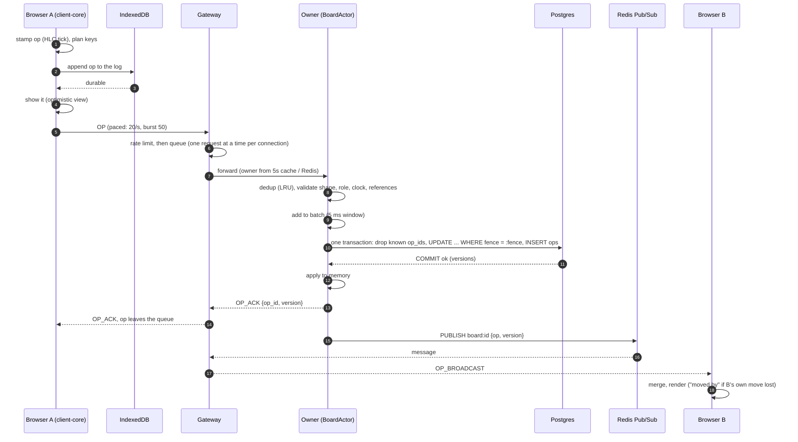

## 2. Architecture

> **Postgres is the system's memory and each board's owner is its only writer: an edit is committed before anyone is told about it, and Redis carries only what can be lost.**

```mermaid title="Concord architecture: clients, gateways, Session instances, Postgres and Redis"
flowchart LR
  subgraph Browsers
    C1["Browser A<br/>React + client-core<br/>IndexedDB queue"]
    C2["Browser B<br/>React + client-core<br/>IndexedDB queue"]
  end
  subgraph Gateways["Gateways (stateless)"]
    G1["gateway 1<br/>WebSockets, REST API<br/>rate limit, fan-out"]
    G2["gateway 2"]
  end
  subgraph Sessions["Session instances"]
    S1["session 1<br/>BoardActor per board<br/>validate, group commit, apply"]
    S2["session 2"]
  end
  PG[("Postgres<br/>board_ops, snapshots,<br/>boards.fence, users")]
  R[("Redis<br/>leases, owner keys,<br/>fence counters, presence,<br/>Pub/Sub board:id")]
  C1 -- "WebSocket: JOIN, OP" --> G1
  C2 -- WebSocket --> G2
  G1 -- "internal WebSocket<br/>(shared secret)" --> S1
  G2 --> S1
  S1 -- "1. commit (fence checked)" --> PG
  S1 -- "2. PUBLISH board:id" --> R
  R -- "OP_BROADCAST" --> G1
  R -- OP_BROADCAST --> G2
  S1 -. "lease renew every 5s" .-> R
  G1 -. "owner lookup" .-> R
  S2 -. "claims boards whose lease expired" .-> R
```

**Words used throughout.**

| Term | Meaning | Concord example |
|---|---|---|
| **Op** | One edit, with a unique `op_id`, a timestamp and a type | `{"type":"SET_FIELD","entity_id":X,"field":"title","value":"Pay rent"}` ([[op#export type Op =]]) |
| **Replica** | One copy of a board's state that applies ops | each browser tab is a replica; so is the owner |
| **Owner** | The one Session instance allowed to order and commit a board's ops | the instance holding the board's lease, with the current fence |
| **Lease** | A Redis key with a 15 s expiry that says "this instance serves this board" | `board:lease:{id}`, renewed every 5 s ([[rediskeys#public static final long LEASE_MS = 15_000;]]) |
| **Fence (fencing token)** | A number that grows with every change of owner; Postgres refuses commits carrying an old one | `UPDATE boards ... WHERE fence = ?` ([[store#WHERE id = ? AND fence = ? RETURNING version]]) |
| **Version** | The board's commit counter: each committed op gets the next one | `boards.version`; clients spot a gap from it |
| **ACK** | `OP_ACK {op_id, version}`: the server's promise that the op is stored | sent only after `COMMIT` ([[actor#r.send(Msg.ack(opId, v))]]) |

### The life of one edit

From a click in browser A to the screen of browser B. Each step names the code that does it.



1. **Stamp.** `submit()` ticks the client's hybrid logical clock and builds the op with a fresh `op_id` ([[client#submit(body: Body): Op]]). Moves and inserts first compute fractional keys, re-keying equal neighbours if needed ([[client#private placeAt(]]).
2. **Save before showing.** The op is appended to an IndexedDB log, and only when that write is durable is it put on the pending queue, shown and sent (§7.2, amendment 21; [[idb#async append(op: Op, seq: number)]]). A crash after this point loses nothing.
3. **Send, paced.** The op goes out through a token bucket shaped like the gateway's limit, 20 ops/s with a burst of 50 (amendment 31; [[client#private pump()]]).
4. **Gateway.** The gateway refuses frames over 64 KB and ops over the rate limit with `RETRY_LATER` ([[clientconn#if (!bucket.take(clock.getAsLong()))]]). It then queues each request for the connection's own virtual thread, which forwards **one request at a time, in arrival order** ([[clientconn#private void drain()]]). It finds the owner from a 5 s cache, then `board:owner:{id}` in Redis, then rendezvous hashing over live instances ([[router#String owner(String board)]]).
5. **Admit.** The owner's actor checks its 10,000-entry LRU of recent op_ids (a resend gets the original ACK). It then validates: shape, membership role (from a 30 s cache), clock skew (more than 60 s ahead is refused), and references, such as "this ADD_CARD names a list that exists" ([[actor#private void admit(Submit s)]], [[actor#private Map<String, Object> validate(Submit s, String opId)]]).
6. **Group commit.** Admitted ops wait up to 5 ms (ADR-005) and are committed in **one transaction** ([[store#public Committed commit(String board, long fence, List<Pending> ops, long deadlineMs)]]):
   - drop op_ids already stored;
   - `UPDATE boards SET version = version + n WHERE id = ? AND fence = ? RETURNING version` (zero rows means a newer owner exists);
   - insert the ops with consecutive versions.
7. **Apply, ACK, publish, in that order, only after `COMMIT`** ([[actor#private void applyCommitted]]). Memory never holds an op that is not in Postgres.
8. **Fan-out.** Every gateway with a client on the board is subscribed to `board:{id}` and forwards the broadcast ([[fanout#private void deliver(String board, String message)]]).
9. **Merge.** Browser B applies the op with the same merge the server uses. If the version is not the next one, it asks for the missing range with `SYNC_REQUEST` ([[client#private confirmedOp(op: Op, version: number, broadcast: boolean)]]).

**Measured:** edit on one client to applied on another, p50 27 ms and p95 32 ms with 2 editors **[laptop]**. From India to Sydney: p50 312–318 ms, p95 315–354 ms **[host]**.

### The life of an offline edit

```mermaid title="The life of an offline edit, from IndexedDB to reconnect and resend"
sequenceDiagram
  autonumber
  participant U as User
  participant C as client-core
  participant IDB as IndexedDB (log + snapshot)
  participant G as Gateway
  participant O as Owner
  Note over C,G: network gone: no close event (Chromium), so 15 s of silence drops the socket
  U->>C: edits (many)
  C->>IDB: append each op to the log, then show it
  C->>IDB: snapshot about once a second, replacing the log entries it contains
  Note over C: reload or crash: load = snapshot + later log entries
  C->>C: reconnect with backoff (0.5 s x 2^n, max 30 s, full jitter)
  C->>G: ticket (REST) then WebSocket JOIN {since_version}
  G->>O: JOIN
  O-->>C: JOINED: ops after since_version (or a snapshot if far behind), server_time_ms
  C->>C: merge the catch-up under its pending ops
  C->>G: resend the whole pending queue, in order, paced 20/s
  O-->>C: OP_ACK for each (a duplicate gets its original ACK)
```

1. **Detecting it.** A browser that loses its network often keeps the WebSocket "open" (incident 013). The owner sends `BOARD_VERSION` every 5 s, so 15 s without any message drops the connection ([[client#this.silenceTimer = setInterval]]). The browser's `offline` event drops it at once ([[client#private readonly onOffline]]).
2. **Editing.** Each edit is appended to the IndexedDB log before it is shown. About once a second a snapshot of everything is written, replacing the log entries it contains ([[client#private saveNow()]], [[idb#async save(state: Saved)]]).
3. **Reload or crash.** Loading merges the snapshot with every later log entry ([[storage#export function merge(]]). A closed tab's queue is adopted by the next tab that opens the board (section 8).
4. **Reconnecting.** The client backs off, `0.5 s × 2^attempt`, capped at 30 s, with full jitter ([[client#export function backoffMs(]]). The browser's `online` event skips the wait.
5. **Catching up.** `JOIN {since_version}`: the owner sends the ops after that version, or a full snapshot if more than 2,000 behind or the range was pruned ([[actor#private Map<String, Object> catchUpMessage(String type, Long since)]]). It also sends the server's time, from which the client recomputes its clock offset.
6. **Resending.** The whole pending queue goes out in order, paced to 20 ops/s ([[client#case "JOINED": {..for (const op of this.pending) this.sendOp(op);]]). Ops that were already committed get their original ACK from dedup.

**Measured:**
- 1 hour offline in two real browsers: 240 edits, converged 11.5 s after reconnecting **[laptop]**.
- 8 and 24 hours **[accelerated]**: 1,885 and 5,701 edits, synced in 92 s and 283 s, 0 lost (`production/load-tests/README.md` §6).
