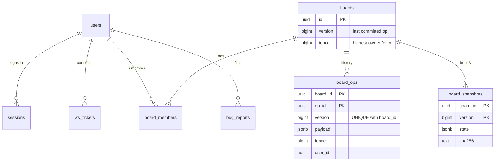

## 5. Components

> **Four codebases, each with one job: the CRDT core decides what state means, the Session instance decides what is committed, the gateway decides who may say what to whom, and the client decides when to show and when to send.**

### CRDT core (`crdt-ts/src`, mirrored in `crdt-java/src/main/java/dev/concord/crdt`)

| Module | Decides | Key choices |
|---|---|---|
| `hlc` | timestamps | pure: the caller passes the time in, so tests need no clock ([[hlc#export function tick(]]) |
| `op` | what a valid op is | exact members, lowercase canonical UUIDs, never the nil UUID, code-point lengths, NFC sorted labels, no U+0000 because Postgres JSONB cannot store it ([[op#export function checkShape(x: unknown)]], [[op#const NUL = String.fromCharCode(0);]]) |
| `orset` | existence | tags per entity, tombstones kept forever ([[orset#remove(id: string, observed: Iterable<string>)]]) |
| `lww` | attributes | HLC order, canonical-bytes tie-break counted as a collision ([[lww#export function pick(a: Register, b: Register)]]) |
| `keys` | order | Greenspan port; reversed bounds throw; re-key plan ([[keys#export function planInsert(]]) |
| `board` | composition and view | apply, merge, Orphaned, render order `(key, id)` ([[board#view(): View]]) |
| `canonical` | bytes for hashing | RFC 8785 JSON, integers only, fixed escapes; equal states have equal SHA-256 (amendment 1) |

### Server (`server/`)

| Component | Decides | Key choices |
|---|---|---|
| `BoardActor` (session) | the order, validity and commit of one board's ops | one mailbox drained by one **virtual thread**, so the board's state has one writer and no locks ([[actor#Thread.ofVirtual().name("board-"]]); states CLAIMING → SERVING ⇄ RECONCILING → CLOSED; bounded mailbox, 5,000 ([[actor#static final int MAILBOX_LIMIT]]) |
| `Store` (session) | every SQL statement of the write path | the fenced group commit, reconcile under a row lock, claim's fence write, snapshot load with checksum fallback ([[store#public Committed commit(String board, long fence, List<Pending> ops, long deadlineMs)]]) |
| `Ownership` (session) | who may serve a board | Lua scripts: fence counter with a floor, compare-and-extend renewal, re-take only while Postgres agrees ([[ownership#static final String FENCE]]) |
| `Boards` (session) | which actors this instance runs | creates an actor on first request; renews every lease every 5 s; graceful close ([[boards#private void renewAll()]]) |
| `InternalServer` (session) | the gateway-facing socket | shared-secret header on upgrade (amendment 8); 64 MB bound per gateway (amendment 9) ([[internal#app.wsBeforeUpgrade("/internal"]]) |
| `ClientConn` (gateway) | one client WebSocket | per-connection token bucket; one request in flight, in order ([[clientconn#private void drain()]]) |
| `Router` (gateway) | where a board's owner is | 5 s cache → `board:owner:{id}` → rendezvous hash; retries `NOT_OWNER` ([[router#private CompletableFuture<Map<String, Object>> attempt(]]) |
| `Fanout` (gateway) | delivering broadcasts | subscribe while a client is on the board; 1 s tick: poll owners if Pub/Sub is down, ask for a claim if a board has no owner ([[fanout#private void tick()]]) |
| `Api` (gateway) | the REST API | session cookie (hashed), Origin checks, invite code, single-use WebSocket tickets, history, bug reports, telemetry ([[api#private void sameOrigin(Context ctx)]]) |
| `Presence` (gateway) | who is here | Redis sorted set per board, one member per connection, 30 s expiry by sweep ([[presence#void update(String board, String connection, String user, String card, String state)]]) |
| `Retention` (gateway) | op retention | daily, batches of 5,000, at or below the oldest kept snapshot ([[retention#WHERE o.version <= k.oldest]]) |
| `Accounts` (gateway) | deleting a user | one transaction; boards with no other member deleted; shared boards keep the user's past edits ([[accounts#static Deleted delete(DataSource db, String userId)]]) |
| `Backup` (session) | a backup you can check | one exported snapshot for `pg_dump` and a manifest of every board's state hash; `verify` replays each board ([[backup#public final class Backup]]) |
| `Outbox` (common) | sending without unbounded memory | counts unsent bytes; over the limit, says `RECONNECT_ELSEWHERE` and closes ([[outbox#public boolean send(String text)]]) |
| `Tracing`, `Prom` (common) | observability | trace ID = `op_id`; off unless `CONCORD_OTLP_ENDPOINT` is set ([[tracing#public static String traceId(String opId)]]) |

### Client (`client-core/src`) and web (`web/src`)

| Component | Decides | Key choices |
|---|---|---|
| `SyncClient` | connection, queue, view | three parts: confirmed state, ops ahead of a gap, pending own ops; view = confirmed + ahead + pending ([[client#export class SyncClient {]]) |
| `IndexedDbStorage` | what survives a reload | one replica per tab held by a Web Lock; append-only log plus coalesced snapshots ([[idb#export class IndexedDbStorage implements Storage]]) |
| `Storage`, `MemoryStorage` | the storage interface | `load`, `save`, `append`; the same merge for both ([[storage#export interface Storage {]]) |
| `useBoard`, `BoardPage` | rendering | external store subscription; memoised list and card components over a stable view ([[boardpage#function useStableView(next: View)]]) |

## 6. Data model

> **Postgres holds everything that must not be lost, and its constraints enforce the rules that matter; Redis is never the source of truth, so losing it costs speed and presence, never data.**

| Table | Holds | Constraint and what it enforces |
|---|---|---|
| `users` ([[schema#CREATE TABLE users (]]) | accounts; argon2id hash in PHC format | `email UNIQUE`, stored lowercased: one account per email |
| `sessions` ([[schema#CREATE TABLE sessions (]]) | sign-in sessions, 30 days | only the **SHA-256** of the token, so a leaked table cannot be replayed; cascades with the user |
| `ws_tickets` ([[schema#CREATE TABLE ws_tickets (]]) | single-use WebSocket tickets, 30 s | read and deleted in one statement (`DELETE … RETURNING`), so a ticket works once, on any gateway ([[api#DELETE FROM ws_tickets WHERE token_hash = ? AND expires_at > now() RETURNING user_id]]) |
| `boards` ([[schema#CREATE TABLE boards (]]) | title, `version`, `fence` | `fence` is the Postgres side of ownership: every commit requires `fence = :fence` |
| `board_members` ([[schema#CREATE TABLE board_members (]]) | role per user per board | `CHECK (role IN ('owner','editor','viewer'))`; primary key `(board_id, user_id)` |
| `board_ops` ([[schema#CREATE TABLE board_ops (]]) | every committed op | **`PRIMARY KEY (board_id, op_id)`** is the last line of dedup: an op can be stored once. **`UNIQUE (board_id, version)`**: no two ops share a version |
| `board_snapshots` ([[schema#CREATE TABLE board_snapshots (]]) | canonical state at a version, with its SHA-256 | three kept per board ([[store#ORDER BY version DESC LIMIT 3]]); a hash mismatch falls back to the previous one |
| `bug_reports` ([[schema#CREATE TABLE bug_reports (]]) | trial bug reports | diagnostics pass the secret redactor first ([[api#private void bugReport(Context ctx)]]) |

`board_ops` is deliberately unpartitioned (v3 change 1): a partitioned table's keys must include the partition key, and v2's did not. Schema changes are forward-only migrations, serialised by an advisory lock and recorded in `schema_migrations` ([[migrate#public static boolean run(DataSource ds)]]). The live database is at version 2 (`migrations/2.sql`: names, sessions, tickets, bug reports).

**Redis keys** ([[rediskeys#public final class RedisKeys {]]). Everything here can be lost.

| Key | Holds | If lost |
|---|---|---|
| `instances` (sorted set) | live Session instances, heartbeat every 2 s, live = within 6 s ([[registry#private void beat()]]) | gateways fall back to the owners they know |
| `board:lease:{id}` | the owner's lease, 15 s, renewed every 5 s | the owner re-takes it only while `boards.fence` is still its own (amendment 13) |
| `board:owner:{id}` | owner address and fence, for gateway lookup | gateways use rendezvous hashing, and an instance claims |
| `board:fence:{id}` | the fence counter | rebuilt: the Lua script never returns less than `boards.fence + 1` ([[ownership#local floor = tonumber(ARGV[1])]]) |
| `presence:{id}` (sorted set) | who is on the board | presence is simply absent until clients report again |
| channels `board:{id}`, `membership`, `board-deleted` | fan-out and cache invalidation | a lost broadcast is a version gap the client repairs; a lost `membership` message waits out the 30 s cache; a lost `board-deleted` is found at the next commit (section 7) |

**Why this split.** Ownership correctness never depends on Redis: the fence check is in the same Postgres transaction that stores the ops (ADR-007). So the stop-redis drill kept committing, 268 ACKs during a 15.8 s outage **[laptop]**, and the wipe-redis drill lost nothing (incidents 005, 006).
