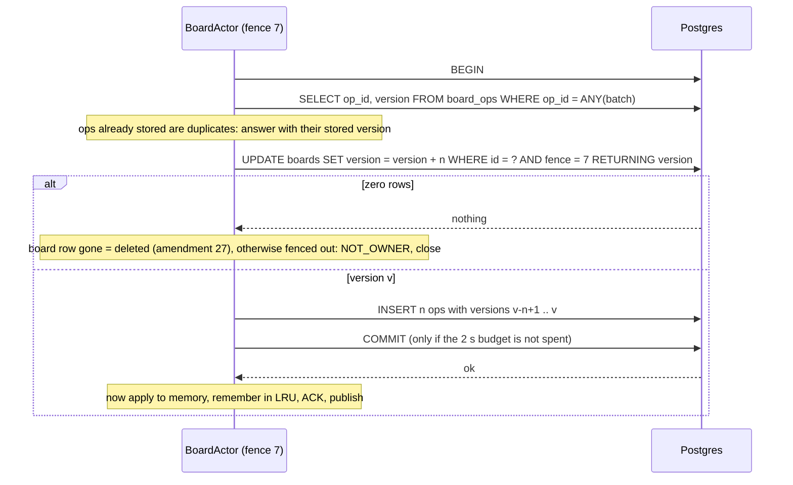

## 7. The write path and ownership

> **One owner per board, chosen by a Redis lease but fenced by Postgres: the fence reaches Postgres before the owner reads anything, every commit checks it, and nothing touches memory until Postgres says COMMIT.**

**Lease.** A lease is a time-limited claim: "instance S serves board B for the next 15 s, unless it renews". It says who *should* serve. It cannot guarantee that only one instance *does*: a process paused past its lease (a long GC pause, `docker pause`, a VM migration) wakes up still believing it is the owner.

**Fencing token.** A fencing token is a number that only grows, handed out with each new claim, that the storage layer checks on every write. A writer holding an old number is refused. In Concord the number comes from Redis (`INCR`) and is checked by Postgres, inside the same transaction that stores the ops (ADR-007).

### 7.1 The claim order, and the interleaving that lost ACKed ops

**The rule** (amendment 6 A, confirmed by amendment 8; [[ownership#public long claim(String board)]]):
1. Draw a fence: `INCR board:fence:{id}`, but never below `boards.fence + 1`, so it survives a Redis wipe ([[ownership#static final String FENCE]]).
2. Take the lease: `SET board:lease:{id} NX PX 15000`. If that fails, someone else owns the board.
3. Write the fence to Postgres **before loading anything**: `UPDATE boards SET fence = :f WHERE id = ? AND fence < :f` ([[store#UPDATE boards SET fence = ? WHERE id = ? AND fence < ?]]).
4. Load the newest snapshot whose SHA-256 matches, and replay the ops after it ([[store#public Loaded load(String board)]]).
5. Announce the owner in Redis and serve ([[actor#d.ownership().announce(id, fence);]]).

**What the original order got wrong** (SPEC v3, found in review before any code; incident 009). v3 wrote the new fence to Postgres lazily, at the new owner's *first commit*, with the condition `fence <= :fence`. Between B's load and B's first commit, Postgres still held A's fence:

```mermaid title="SPEC v3's claim order: a stale owner's ACKed op is missing from the new owner's state"
sequenceDiagram
  participant A as Owner A (fence 1)
  participant R as Redis
  participant PG as Postgres
  participant B as Instance B
  A->>A: op X in batch, then A pauses (GC)
  Note over R: A's lease expires (15 s)
  B->>R: INCR fence = 2, SET lease NX
  B->>PG: load snapshot + tail (without X)
  A->>PG: commit X WHERE fence <= 1
  Note over PG: boards.fence is still 1, so the commit succeeds
  PG-->>A: COMMIT
  A-->>A: OP_ACK X to the client
  B->>PG: first commit, fence 2 (now boards.fence = 2)
  Note over B: B's memory and every later snapshot lack X, an ACKed op
```

With step 3 first, A's commit in that window updates **zero rows**: Postgres already holds fence 2. `FencingTest.staleOwnerCannotCommitAfterANewOwnerClaims` reproduces exactly this window: B claims and loads but does not commit, then A wakes. The guard check `old-claim-order` restores v3's order, and the test fails with `stale owner ACKed`. The first version of this test passed even with the old order, because B committed before A woke (incident 015).

I kept the lease `SET NX` *before* the Postgres write, unlike the order first proposed in review: otherwise a claimer that loses the lease race would already have fenced out the live owner. That reading was put to review and confirmed in amendment 8.

### 7.2 The normal commit



- **Apply-after-commit** (v3 change 5). Memory changes only after `COMMIT` ([[actor#private void applyCommitted]]). v2 applied first, so a failed append left an unstored op in memory and in the next snapshot. Guard check `apply-after-commit`: with apply moved before the transaction, `WritePathTest.noAckBeforeCommit` fails with "memory must not change".
- **The 2 s budget.** Pool wait counts toward it, and every statement gets a network timeout of what is left. A `COMMIT` that would start after the deadline is never sent ([[store#budget(c, deadlineMs); // a commit that would start after the deadline is not sent]]).
- **Group commit.** The batch closes 5 ms after its first op ([[actor#if (batch.isEmpty()) batchDeadline = d.clock().getAsLong() + d.batchMs();]], ADR-005).

### 7.3 Idempotency and dedup

**Idempotency** means doing something twice has the same effect as doing it once. Clients resend until they see an ACK, so the server must recognise a resend. Two layers do it:
1. **The LRU:** the last 10,000 op_ids and their versions, in the actor's memory ([[actor#static final int LRU_SIZE = 10_000;]]). A resend gets its original ACK at once, even while Postgres is down.
2. **The primary key:** `board_ops (board_id, op_id)`. Inside the commit, ops already stored are dropped and answered with their stored version. A rejected resend is checked against the table before it is called invalid, so a stored op is never reported as bad ([[actor#private void rejectOrAckStored]]).

Guard checks `dedup-lru` and `dedup-backstop` prove each layer separately. The LRU's own test had to be written after the first guard run, because the primary key alone made the LRU's removal invisible (incident 015).

### 7.4 A commit with an unknown outcome

A commit that throws or times out may have committed: the reply can be lost after the work is done. Concord treats that as **unknown** (amendment 6 B, incident 010). The actor:
1. answers `RETRY_LATER` and takes no snapshots;
2. locks the board row, which waits out any transaction of ours still holding it (`SELECT fence FROM boards WHERE id = ? FOR UPDATE`, [[store#public Reconciled reconcile(String board, long applied)]]);
3. reads every op above its version, applies and publishes them;
4. serves again, or closes if the fence moved ([[actor#private void reconcile() throws]]).

A deleted board ends reconciling instead of retrying forever (amendment 27). The soak's disk stall produced 16 real commit failures, and every one was reconciled (`deploy/soak/results.txt`).

### 7.5 Versions and gap detection

Every commit gives each op the next board version, and every broadcast carries it. A client applies versions in order. An op that arrives early waits in `ahead`, and the client asks for the gap with `SYNC_REQUEST` ([[client#private confirmedOp(op: Op, version: number, broadcast: boolean)]]). The owner also publishes `BOARD_VERSION` every 5 s, so a quiet client that missed the last op notices within 5 s ([[actor#d.publisher().publish(id, Msg.encode(Msg.boardVersion(version)));]]). Pub/Sub is fire-and-forget (ADR-006), so a lost message costs one round trip, never an op. The e2e test drops broadcasts on purpose: "8 dropped, 8 SYNC_REQUESTs, converged" **[CI]**.

### 7.6 Owner crash and stale owner

```mermaid title="Owner crash: the lease expires and the next instance claims"
sequenceDiagram
  participant C as Clients
  participant G as Gateway
  participant S1 as session1 (owner, fence 1)
  participant R as Redis
  participant S2 as session2
  participant PG as Postgres
  S1-xS1: killed (SIGKILL)
  C->>G: OP
  G->>S1: forward
  G-->>C: UNAVAILABLE (link down), client keeps the op queued
  Note over R: lease expires within 15 s
  G->>R: board:owner:id exists? (1 s watchdog) no
  G->>S2: ENSURE (preferred by rendezvous hash)
  S2->>R: fence 2, lease NX
  S2->>PG: UPDATE boards SET fence = 2, load snapshot + tail
  S2->>R: announce owner
  C->>G: resend queue in order
  G->>S2: forward
  S2-->>C: OP_ACK (duplicates get their original ACK)
```

**Measured** (kill-owner drill, current code): new owner serving **1,565 ms after lease expiry** (target ≤ 5 s); first ACK 13,979 ms after the kill; 0 of 347 ACKed ops missing **[laptop]**. Five earlier runs: 210–1,474 ms. The claim watchdog is in [[fanout#router.forward(board, Msg.obj("k", "ENSURE"]].

```mermaid title="Stale owner: paused past its lease, cut off from Redis, stopped by Postgres"
sequenceDiagram
  participant A as Owner A (fence 1)
  participant R as Redis
  participant B as Instance B
  participant PG as Postgres
  Note over A: docker pause, and A's Redis route cut
  Note over R: lease expires
  B->>R: fence 2, lease
  B->>PG: UPDATE boards SET fence = 2
  B->>B: serving
  Note over A: unpaused: requests queued in its socket
  A->>R: renew lease (fails: Redis unreachable, A keeps serving)
  A->>PG: commit WHERE fence = 1
  PG-->>A: 0 rows
  A->>A: ALERT fenced out, NOT_OWNER, close (nothing stored, nothing broadcast)
```

**Measured** (pause-owner-no-redis drill): 1 fence rejection, rows 99 → 99, the probe op refused with `NOT_OWNER`, 0 stale commits **[laptop]**. With Redis reachable, the stale owner's renewal finds the new lease first and drops the board before trying to commit (pause-owner drill: 0 stale commits). A **renewal** re-takes a missing lease only while `boards.fence` still equals its fence, so a stale owner cannot steal back the board after a Redis wipe (amendment 13, incident 014; [[ownership#if (current == null || current != fence) return 0;]]).

**Stale reads** (amendment 12). A stale owner that never writes is never fenced, and may answer `JOIN` from memory that is behind. It is a prefix of the committed history: behind, never wrong. The window is bounded by the gateway's 5 s owner cache and by the stale owner's next renewal.

### 7.7 Idle unload and board deletion

- **Idle unload** (amendment 26; [[actor#private void unloadIfIdle()]]). After 10 minutes with no request **and** no gateway subscribed to the board's channel, the owner unloads the board the way a graceful handover does: snapshot, release the lease, close. It never unloads while reconciling, with ops still queued, or when Redis cannot count subscribers. Found by the memory soak: a Session instance's heap grew with every board it had ever loaded (incident 016).
- **A board deleted while loaded** (amendment 27; [[actor#private void dropDeleted(String how)]]). Account deletion removes a user's sole-member boards in one transaction ([[accounts#static Deleted delete(DataSource db, String userId)]]) and announces them on `board-deleted`. The owner drops the board at once: no snapshot, lease released, queued requests get `UNAUTHORIZED "board deleted"`, so an edit in flight lands in its sender's Unsent edits. If the message is lost, the next commit tells "zero rows **and** no board row" (deleted) apart from "zero rows" (fenced), with no false fence alert ([[store#boolean deleted = !exists(c, board);]]). Found on the live host (incident 018).
