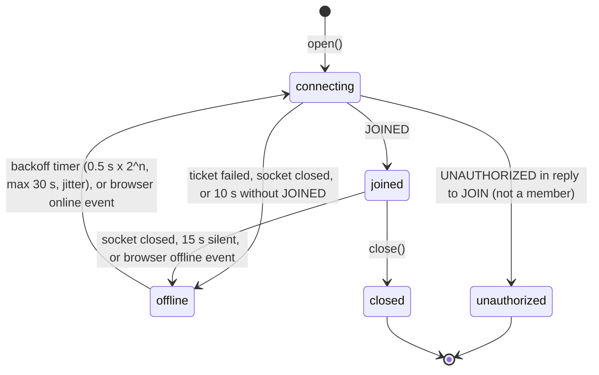

## 8. The client

> **The client saves before it shows, sends in order at the server's pace, and never drops an edit silently: every edit ends acknowledged, still queued, or in a visible Unsent list.**

### 8.1 What the client keeps

The client keeps three things, and the screen shows them merged ([[client#export class SyncClient {]]; the file's opening comment explains why):

| Part | Holds | Changes when |
|---|---|---|
| `confirmed` | a board built only from server-confirmed ops, and its version | an ACK or broadcast at the next version; a snapshot replaces it |
| `ahead` | confirmed ops that arrived before an earlier version (a gap) | drained once the gap is filled |
| `pending` | this client's own ops not yet ACKed, in creation order | an ACK removes one; a rejection moves it to Unsent |

**View = confirmed + ahead + pending, merged** ([[client#private viewBoard()]]). Merge is idempotent, so an op present in two parts is harmless, and an optimistic edit never needs undoing by hand. When an op leaves `pending` without being confirmed, the view is simply rebuilt.

### 8.2 Storage layout: append first, snapshot later

IndexedDB holds two object stores ([[idb#function openDb()]]):

| Store | Key | Holds |
|---|---|---|
| `log` | `[owner, seq]` | each new edit, appended before it is shown or sent |
| `replicas` | `boardId:tabReplicaId` | one coalesced snapshot per tab replica: confirmed state, version, pending, Unsent, replica ID, HLC, clock offset, `logUpTo` |

1. **Append-first** (§7.2, amendment 21). `submit()` appends the op to `log` and waits for the write to commit before putting it on `pending`, showing it and sending it ([[client#submit(body: Body): Op]]). If storage refuses (quota, a closed database), the edit is kept in memory rather than dropped ([[client#const failed = (e: unknown) => {]]).
2. **Snapshots, coalesced.** ACKs, broadcasts and rejections mark the state dirty. A snapshot is written about once a second, and on `pagehide` ([[client#private saveNow()]]). One write is in flight at a time; changes made meanwhile are written together right after.
3. **Log compaction.** A snapshot records `logUpTo`, the highest append it includes. The same IndexedDB transaction that writes it deletes those log entries ([[idb#async save(state: Saved)]]).
4. **Load** = the snapshot plus every later log entry, merged ([[storage#export function merge(]]). A crash between an append and the next snapshot loses nothing.

**Measured:** edit-to-screen p50 4.1–4.3 ms with append-first, 4.9–5.0 ms before. It got faster, because an edit used to trigger a full snapshot write and now writes one small log entry (`web/e2e/latency.spec.ts`, amendment 21; `docs/phases.md:244`) **[laptop]**.

### 8.3 One replica per tab, with Web Locks

Each browser tab is its own replica, with its own replica ID and queue ([[idb#static async open(boardId: string]]):
- **The replica ID lives in `sessionStorage`,** so a reload resumes the same replica and its queue.
- **Each tab holds the Web Lock** `concord:replica:{board}:{replica}` for its lifetime. The browser releases it when the tab closes or crashes.
- **The duplicated-tab bug** (amendment 17). Browsers copy `sessionStorage` into a duplicated tab, so two live tabs would share one replica ID. Their HLCs could produce the same stamp for different ops. On load, a tab takes the lock for its remembered ID; if another tab holds it, it makes a new ID ([[idb#Duplicated tab: browsers copy sessionStorage]]). Guard check `duplicate-tab-lock` (`web/e2e/offline.spec.ts`).
- **Adopting a closed tab's queue.** On load, a tab looks for saved replicas of this board whose lock nobody holds (their tab is gone). It takes each one's lock before adopting it, so two tabs never adopt the same queue. Adopted ops go to the front of its queue, keeping their op_id, HLC and replica ID, so a resend of one that already committed is answered by dedup. Writing the merged record and deleting the adopted ones is one IndexedDB transaction ([[idb#async load(): Promise<Saved | undefined>]]). Guard check `adoption-lock`.

### 8.4 Connecting, liveness and reconnect

- **Ticket.** Every connection attempt first fetches a single-use, 30 s ticket over REST, and puts it in the WebSocket URL (amendment 14). A ticket in a URL may end up in a log, but it is worthless once used.
- **JOIN timeout, 10 s** ([[client#export const JOIN_TIMEOUT_MS = 10_000;]]). A port can accept TCP before the gateway behind it is listening, and the handshake then hangs forever (incident 001).
- **Liveness: the Chromium finding** (amendment 18, incident 013). A browser that loses its network often keeps the WebSocket "open": no close, no error. The client therefore treats **15 s without any message** as death ([[client#export const SILENCE_MS = 15_000;]]), since the owner sends `BOARD_VERSION` every 5 s. It also listens for the browser's `offline` event, which drops the socket at once, and `online`, which reconnects without waiting for the backoff ([[client#private readonly onOffline]]).
- **Backoff** with full jitter, so thousands of clients do not reconnect in step ([[client#export function backoffMs(]]). The reconnect-storm drill shows this alone was enough at 500 clients (amendment 30).
- **Rotation.** Each failed attempt moves to the next gateway URL.

### 8.5 Sending: in order, paced

- **Resend the whole queue, in order, on one timer** (incident 012). Ops depend on each other: an `ADD_CARD` is valid only after its `ADD_LIST` commits. So the client never retries one op on its own timer ([[client#private scheduleQueueResend()]]).
- **Paced to the gateway's limit** (amendment 31, incident 021). A token bucket of the gateway's shape, 20 ops/s with a burst of 50, full on each new connection, timed on real time ([[client#private pump()]]). Before this, a 24-hour queue was refused frame by frame and had not synced after 10 minutes; now it takes 283 s **[accelerated]**.

### 8.6 Every rejection, and why nothing is dropped silently

([[client#private error(m: Msg)]])

| Server answer | Meaning | What the client does | Where the edit ends |
|---|---|---|---|
| `OP_ACK` | committed | removes it from `pending`; confirmed at that version | the board |
| `RETRY_LATER` | rate limited, owner busy, commit failed, storage unreachable | resends the whole queue after backoff | still queued |
| `UNAVAILABLE` | owner unreachable or changing | same | still queued |
| `CLOCK_SKEW` | stamped more than 60 s ahead | recomputes the clock offset, re-stamps, resends under the same `op_id`; a fresh replica ID if its HLC had run ahead | still queued |
| `INVALID_OP` **behind** an unacknowledged op of ours | may be invalid only because its dependency has not committed yet | **deferred**: judged again once everything ahead is ACKed ([[client#private acked(opId: string, version: number)]]) | still queued |
| `INVALID_OP` at the **head** of the queue | really invalid (a client bug) | moves it to Unsent edits | **Unsent edits** (visible, exportable) |
| `UNAUTHORIZED` (for an op) | access revoked, or the board deleted | moves it to Unsent edits | **Unsent edits** |
| `UNAUTHORIZED` (for JOIN) | no longer a member | every queued edit goes to Unsent; stops connecting | **Unsent edits** |

**Unsent edits** are kept in storage and shown to the user, never discarded (v3 change 10, amendment 4). Every drill, load test and live check asserts **0 Unsent edits**: a valid edit landing there is a bug, as it was in incident 012.
