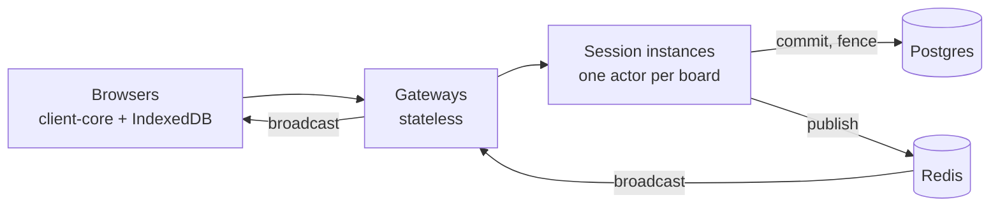
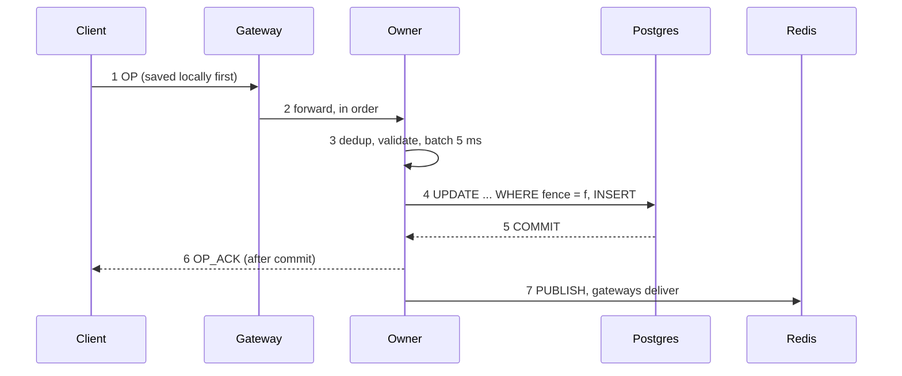

## 4. Scaling: what breaks first

> **At 10× the first wall is Postgres commits across many boards; at 100× it is one owner per hot board and Redis fan-out; each claim below rests on a measurement or is marked as reasoning.**

| Scale | What breaks first | Evidence | What I would change |
|---|---|---|---|
| **10×** active boards (≈3,000 busy boards on one Postgres) | **Postgres commits per second.** Each board commits alone; 300 boards already made about 300 commits/s with Postgres peaking at 6.8 cores and p95 at 294 ms | `production/load-tests/README.md` §4 **[laptop]** | batch commits *across* boards per Session instance (one transaction per instance-window), reopening ADR-004's isolation trade-off; or shard boards across Postgres instances by board ID (`board_ops` keys already include `board_id`) |
| 10× editors on one board (300) | **one owner per board.** One commit at a time; at 30 editors commits levelled at 13–16/s while ops per commit rose. Not measured above 30 | §2 of the load tests **[laptop]**; [design] above | larger windows under load (an adaptive window, ADR-005 alternatives); the per-board limit is the cost of a single writer |
| 10× connections per gateway (5,000) | gateway memory (each connection: a virtual thread, an outbox up to 8 MB, Jetty buffers) and reconnect bursts. 500 reconnected in 3.5–16.2 s with no cascade | reconnect-storm drill; gateways peaked at 524–555 MiB with 1,000 connections **[laptop]** | more gateways (stateless); revisit the dropped connection-rate limit (amendment 30 says when) |
| **100×** | **Redis Pub/Sub fan-out**: one publish per op, one delivery per subscribed gateway; a single Redis | [design]: not measured | shard channels across Redis instances, or Redis Cluster's sharded Pub/Sub |
| 100× boards in memory | Session heap; idle unload bounds it to boards in use | soak, amendment 26 | more Session instances: rendezvous hashing spreads boards with no coordination |
| Any scale | the 15 s lease is the recovery floor (owner crash → 13–20 s to the first ACK) | recovery measurement **[laptop]** | a shorter lease trades false failovers during pauses; replicated owners (Raft) only if seconds matter |

**What never breaks first:** the CRDT merge. A claim replays a 2,000-card board with a 499-op tail in under 350 ms.

## 5. Story bank

> **Ten real incidents in STAR form, with real numbers; pick the one that fits the question, and keep "I directed" honest.**

Amazon Leadership Principles in brackets.

**S1. The claim order that could lose an acknowledged edit** [Dive Deep, Insist on the Highest Standards]
- **Situation:** the spec's ownership protocol wrote the fencing token to Postgres lazily, at the new owner's first commit.
- **Task:** implement claiming without ever losing an ACKed op.
- **Action:**
  - Reading §6.2 against §6.3, we found the window: a paused old owner could still commit after the new owner loaded.
  - I approved writing the fence before loading (amendment 6 A), and kept the lease before the Postgres write, which the review confirmed (amendment 8).
  - We insisted on a test that stops in exactly that window, plus a guard check that restores the old order.
- **Result:** the guard check fails with "stale owner ACKed"; the pause-owner drills show 0 stale commits. (incident 009)

**S2. The test that couldn't fail** [Insist on the Highest Standards, Learn and Be Curious]
- **Situation:** `FencingTest` was green.
- **Task:** prove it actually detects the bug it's named for.
- **Action:** I made "remove the guard, the test must fail" a rule; the first run restored the old claim order, and the test still passed.
- **Result:** the test now pins the dangerous interleaving. The same run found the LRU's test couldn't fail either. Today there are 42 checks, each recorded failing. (incident 015)

**S3. Valid edits in "Unsent" after an owner crash** [Customer Obsession, Ownership]
- **Situation:** the kill-owner drill passed every server check, but 2–3 valid edits per run ended in the user's Unsent list.
- **Task:** find why a server-side success still failed users.
- **Action:** traced it to per-op retry timers: an `ADD_CARD` overtook its `ADD_LIST` after the crash. We moved to whole-queue, in-order resends, with "`INVALID_OP` is final only at the head of the queue".
- **Result:** 0 Unsent in every drill since; drills now assert the user's end state. (incident 012)

**S4. Chromium never closes a dead WebSocket** [Customer Obsession, Dive Deep]
- **Situation:** the offline browser test showed "joined" while offline.
- **Task:** detect a dead connection on a real network.
- **Action:** found that browsers don't report a silently dropped network. We added a 15 s silence rule on top of the owner's 5 s heartbeat, plus the browser's offline and online events.
- **Result:** the scripted offline hour: 240 edits, converged 11.5 s after reconnecting. (incident 013)

**S5. The memory soak that "failed"** [Dive Deep, Are Right, A Lot]
- **Situation:** a 2-hour soak failed: session3's heap grew 4.61 MB/h.
- **Task:** decide whether it was a leak.
- **Action:** a heap histogram showed CRDT state, not garbage. The workload grew boards forever, and nothing unloaded idle boards. We measured growth per op (163 B) and per deleted card (≈3 KB), added idle unload (amendment 26), and made the soak's workload fixed-size.
- **Result:** the next soaks were flat, including with the 2 GB host's limits. (incident 016)

**S6. The arm64 CI hang** [Dive Deep, Bias for Action]
- **Situation:** CI hung twice on arm64 with no output; 12 hunt runs passed.
- **Task:** make an intermittent hang diagnosable.
- **Action:** added per-test logging, a thread dump after 8 minutes and a hard timeout. The next hang's dump showed a virtual thread holding a test appender's monitor while formatting. We fixed the helper to format without a lock, as production's appender does.
- **Result:** green on every arm64 run since. (incident 017)

**S7. A board deleted while loaded, found on the live host** [Ownership, Deliver Results]
- **Situation:** the live smoke test's account deletion removed a board its owner still had loaded; the next snapshot failed on a foreign key.
- **Task:** fix it without false alarms.
- **Action:** reading around it found worse cases: a fence alert for a deleted board, and an endless reconcile. We added a `board-deleted` announcement, and "zero rows plus no board row means deleted".
- **Result:** deployed; the next live deletion logged "dropped" with 0 errors. (incident 018)

**S8. `/metrics` was public, and my deploy command made it worse** [Ownership, Earn Trust]
- **Situation:** the gateway's metrics, including board IDs, were reachable from the internet.
- **Task:** close it and make it impossible to reopen.
- **Action:**
  - The first fix didn't take: the deploy command I gave skipped `git pull`, which I owned in the write-up.
  - The second deploy's new outside check caught that Caddy was reading an old file through a single-file mount.
  - We mounted the directory, and `deploy.sh` now refuses a stale checkout and checks from outside.
- **Result:** 404 from outside since `e274eba`. (incident 019)

**S9. A day offline would have taken hours to sync** [Customer Obsession, Deliver Results]
- **Situation:** the 24-hour offline measurement still had 5,243 edits pending after 10 minutes.
- **Task:** find why, without weakening the rate limit.
- **Action:** the client sent its whole queue at once and resent all of it on every refusal. I approved client-side pacing matching the gateway (amendment 31), with a unit test and a guard check.
- **Result:** 8 h went from 487 s to 92 s; 24 h synced in 283 s, 0 lost. (incident 021)

**S10. Dropping a feature instead of inventing a number** [Frugality, Invent and Simplify]
- **Situation:** the spec promised a per-gateway connection-rate limit for reconnect storms, with no value.
- **Task:** decide without guessing.
- **Action:** built the storm drill first: 500 clients, gateway killed. It found no cascade without a limit. I chose to drop the limit and record when to revisit it (amendment 30). The drill's own wait condition was wrong twice; we fixed it each time and recorded both.
- **Result:** all 500 back in 3.5–16.2 s (laptop) and 12.4 s (CI), 0 lost. (incident 007)

## 6. Whiteboard drills

> **Four drawings carry the interview: the box diagram, the write path, the claim interleaving, and the concurrent-move merge; practise each until it takes two minutes.**

### 6.1 The architecture, in 2 minutes

Draw left to right, saying one sentence per box:
1. **Browsers.** "Each has client-core and an IndexedDB queue; edits are saved, shown, then sent."
2. **Gateways.** "Stateless: WebSockets, REST, rate limit, fan-out."
3. **Session instances.** "One actor per board; the only writer."
4. **Postgres** under them. "Ops, snapshots, and the fence."
5. **Redis** on the side. "Leases, owner lookup, Pub/Sub; nothing durable."
6. Arrows: client → gateway → owner → Postgres (commit), then owner → Redis → gateways → clients (broadcast).



### 6.2 The write path

Seven arrows; say "commit before anything else" at arrow 5.



### 6.3 The claim interleaving

Two lifelines (A, the old owner; B, the new) and Postgres. Draw v3's order first, then the fix: move "B writes fence 2" *above* "B loads".

```mermaid title="Whiteboard: why the fence goes into Postgres before loading"
sequenceDiagram
  participant A as Old owner A (fence 1)
  participant P as Postgres
  participant B as New owner B
  Note over A: paused with op X in its batch
  B->>P: write fence 2 (the fix: before loading)
  B->>P: load snapshot + tail
  A->>P: commit X WHERE fence = 1
  P-->>A: 0 rows: NOT_OWNER, X never ACKed
```

### 6.4 The concurrent-move merge

Draw a two-row table. Both replicas get both moves, in opposite orders; the higher HLC's whole placement wins on both.

| Replica | First applied | Then applied | Placement register holds | Card shown in |
|---|---|---|---|---|
| R1 | A: To Do @ a1 (HLC 1010/A) | B: Done @ a0 (HLC 1011/B) | B's `{Done, a0}` | Done |
| R2 | B: Done @ a0 | A: To Do @ a1 | B's `{Done, a0}` (A's loses: lower HLC) | Done |

Then say: "If list and position were separate registers, a tie-broken mix could put the card in To Do at Done's key: a placement nobody chose. One atomic register makes that impossible. A's client shows 'moved by B' for 4 s."
